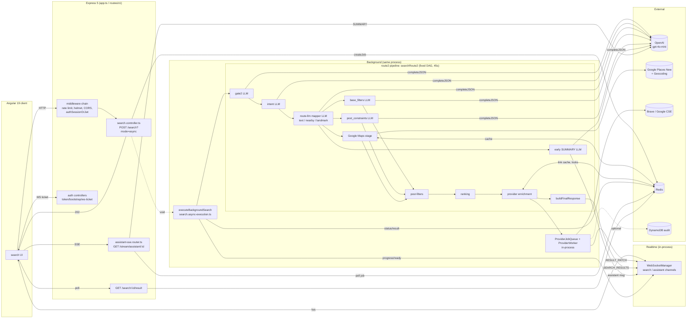

# 09 — As-Is HLD, component map, and LangChain/LangGraph migration gaps

This doc describes the current system and lists the gaps. It does **not** propose an implementation.
Paths are relative to `server/src/`; `route2/` = `services/search/route2/`.

---

## 1. As-Is HLD



The control flow is a **fixed DAG**:

```
gate2 ─▶ intent ─▶ route_mapper ─┬─▶ base_filters ─┐
  │STOP/CLARIFY  │CLARIFY(near-me) ├─▶ post_constraints ┼─▶ post_filter ─▶ rank ─▶ enrich ─▶ respond
  ▼              ▼                 ├─▶ google ─────────┘
 END            END                └─▶ early_summary (fire & forget)
```

---

## 2. Component map

| Layer | Component | File(s) : entry symbol | Kind | Depends on |
|---|---|---|---|---|
| Entry | Search API | `controllers/search/search.controller.ts` `router.post('/')` | Express route | job store, `wsManager`, `createLLMProvider`, `searchRoute2` |
| Entry | Background runner | `controllers/search/search.async-execution.ts` `executeBackgroundSearch` | function | job store, `publishSearchEvent`, `searchRoute2` |
| Orchestration | Pipeline | `route2/route2.orchestrator.ts` `searchRoute2`, `searchRoute2Internal` | function (DAG) | all stages, `wsManager` (imported from `server.ts`) |
| Orchestration | Helpers | `route2/orchestrator.{guards,nearme,early-context,parallel-tasks,filters,response,error,search-terminal,helpers}.ts` | functions | — |
| Classification | Gate | `route2/stages/gate2.stage.ts` `executeGate2Stage`; `stages/gate2/gate2-query-validity.ts` | LLM + regex | `ctx.llmProvider`, `resolveLLM('gate')` |
| Classification | Intent / router | `route2/stages/intent/intent.stage.ts` `executeIntentStage` | LLM | `resolveLLM('intent')` |
| Extraction | Query mapping | `route2/stages/route-llm/route-llm.dispatcher.ts` `executeRouteLLM` → `textsearch/nearby/landmark.mapper.ts` | LLM | `schemas.ts` + `static-schemas.ts` |
| Extraction | Filters | `route2/shared/base-filters-llm.ts` `resolveBaseFiltersLLM`; `stages/post-constraints/post-constraints.stage.ts` | LLM | — |
| Retrieval ("tool") | Google Places | `route2/stages/google-maps.stage.ts` `executeGoogleMapsStage` → `google-maps/{text-search,nearby-search,landmark-plan}.handler.ts` | HTTP | `GOOGLE_API_KEY` (env read per call), `cache-manager.ts` |
| Retrieval | Geocoding | `google-maps/textsearch/geocoding-service.ts` + duplicate in `landmark-plan.handler.ts` | HTTP | — |
| Retrieval | Cache | `lib/cache/googleCacheService.ts`, `google-maps/cache-manager.ts` | class + module singleton | Redis |
| Post-processing | Filter resolve | `route2/shared/filters-resolver.ts` `resolveFilters` | pure | — |
| Post-processing | Post-filter | `route2/post-filters/post-results.filter.ts` `applyPostFilters`, `list-shape.ts`, `dietary-hints.ts`, `not-kosher-name.ts` | pure + regex | — |
| Ranking | Weights + score | `route2/ranking/ranking-weight-resolver.ts` `resolveRankingWeights`, `ranking-apply.ts` `applyBaselineRanking` | pure | — |
| Verification | Order-link verify | `enrichment/provider-strategies/*` (host/path/name match), `*-verifier.ts` (no-op `accept:true`) | classes | — |
| Enrichment ("tool") | Provider links | `enrichment/provider/provider-enrichment.service.ts` `enrichWithProviderLinks`; `provider-job-queue.ts`; `provider-worker.ts` `ProviderWorker.processJob`; `provider-deeplink-resolver.ts` | classes + singletons | Redis, Brave/CSE, `wsManager` |
| Generation | Assistant | `route2/assistant/assistant-llm.service.ts` `generateAssistantMessage` / `generateMessageOnlyText` / `streamAssistantMessage`; `assistant-integration.ts`; `prompt-builder.ts`; `validation-rules.ts`; `fallback-messages.ts` | functions | LLM, `wsManager` |
| Generation | SSE assistant | `controllers/stream/assistant-sse/assistant-sse.orchestrator.ts` `AssistantSseOrchestrator` | class (ctor DI) | job store, LLM, Redis lock |
| LLM infra | Provider | `llm/openai.provider.ts` `OpenAiProvider.completeJSON/complete/completeStream`; `llm/factory.ts` `createLLMProvider` | class | OpenAI SDK, budget |
| LLM infra | Model routing | `lib/llm/llm-resolver.ts` `resolveLLM`; `llm-config.ts`; `llm-purpose.ts` | functions | env |
| LLM infra | Budget / cost | `lib/llm/session-model-budget.ts` `consumeSessionModelCall`; `llm/cost-calculator.ts` | functions | Redis |
| State | Job store | `services/search/job-store/index.ts` `searchJobStore` (Proxy) → `RedisSearchJobStore` / in-memory | interface + classes | Redis |
| Transport | WS | `infra/websocket/websocket-manager.ts` `WebSocketManager` (+ sub-managers); `search-ws.publisher.ts` `publishSearchEvent` | classes | job store (ownership) |
| Observability | Logs / audit | `lib/logger/structured-logger.ts`, `lib/telemetry/stage-timer.ts` `startStage/endStage`, `route2/search-audit.ts`, `ranking-observability.ts`, `enrichment/metrics-collector.ts`, `lib/audit/providerAudit.store.ts` | functions | pino, DynamoDB |

---

## 3. Migration gaps (evidence-backed)

Each row is a property LangChain/LangGraph relies on, what the code does today, and the evidence.

### 3.1 Orchestration and state

| # | Gap | Today | Evidence |
|---|---|---|---|
| G1 | No explicit state schema | Stage outputs are local variables. `Route2Context` is a mutable bag with dead fields and `as any` additions | `route2.orchestrator.ts:159-620`; `route2/types.ts` (`sessionService:any`, `debug`, `regionCodeFinal` never written); `guards/nearby-location.guard.ts:112` (`isGenericQuery` via `as any`) |
| G2 | Dependencies live inside the state | `llmProvider` is carried in the context; `wsManager` is imported from `server.ts` (import cycle) | `search.controller.ts` (ctx build); `route2.orchestrator.ts:23`; `enrichment/provider/provider-worker.ts:39` |
| G3 | Control flow is imperative | Branching is `if (response) return …` blocks with publishes mixed in, not declarative edges | `route2.orchestrator.ts:203-372` |
| G4 | Side effects are mixed into steps | Stages and guards publish to WS directly (assistant, terminal events), so replaying a step republishes | `orchestrator.search-terminal.ts publishAndLog`; `guards/shared/assistant-helper.ts`; `orchestrator.response.ts` (`publishToChannel`) |
| G5 | No checkpoint, resume or thread | Clarify ends the job; a follow-up is a new search with no memory. `clearContext` and `filters` are accepted, then ignored. This breaks the product rule "clarification resumes the same search" | `search.async-execution.ts` (DONE_CLARIFY terminal); `search-request.dto.ts` |
| G6 | No interrupt primitive | CLARIFY is encoded as a terminal response + WS event + job status | `orchestrator.search-terminal.ts publishTerminalClarify` |
| G7 | Terminal status is misclassified | gate-clarify and nearby-clarify are stored as DONE_STOPPED | `guards/gate-clarify.guard.ts:68-69`, `guards/nearby-location.guard.ts:70-71` vs the `search.async-execution.ts` classification |
| G8 | Fire-and-forget branches outside any run boundary | Early SUMMARY, provider jobs and deferred narration keep running after the response; their outputs arrive as unordered WS events | `route2.orchestrator.ts:394-413`; `provider-job-queue.ts`; `assistant-integration.ts generateAndPublishAssistantDeferred` |
| G9 | Process-local runtime | WS pub/sub, provider queue, metrics, `summaryGenStateByRequestId` and the L1 cache are in-memory per instance | `infra/websocket/*`; `provider-job-queue.instance.ts`; `assistant-llm.service.ts:28` |

### 3.2 LLM layer

| # | Gap | Today | Evidence |
|---|---|---|---|
| G10 | Custom provider, not LangChain chat models | `LLMProvider` interface with `completeJSON/complete/completeStream`; installed LangChain packages are unused | `llm/openai.provider.ts`; `llm/types.ts`; `package.json` |
| G11 | Two schema sources per call, already drifted | Hand-written JSON schema + zod; landmark enum mismatch breaks LANDMARK street queries | `route-llm/static-schemas.ts:63` vs `schemas.ts:63` |
| G12 | Abort is not propagated | `ctx.abortSignal` never reaches LLM calls; the provider creates its own controller; the controller's 30s signal is written to an unread field | `post-constraints.stage.ts:100` (`signal as any`, ignored); `search.async-execution.ts:28-31` |
| G13 | Retry policies are inconsistent and nested | Stage retries on timeout only (gate, mappers) on top of the provider's `retryWithBackoff`; intent, filters and post_constraints have none; timeouts are hard-coded in nearby and post_constraints | `gate2.stage.ts:277`; `nearby.mapper.ts:120-122,173`; `openai.provider.ts` |
| G14 | Fallback semantics differ by stage | Gate throws; intent and filters default; text mapper falls back to deterministic output; nearby and landmark throw; budget error rethrown at gate, swallowed elsewhere | stage files listed in 07 §2 |
| G15 | Duplicate extraction | base_filters and post_constraints both extract open-state and price, with opposite merge priority | `orchestrator.filters.ts:72-89` vs `ranking/ranking-weight-resolver.ts:50` |
| G16 | Prompts are inline strings with ad-hoc versions | `gate2_v9`, `intent_v4`, `textsearch_mapper_v2`, … each defined in its stage file; one has unfilled `{{lat}}` placeholders | `textsearch.mapper.ts:19,30,37` |
| G17 | Anthropic provider is a stub | `AnthropicProvider` throws on every method | `llm/anthropic.provider.ts` |

### 3.3 Tools and integrations

| # | Gap | Today | Evidence |
|---|---|---|---|
| G18 | Google / Brave are not typed tools | Handlers return `any[]`; there is no zod validation of Google responses; the API key env is read per call | `google-maps.stage.ts` (`GoogleMapsResult.results: any[]`); `text-search.handler.ts:44-53` |
| G19 | Missing API key is invisible | Handlers quietly return `[]`, which looks like "no results"; `GOOGLE_API_KEY_MISSING` is never raised | `text-search.handler.ts:44-53`; `pipeline-error-kinds.ts` |
| G20 | Cache is coupled to the first caller | The L0 in-flight entry captures the first request's abort signal; a 10s race re-fetches while the first call is still running | `google-maps/cache-manager.ts`, handlers ~156/169/214 |
| G21 | Enrichment errors become cached data | Transient Brave/CSE errors become NOT_FOUND for 7 days | `provider-deeplink-resolver.ts:206-217`; `provider-worker.ts:353-374` |

### 3.4 Determinism vs LLM-first

| # | Gap | Today | Evidence |
|---|---|---|---|
| G22 | Rule-based overrides of LLM decisions | Profanity regex (STOP without an LLM call), near-me substring override, Hebrew-only distance override, list-shape city/dish regex, not-kosher regex | `gate2-query-validity.ts`; `utils/near-me-detector.ts`; `intent.stage.ts:159-176`; `post-filters/list-shape.ts`; `post-filters/not-kosher-name.ts` |
| G23 | Language decided in 5 places | Gate (`other`), intent LLM, script detector, intent fallback, early ctx/resolver; Google gets he/en only | `orchestrator.early-context.ts`; `utils/query-language-detector.ts`; handlers |

### 3.5 Observability and testing (details in 08)

| # | Gap | Today | Evidence |
|---|---|---|---|
| G24 | No tracing | Logs with `requestId`/`traceId` only; no spans and no LangSmith/OTel; LLM calls are not linked into a run tree | `lib/logger/structured-logger.ts`, `lib/telemetry/stage-timer.ts` |
| G25 | No LLM-quality evals | No golden query set; `npm run qa` points to `services/search/qa/run-qa.ts`, which does not exist. 504 pass / 74 fail across route2+LLM tests, 18 files cannot load (see 08) | `server/package.json` scripts |
| G26 | Tests depend on module-level singletons | `searchRoute2` accepts only `deps.wsManager`; the cache, Redis, job queue and config are imported singletons | `route2.orchestrator.ts:629-643` |

### 3.6 Platform blockers that affect any engine

| # | Gap | Evidence |
|---|---|---|
| G27 | Identity is forgeable, so per-session state/checkpoints keyed by session would be unsafe | `controllers/auth/token.controller.ts:25,76`; `middleware/auto-refresh-expired-cookie.middleware.ts:44-75,148-175` |
| G28 | No env schema; ~130 `process.env` reads; `.env` load order is wrong | `server.ts:6-46`; `config/env.ts` |
| G29 | No composition root to inject a graph's dependencies | `server.ts` exports singletons; `getExistingRedisClient()`, `getConfig()` service locators |

---

## 4. What is already close to LangGraph-ready
- The stage boundaries are clean and map 1:1 to nodes: `executeGate2Stage`, `executeIntentStage`, `executeRouteLLM`, `resolveBaseFiltersLLM`, `executePostConstraintsStage`, `executeGoogleMapsStage`, `applyPostFilters`, `resolveRankingWeights` + `applyBaselineRanking`, `buildFinalResponse`.
- Fan-out and fan-in already exist (`fireParallelTasks` + the barrier).
- Every LLM output already has a zod schema.
- Ranking, filter resolution and post-filtering are mostly pure functions.
- `ISearchJobStore`, `LLMProvider` and the WS sub-managers are interface/ctor-injected.
