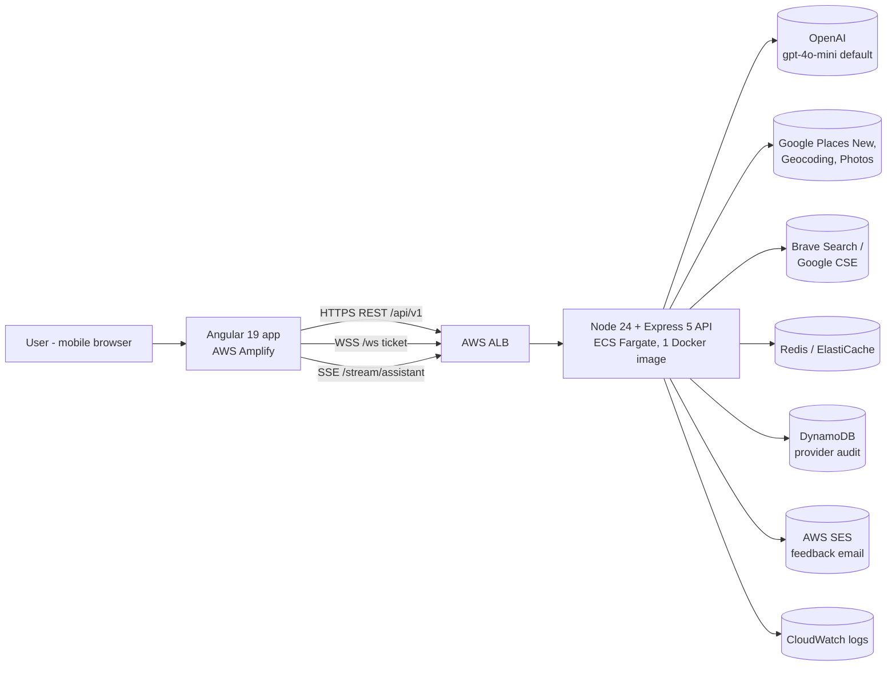
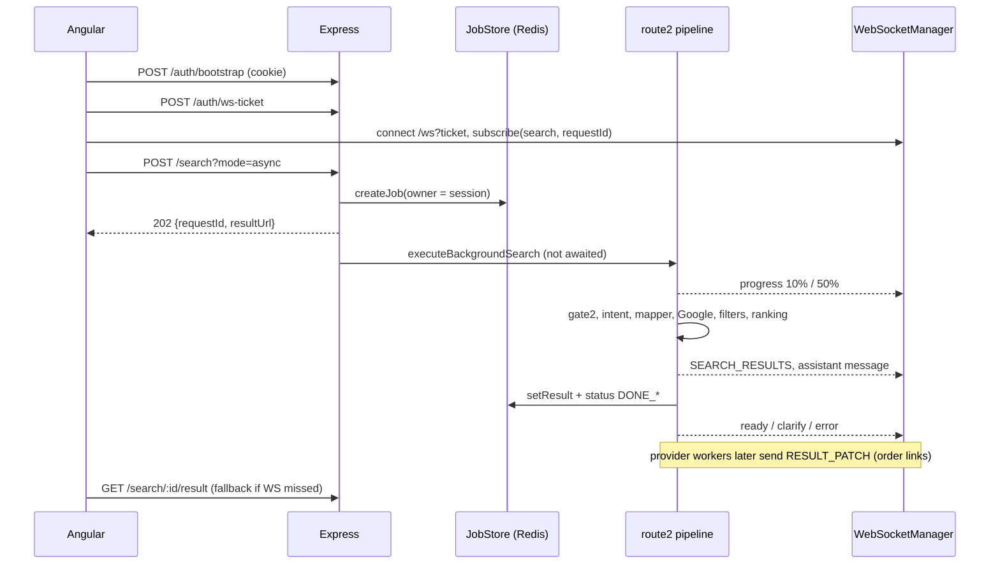

# 01 — High-level architecture

## 1. What the backend does

It turns a free-text food query in Hebrew, English, Arabic or Russian into a ranked list of restaurants. The path is: LLM understanding → Google Places → deterministic filtering and ranking → background discovery of Wolt / 10bis / Mishloha order links. It also streams assistant narration to the client.

## 2. System context



Wolt, 10bis and Mishloha are **never called directly**. Their deep links are found through web search and then verified against host and path allowlists.

## 3. Runtime shape

- One Node process. It serves REST, WebSocket (`ws`) and SSE from the same HTTP server (`server.ts` creates the `WebSocketManager` on the `http.Server`).
- No workers and no queue service. The provider enrichment queue runs in the same process.
- Redis is used for the job store, sessions, WS tickets, rate limits, LLM budget, and the Google and provider caches. Without Redis the app falls back to in-memory versions. In prod it refuses to boot if WS auth needs Redis and Redis is down.

## 4. Layering (as intended by `backend.mdc`, and as it really is)

```mermaid
flowchart TD
  R[routes/v1/index.ts] --> C[controllers/*<br/>validation, auth, response shape]
  C --> S[services/search/route2/*<br/>pipeline: stages, guards, assistant,<br/>enrichment, ranking, post-filters]
  S --> P[llm/ OpenAI provider<br/>lib/cache Google cache<br/>job-store, enrichment clients]
  P --> I[infra/ websocket, state<br/>lib/ redis, logger, session, audit]
  C -. wsManager imported from server.ts .-> I
  S -. wsManager imported from server.ts .-> I
```

The dotted arrows are the main layering violations. Controllers and the orchestrator import a singleton `wsManager` from `server.ts`, which creates a circular import and makes the controllers untestable without booting the server.

## 5. Request lifecycle (async mode, the one the UI uses)



Sync mode (`?mode=sync`, the default) skips the job store and returns the `SearchResponse` directly. The orchestrator still publishes WS events for that `requestId`, but nobody is subscribed.

## 6. Cross-cutting concerns

| Concern | Where | Notes |
|---|---|---|
| Auth | `middleware/auth*.ts`, `controllers/auth/*` | Anonymous `sessionId`. JWT or HttpOnly cookie. Job ownership is checked against the session. |
| Rate limits | `middleware/rate-limit.middleware.ts` | Global 300/min, search 30/min, details 60/min. In-memory in practice. |
| LLM cost control | `lib/llm/session-model-budget.ts` | 40 model calls per session per UTC day. |
| Timeouts | `lib/reliability/timeout-guard.ts` | The pipeline cap is 45 s, each LLM stage about 4 s, Google 8 s. |
| Logging | `lib/logger/structured-logger.ts` (pino) | Structured events with `requestId`, `traceId` and stage timings. One `search_audit` line per search. |
| Config | `config/env.ts`, `route2.config.ts`, `lib/llm/llm-config.ts` | Several overlapping sources. |
| Errors | `middleware/error.middleware.ts`, `orchestrator.error.ts` | No single error contract across controllers. |

## 7. Route2 is the only engine today

`CLAUDE.md` describes route2 as legacy and says new search work goes in `server/src/graph/` (a LangGraph.js v2 engine). **On branch `refactor/phase-1-hygiene` that folder does not exist, and `@langchain/langgraph` is not in `server/package.json`.** Route2 is therefore the only search pipeline in this tree. The v2 engine is either on another branch or not started. Rule: bug fixes only in route2, new capability in the graph engine.

This documentation set covers route2 because that is what serves production traffic.
