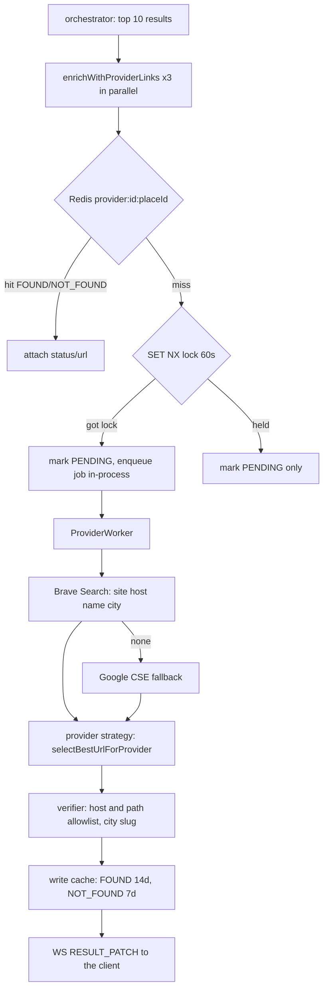

# 02 — Low-level architecture

Paths are relative to `server/src/`.

## 1. Module map

| Folder | Responsibility | Notes |
|---|---|---|
| `server.ts` | Boot: env, Redis, session store, HTTP listen, `WebSocketManager`, signals | Exports the `wsManager` singleton that controllers import (circular). |
| `app.ts` | Express app and middleware order | |
| `routes/v1/index.ts` | The only router aggregator, mounted at `/api/v1` and the legacy `/api` | |
| `controllers/` | HTTP edge: `auth/`, `search/`, `restaurants/`, `photos/`, `analytics/`, `stream/assistant-sse/` | The search controller is split into `search.controller`, `.validation`, `.security`, `.async-execution`, `.idempotency-key.generator`. |
| `middleware/` | Auth, rate limit, request context, logging, security headers, error | |
| `services/search/route2/` | The search pipeline | See section 3. |
| `services/search/job-store/` | `ISearchJobStore` with Redis and in-memory implementations | |
| `services/restaurant-details/` | Place details | |
| `services/feedback/` | SES email | |
| `llm/` | `LLMProvider` interface, OpenAI provider, Anthropic stub, cost calculator | |
| `lib/` | Infrastructure helpers: redis, cache, llm (config, resolver, budget), session, logger, telemetry, reliability, audit | |
| `infra/websocket/` | WebSocket machinery | |
| `infra/state/` | `IRequestStateStore` and `InMemoryRequestStore` (replay for late subscribers) | |
| `config/` | env, flags, logging config | |

## 2. Route2 folder structure

```
services/search/route2/
├─ route2.orchestrator.ts        searchRoute2() and searchRoute2Internal()
├─ orchestrator.*.ts             extracted helpers: guards, nearme, early-context, parallel-tasks,
│                                filters, response, error, helpers, search-terminal
├─ types.ts                      Route2Context, stage result types, shouldAbort()
├─ route2.config.ts              timeouts and enrichment caps (env overrides)
├─ search-audit.ts               one "search_audit" log line per request
├─ stages/
│  ├─ gate2.stage.ts + gate2/    food classifier and deterministic pre-check
│  ├─ intent/                    route selector (TEXTSEARCH | NEARBY | LANDMARK)
│  ├─ route-llm/                 dispatcher and 3 mappers (textsearch, nearby, landmark), zod and static schemas
│  ├─ google-maps.stage.ts       dispatcher
│  ├─ google-maps/               text-search, nearby-search, landmark-plan handlers, cache-manager, mapper
│  └─ post-constraints/          LLM that extracts open/price/kosher/gluten-free constraints
├─ shared/                       base-filters LLM, filters-resolver, price helpers, shared types
├─ guards/                       gate-stop, gate-clarify, nearby/textsearch location guards, response builder
├─ post-filters/                 deterministic filtering of Google results
├─ ranking/                      weight resolver, scoring, distance, normalization, observability
├─ assistant/                    LLM narration: prompts, validation, fallbacks, publisher, SSE-aware integration
├─ constraints/                  registry of filter enforcement metadata
├─ enrichment/                   provider deep links (Wolt/10bis/Mishloha), caches, queue, worker, place-details policy
└─ utils/                        language detection, region resolution, near-me detection
```

## 3. The data model that flows through the pipeline

`Route2Context` (`types.ts`) is passed to every stage. It holds:
- identity: `requestId`, `traceId`, `sessionId`, `clientIp`
- inputs: `userLocation`, `query`, `queryLanguage`, `debug.stopAfter`
- control: `abortSignal`, `startTime`, `timings`
- results of earlier stages: `userRegionCode`, `sharedFilters.{preGoogle, final}`, `missingLocationQuestion`, `searchAudit`
- one hidden dependency: `llmProvider: LLMProvider` (a service-locator style injection)
- untyped extras: `sessionService?: any`, and `isGenericQuery` read through `(ctx as any)`

Stage outputs, in order:

| Stage | Output type |
|---|---|
| gate2 | `Gate2StageOutput { gate: { foodSignal, route, confidence, language }, error? }` |
| intent | `IntentResult { route, confidence, reason, language, regionCandidate, cityText?, landmarkText?, radiusMeters? }` |
| route-LLM | `RouteLLMMapping`, a discriminated union on `providerMethod` (`textSearch` / `nearbySearch` / `landmarkPlan`) |
| base filters | `PreGoogleBaseFilters` |
| filters resolver | `FinalSharedFilters` |
| post-constraints | `PostConstraints { openState, openAt, openBetween, priceLevel, isKosher, isGlutenFree, requirements }` |
| Google | `GoogleMapsResult { results[], providerMethod, durationMs, servedFrom }` |
| final | `SearchResponse { requestId, sessionId, query, results, chips, assist, meta }` |

## 4. LLM layer

```mermaid
classDiagram
  class LLMProvider {
    <<interface>>
    +completeJSON(messages, zodSchema, opts, staticJsonSchema)
    +complete(messages, opts)
    +completeStream(...)
  }
  class OpenAiProvider
  class AnthropicProvider {
    stub: every method throws
  }
  LLMProvider <|.. OpenAiProvider
  LLMProvider <|.. AnthropicProvider
  class createLLMProvider {
    factory by LLM_PROVIDER
  }
  createLLMProvider ..> LLMProvider
  class resolveLLM {
    per purpose: gate, intent, baseFilters, routeMapper, assistant
    model and timeout by env
  }
  class SessionModelBudget {
    40 calls per session per UTC day
    Redis INCR
  }
  resolveLLM ..> SessionModelBudget
```



- Stages call `resolveLLM(purpose)` (`lib/llm/`) to get the model, timeout and a client wrapper that counts the session budget.
- `completeJSON` uses OpenAI Structured Outputs (`strict: true`) and `schema.parse()` afterwards.
- zod v4 is incompatible with `zod-to-json-schema`, so most stages carry a **hand-written static JSON schema** next to the zod schema (`GATE2_JSON_SCHEMA`, `intent`, `static-schemas.ts`). Two sources of truth can drift.
- `createLLMProvider()` (`llm/factory.ts`) caches the provider in a module variable and the controller calls it on every request, so it is a hidden singleton rather than an injected dependency.

## 5. Google Places layer

```
google-maps.stage.ts (switch on providerMethod, exhaustive)
 ├─ text-search.handler.ts      places:searchText, paging to ≤20, geocode city if no bias,
 │                              retry without bias if ≤1 result, field-mask-builder, location-bias-validator
 ├─ nearby-search.handler.ts    places:searchNearby (radius, includedTypes)
 └─ landmark-plan.handler.ts    geocode landmark → nearby search around it
        └─ all use cache-manager.ts → lib/cache/googleCacheService.ts (L0 in-flight dedupe, L1 memory, L2 Redis)
```

- Timeout per call: `GOOGLE_PLACES_TIMEOUT_MS` (8000 ms).
- Cache TTL is 900 s. For queries that contain "open/now/פתוח/עכשיו" it is 300 s, and it is shorter for empty results.
- `result-mapper.ts` maps Google fields to the domain `RestaurantResult`. Photos are rewritten to the proxy URL.

## 6. Provider enrichment (Wolt / 10bis / Mishloha)



- The `await` in the orchestrator only covers the cache lookup and the enqueue. The slow search work is in the worker.
- Strategies live in `provider-strategies/`: one URL-selection function per provider, plus a `ProviderVerifier` interface.
- A provider is turned on or off with `ENABLE_{WOLT,TENBIS,MISHLOHA}_ENRICHMENT`.
- Legacy directories (`wolt/`, `tenbis/`, `mishloha/` matchers, stubs and mocks, `provider-verifier-utils.ts`) are dead per `documentation/04-backend.md`.

## 7. Realtime (`infra/websocket/`)

| Class | Job |
|---|---|
| `WebSocketManager` | Facade: upgrade, auth, wiring, `publishToChannel`, `activatePendingSubscriptions` |
| `auth-verifier` | Origin check and one-time ticket from Redis (`GET` + `DEL`, not atomic) |
| `SubscriptionManager` | Channel to sockets map, ownership check against the job store |
| `PendingSubscriptionsManager` | Parks subscriptions that arrive before the job exists (90 s) |
| `BacklogManager` | Replay for late subscribers (2 min, 50 per request, 10k global) |
| `PublishManager` | Fan-out to subscribers |
| `RateLimiter` | Subscribe token bucket (10, refill 10/min) |
| `LifecycleHandler` | Heartbeat (30 s ping), idle close (15 min) |
| `search-ws.publisher.ts`, `assistant-ws.publisher.ts` | Free functions that call the **singleton** `wsManager` from `server.ts` |

All state is in-process. There is no Redis pub/sub, so with more than one task a publish reaches only sockets connected to the same task.

## 8. Storage and state

| Store | Keys / shape | TTL | In-process fallback |
|---|---|---|---|
| Job store | `search:job:<requestId>` | 24 h | In-memory, 10 min |
| Sessions | `session:<id>` | 7 d sliding | none |
| WS tickets | `ws_ticket:<uuid>` | 60 s | `ws-ticket-memory-store` |
| LLM budget | `llm-budget:<session>:<day>` | 48 h | In-memory Map that is never cleared |
| Google cache | `g:textsearch:*`, `g:search:*`, `g:place:*` | 300–900 s | L1 memory |
| Provider cache | `provider:<id>:<placeId>`, `provider:<id>:lock:<placeId>` | 14 d / 7 d / 60 s | none |
| Place-details hints | `pd:hints*` | 24 h | |
| Provider audit | DynamoDB, PK `traceId`, SK `<ts>#<provider>#<op>` | 90 d | disabled by default |
| Analytics | in-memory ring buffer of 1000 | process life | the only sink is CloudWatch logs |

Redis connections: the main client, the Google cache client, the job-store client and the WS client. That is up to 4 per process.

## 9. Middleware order (`app.ts`)

Global rate limit (300/min) → timeouts (30 s) → helmet and security headers → compression → body parsers (1 MB) → request context (`traceId`) → HTTP logging → JSON error handler → `/healthz` → CORS (photos reflect any origin) → `/api/v1`: auto-refresh cookie → router → the same router again on `/api` with deprecation headers → error middleware.

## 10. Configuration sources

`config/env.ts#getConfig()` (not memoized), `config/index.ts` (LLM constants), `route2.flags.ts`, `feature-flags.ts`, `route2.config.ts`, `lib/llm/llm-config.ts`, plus raw `process.env.*` reads inside services (such as `FEATURE_SSE_ASSISTANT` in `orchestrator.response.ts`). About 140 variables. Several are read only by dead modules.
