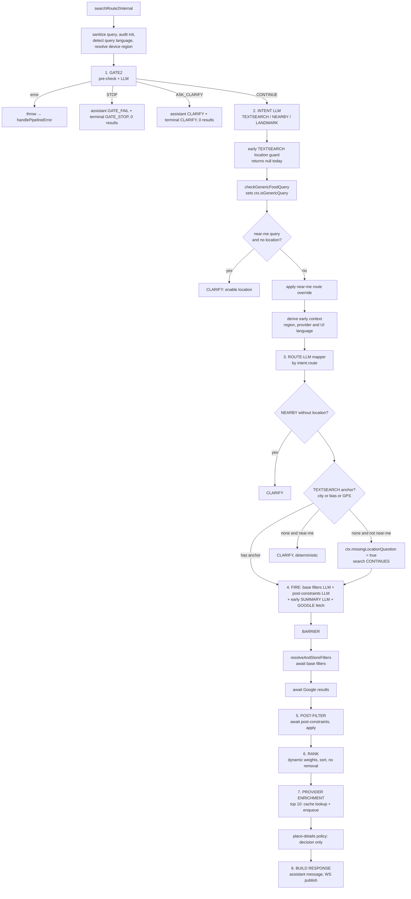

# 05 — Route2 flow (step by step)

Source of truth: `server/src/services/search/route2/route2.orchestrator.ts` and the modules it calls, read on 2026-10-10. Where this differs from the orchestrator header comment or from older docs, this file follows the code.

## 0. Entry points

```
POST /api/v1/search[?mode=sync|async]       controllers/search/search.controller.ts
  ├─ validate body (zod)                    search.validation.ts
  ├─ ROUTE2_ENABLED and createLLMProvider() must both be truthy, else 500 CONFIG_ERROR
  ├─ build Route2Context { requestId, startTime, llmProvider, userLocation, traceId, sessionId, clientIp }
  ├─ async: createJob → 202 {requestId, resultUrl} → void executeBackgroundSearch()
  └─ sync : await searchRoute2() → sanitize photo URLs → 200
```

- `requestId = req-${Date.now()}-${Math.random()…}`.
- The session id comes only from the verified auth (`getAuthenticatedSession`), never from the body.
- In prod, async without a session returns 401 `MISSING_AUTH_SESSION`.

`searchRoute2(request, ctx)` wraps `searchRoute2Internal` in `withTimeout(PIPELINE_TIMEOUT_MS = 45 000)`. On timeout it aborts a request-scoped `AbortController`, whose signal is `ctx.abortSignal`. It then calls `logSearchAudit` on success and on error.

## 1. The whole flow



## 2. Stage details

### Pre-stage
| Step | Code | Behaviour |
|---|---|---|
| Sanitize and audit | `sanitizeQuery`, `initSearchAudit` | Produces `queryLen`, `queryHash`, `queryPreview`. Raw queries are not logged beyond the preview. |
| Query language | `detectQueryLanguage` | Deterministic, majority script. Used for assistant messages. |
| Device region | `resolveUserRegionCode` | Best effort, falls back to `OTHER`. Never fails the pipeline. |
| Debug stop | `shouldDebugStop(ctx, 'gate2' \| 'intent')` | Returns a stub response when `ctx.debug.stopAfter` is set. |

### Stage 1 — Gate2 (`stages/gate2.stage.ts`)
1. A deterministic pre-check (`gate2-query-validity.ts`) catches gibberish, profanity fragments and anchor-only queries. The result is `NOT_FOOD` (→ STOP) or `ASK_CLARIFY`, with no LLM call and confidence 0.7.
2. Otherwise it makes an LLM call (purpose `gate`, prompt `gate2_v9`, strict schema `{foodSignal, confidence}`).
3. Deterministic mapping: `NO → STOP`, `UNCERTAIN → ASK_CLARIFY`, `YES → CONTINUE`. `shouldOverrideFoodToClarify` can downgrade a YES.
4. A timeout produces a STOP-shaped result with confidence 0.1 and an error. The orchestrator then throws, and `handlePipelineError` handles it. `ModelBudgetExceededError` is rethrown (→ HTTP 429).
5. It records `ctx.timings.gate2Ms`.

Gate2's own `language` is always `'other'`. The real language comes from the intent stage.

### Gate guards (`orchestrator.guards.ts`, `guards/*`)
- `handleGateStop` builds a response with `meta.source = route2_gate_stop`, an assistant `GATE_FAIL` message and 0 results. The orchestrator then publishes the terminal `GATE_STOP` event.
- `handleGateClarify` does the same with `CLARIFY`. The helper `publishClarifyAndReturn` publishes the terminal CLARIFY event, but **only if `!shouldAbort(ctx)`**.

### Stage 2 — Intent (`stages/intent/intent.stage.ts`)
- LLM call (purpose `intent`, prompt `intent_v4`) → `{route, confidence, reason, language, regionCandidate, cityText, landmarkText, radiusMeters}`.
- Failure or timeout falls back to `TEXTSEARCH` (`reason: fallback_timeout | fallback_error | fallback_schema_invalid`).
- `NEARBY` without `userLocation` becomes `TEXTSEARCH` (`nearby_location_missing_fallback`).
- An invalid `regionCandidate` becomes `null`. The final region is decided later by the filters resolver.
- It records `ctx.timings.intentMs` and the audit fields.

### Between intent and mapper (`orchestrator.nearme.ts`, `orchestrator.early-context.ts`)
- `handleEarlyTextSearchLocationGuard` returns `null` for plain text search. A missing location only sets `ctx.missingLocationQuestion` later, and the search still runs.
- `checkGenericFoodQuery` flags generic queries such as "what to eat" (`ctx.isGenericQuery`) for a later narration message.
- `handleNearMeLocationCheck`: a near-me query without a location returns CLARIFY. `applyNearMeRouteOverride` switches the route to NEARBY when a near-me phrase comes with a location.
- `deriveEarlyRoutingContext` builds a deterministic subset of the final filters (region code, provider language, UI language) so the mapper and Google can start **before** the base-filters LLM finishes. A later sanity check logs `early_context_mismatch` if the final region differs.

### Stage 3 — Route-LLM mapper (`stages/route-llm/*`)
`executeRouteLLM` is an exhaustive `switch (intent.route)`.

| Route | Mapper | Output (`providerMethod`) | Failure |
|---|---|---|---|
| TEXTSEARCH | `textsearch.mapper.ts` | `textSearch { textQuery, bias?, cityText?, region, language }` | Retries once, then a deterministic mapping |
| NEARBY | `nearby.mapper.ts` | `nearbySearch { keyword, location, radiusMeters }` | Retries once, then a default radius. Timeout hard-coded at 4500 ms. |
| LANDMARK | `landmark.mapper.ts` | `landmarkPlan { geocodeQuery, afterGeocode, radiusMeters, keyword }` | Retries once, and only on timeout. **Then throws, no fallback** (`landmark.mapper.ts`, the `if (!mapping) throw` block). See B1 below. |

The mapper receives `earlyFiltersForRouting` (region and languages only, `as any`).

### Post-mapping guards
1. `handleNearbyLocationGuard`: NEARBY without `userLocation` returns CLARIFY.
2. TEXTSEARCH anchor check: `hasCityText || hasLocationBias || hasUserLocation`.
   - Anchor present: continue.
   - No anchor and **not** a near-me query: set `ctx.missingLocationQuestion = true` and **continue**. The success response carries a "where?" question in `assist`.
   - No anchor and near-me: `handleTextSearchMissingLocationGuard`, then `handleEarlyTextSearchLocationGuard`, then `buildDeterministicMissingLocationClarify`. All return CLARIFY.

### Stage 4 — Fan-out and barrier
Only after every guard passes (so a CLARIFY never costs extra LLM calls):

| Task | Started by | Failure |
|---|---|---|
| Base filters LLM (`shared/base-filters-llm.ts`) | `fireParallelTasks` | Falls back to `DEFAULT_BASE_FILTERS` |
| Post-constraints LLM (`post_constraints_v2`, 4500 ms) | `fireParallelTasks` | Falls back to `DEFAULT_POST_CONSTRAINTS` |
| Early SUMMARY LLM (`withTimeout 1500 ms`) | orchestrator, fire and forget | Swallowed. It publishes an assistant message when done. |
| Google Places fetch | `executeGoogleMapsStage(mapping, …)` | **Throws.** `handlePipelineError` handles it. |

Barrier order in the orchestrator:
1. `await baseFiltersPromise` → `resolveAndStoreFilters` (calls `resolveFilters` with intent, device region and location, and stores `ctx.sharedFilters`).
2. `await googlePromise` (records `ctx.timings.googleMapsMs`).
3. `await postConstraintsPromise` (inside the post-filter step).

`drainParallelPromises` in `finally` prevents unhandled rejections.

Note: the orchestrator header comment says base filters and post-constraints fire "after Gate2". They fire after the mapper and the guards.

### Stage 5 — Post-filter (`orchestrator.filters.ts` → `post-filters/post-results.filter.ts`)
- Merges post-constraints over the final filters. Post-constraint values win (`openState`, `openAt`, `openBetween`, `priceLevel`, `isKosher`, `isGlutenFree`, `requirements`).
- If the query asks for "not kosher" (`queryAsksNotKosher`), it forces `isKosher = false`.
- It then runs deterministic open-state, dietary-hint and list-shape filters. The result is `resultsFiltered` plus `stats`.

### Stage 6 — Ranking (`ranking/*`)
- Baseline weights: rating 0.45, review count 0.25, distance 0.15, openNow 0.10, priceFit 0.05.
- `resolveRankingWeights` adds a boost per signal and normalizes to a sum of 1. If no signal applies, it returns the baseline.

| Signal | Boost |
|---|---|
| open state is OPEN_NOW, OPEN_AT or OPEN_BETWEEN | openNow +0.06 |
| price intent, price levels or a post-constraint price level | priceFit +0.05 |
| route NEARBY, or a reason of `near_me_phrase` or `explicit_distance_from_me` | distance +0.06 |

- `applyBaselineRanking` scores, sorts and assigns `score` and `rank`. **It never removes results.**
- `logRankingObservability` logs the top 5 before and after.

### Stage 7 — Provider enrichment (`enrichment/provider/*`)
- Takes the top `MAX_RESULTS_TO_ENRICH` (default 10).
- `Promise.all` of Wolt, 10bis and Mishloha. Each does a Redis cache check, and on a miss marks `PENDING`, takes a lock, and enqueues a job.
- Results mutate in place, with `providers.<id>.{status,url}`. Real links arrive later as `RESULT_PATCH` over WS.
- `getMetricsCollector()` tracks per-request enrichment metrics.
- The **Place Details policy** (`decidePlaceDetailsEnrichment`) only computes a plan and logs it. **No API call is made yet.** The cached-ids set is `new Set()` with a TODO.

### Stage 8 — Response (`orchestrator.response.ts`)
1. Language: `intentDecision.language`, normalized by `toRequestLanguage` (`other` → `en`).
2. `buildSummaryEnrichment` computes `top` and `analysisMode`. It also computes open-now counts, radius and applied filters.
3. Assistant message:
   - If `FEATURE_SSE_ASSISTANT=true`: skipped (the SSE endpoint is the source).
   - Else if `analysisMode !== 'SATURATED'`: publishes a **deterministic fallback** SUMMARY message.
   - Else: `generateAndPublishMessageOnly` (LLM, 1000 ms).
   - Generic queries with a location additionally get a deferred `GENERIC_QUERY_NARRATION`.
4. The HTTP `assist.message` is always `''`. The text is delivered over WS or SSE.
5. WS publish (unless aborted): `status: completed`, then `SEARCH_RESULTS`.
6. `meta`: `tookMs`, `mode`, `appliedFilters`, `filtersWithMeta`, `confidence`, `source: 'route2'`, `failureReason: 'NONE'`.

### Error path (`orchestrator.error.ts`)
Any throw goes to `handlePipelineError`, which classifies the error (see `pipeline-error-kinds.ts`), publishes `SEARCH_FAILED` and the assistant failure message, and either returns a failure response or rethrows (budget and timeout errors).

## 3. Timing and budgets

| Item | Value | Source |
|---|---|---|
| Pipeline cap | 45 000 ms | `route2Config.PIPELINE_TIMEOUT_MS` (`ROUTE2_PIPELINE_TIMEOUT_MS`) |
| LLM default per stage | 4000 ms, overridable by `<PURPOSE>_TIMEOUT_MS` | `lib/llm/llm-config.ts` |
| Nearby mapper, post-constraints | 4500 ms hard-coded | the mapper and stage files |
| Early SUMMARY | 1200–1800 ms (default 1500) | `route2Config` |
| MESSAGE_ONLY | 900–1200 ms (default 1000) | `route2Config` |
| Google call | 8000 ms | `GOOGLE_PLACES_TIMEOUT_MS` |
| Model calls per session | 40 per UTC day | `session-model-budget.ts` |

Maximum LLM calls per request is about 7–8: gate (up to 2), intent, mapper (up to 2), base filters, post-constraints, early summary, and message-only or narration.

## 4. Events published during a search

| Channel | Event | By |
|---|---|---|
| search | `progress` (accepted 10%, route_llm 50%) | `search.async-execution.ts` |
| search | `status: completed`, `SEARCH_RESULTS` | `orchestrator.response.ts` |
| search | `CLARIFY`, `GATE_STOP`, `SEARCH_FAILED` | `orchestrator.search-terminal.ts`, `orchestrator.error.ts` |
| search | `ready` (results or stop), `clarify`, `error` | `search.async-execution.ts` |
| search | `RESULT_PATCH` (provider links) | `provider-worker.ts` |
| assistant | `GATE_FAIL`, `CLARIFY`, `SUMMARY`, `SEARCH_FAILED`, `GENERIC_QUERY_NARRATION`, … | `assistant/assistant-publisher.ts` |

## 5. Bugs and smells confirmed in the code

| # | Finding | Evidence | Impact |
|---|---|---|---|
| R1 | **The 30 s async abort is dead.** `executeBackgroundSearch` sets `ctx.signal`, but the pipeline reads `ctx.abortSignal`, which `searchRoute2Internal` overwrites with its own controller. | `search.async-execution.ts` (`signal: abortController.signal`), `route2.orchestrator.ts` (`ctx.abortSignal = controller.signal`) | The real cap is 45 s. The `TIMEOUT` error code in the catch block can never be produced from that controller, so a pipeline timeout ends as `SEARCH_FAILED`. |
| R2 | **Clarify can end as `DONE_STOPPED`.** The terminal check treats `failureReason === 'LOW_CONFIDENCE'` as a gate stop before it looks at `assist.type === 'clarify'`. | `search.async-execution.ts` | **Confirmed:** `gate-clarify.guard.ts` and `nearby-location.guard.ts` set `failureReason: 'LOW_CONFIDENCE'`. These CLARIFY outcomes therefore end as `DONE_STOPPED` with a `ready/stop` event. Only the location-required clarifies (`LOCATION_REQUIRED`) end as `DONE_CLARIFY`. |
| R3 | **Duplicate terminal events.** The orchestrator publishes `CLARIFY`, `GATE_STOP` and `SEARCH_RESULTS`, and async-execution publishes `clarify`, `ready` and `error` on top. | both files | Clients must de-duplicate. Differing casing and shapes. |
| R4 | **Likely duplicate assistant SUMMARY.** The early SUMMARY (LLM) publishes when it finishes, and the response stage then publishes a deterministic SUMMARY for non-SATURATED results. | `orchestrator.response.ts` (comment says "early SUMMARY result or fallback", code always publishes the fallback) | Two assistant messages, and the LLM one can be overwritten by the weaker one. |
| R5 | **Sync catch does not log.** `search.controller.ts` catch returns 500 `SEARCH_ERROR` with no `logger.error`. | `search.controller.ts` | Silent failures in sync mode. |
| R6 | **Orchestrator comments are stale** (header says filters fire "after Gate2"). Also `TEXTSEARCH without a location continues` is split between three guards. | `route2.orchestrator.ts` | Misleads maintainers. |
| R7 | **Hidden singleton `wsManager`** imported from `server.ts` into the orchestrator, the controller and the worker. `SearchRoute2Deps` offers an override for tests, but the controller does not use it. | `route2.orchestrator.ts`, `search.controller.ts` | Circular import, hard to test. |
| R8 | **Heavy `any`.** `ctx.sessionService?: any`, `(ctx as any).isGenericQuery`, `(mapping as any).bias`, `earlyFiltersForRouting as any`, debug stubs `as any`. | orchestrator | Type safety is lost exactly where the stages meet. |
| R9 | **Place-details enrichment is a no-op** (decision only, cache set empty). | orchestrator | Dead cost-control path, plan logged but never executed. |
| R10 | **Enrichment adds latency before the response.** Three `Promise.all` cache lookups (Redis) run before the response is built. Redis down means each call degrades to `PENDING` or skip, but a slow Redis delays the results. | orchestrator | Violates "results before words" if Redis is slow (timeouts are 2 s per command). |
| R11 | **Early context duplicates the filters resolver.** `deriveEarlyRoutingContext` re-derives region and language, and the code only warns when they differ. | orchestrator | Two sources of truth for region. |
| R12 | **`requestId` uses `Math.random`**; the `searchAsync` and V1 type leftovers remain. | `search.controller.ts` | Low. Use `crypto.randomUUID()`. |
| **B1** | **LANDMARK queries that need `textSearchWithBias` always fail.** The strict JSON schema and prompt allow `['nearbySearch','textSearchWithBias']` (`static-schemas.ts:63`, `landmark.mapper.ts:26`), but the zod schema accepts `['nearbySearch','textSearch']` (`schemas.ts:63`). `completeJSON` then fails on `schema.parse()`, parse errors are not retried (`openai.provider.ts` `isRetryable`), the mapper only retries timeouts, and it throws. **Verified by running** `schemas.test.ts`: "validates happy path with textSearchWithBias" fails. *Found by claudeDocs, confirmed here.* | route-llm | Pipeline error for those landmark queries. Same root cause as "two sources of truth for every LLM schema". |
| **B3** | **Results wait for words.** For SATURATED results (≥15) `buildFinalResponse` does `await generateAndPublishMessageOnly(...)` (up to 1000 ms) before returning, so AI text delays results. *Missed in my first pass (I listed the call but not that it is awaited). From claudeDocs, line confirmed.* | `orchestrator.response.ts` | Breaks the owner rule "results before words". |
| **B4** | The early SUMMARY is built with `resultCount: 0, top: []` and is not cancelled, so it can arrive after the real results and say there were none. This is the more precise form of R4. *From claudeDocs.* | `route2.orchestrator.ts` early summary block | Wrong message to the user. |

## 6. Where to add what (without breaking route2)

- A new filter dimension: add a field to `PostConstraints` and its prompt, merge it in `applyPostFiltersToResults`, apply it in `post-filters/`, and register it in `constraints/constraints-registry.ts`.
- A new ranking signal: add a boost in `ranking-weight-resolver.ts` and a feature in `ranking-apply.ts`.
- A new ordering provider: add `<id>.strategy.ts` and a verifier, register it in `provider-strategies/index.ts`, `provider.contracts.ts` and a wrapper like `wolt.ts`. This takes about 4 touch points because of the `switch (config.provider)`.
- A new LLM stage: new `stages/<x>/` folder with a zod schema, a static JSON schema, a versioned prompt and a `resolveLLM` purpose.
- Anything that changes the stage order or adds a new engine capability belongs in the graph engine, not here.
