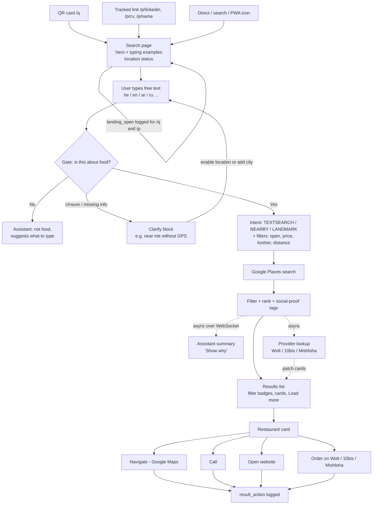

# Going2Eat — Product Overview

> Audience: product manager, founder, new team member.
> Source of truth: the code in `llm-angular/src/app` (what the user sees) and `server/src/services/search/route2` (what the search can do). Docs and git history were used for context and timeline. Where docs and code disagree, this file follows the code.
> Snapshot date: 2026-10-05 (branch `refactor/phase-1-hygiene`).

---

## TL;DR

- **What it is:** Going2Eat (`app.going2eat.food`) is a "food orchestrator". You type what you want to eat the way you would say it to a friend ("cheap falafel with a seat, on Allenby", "המבורגר כשר שאפשר ללכת אליו"), and you get a ranked list of real restaurants from Google Places, with an AI helper line, Navigate / Call / website actions, and "Order on Wolt / 10bis / Mishloha" buttons when we can find the place on those apps.
- **Who it is for:** people in Israel (Hebrew first, also English, Arabic, Russian) deciding where to eat right now, nearby or in a named city/street — including cities abroad.
- **How it works:** an LLM pipeline (OpenAI, default `gpt-4o-mini`) checks the text is about food, picks a search mode (text search / near me / landmark), pulls filters (open now, price, kosher, gluten-free, distance), calls Google Places, filters and ranks, then writes a short assistant summary in the query's language.
- **Where it is:** live in production on AWS (Angular on Amplify, Node API on ECS, Redis). Anonymous use, no sign-up. A cap of **40 model calls per session per day** protects cost.
- **Traction (real, small):** in the 7 days 2026-09-28 → 2026-10-04: **155 searches, 39 sessions, 106 unique queries**. 42% returned results, 35% asked a clarifying question, 15% errored (mostly one bad evening of Gate timeouts). Only **10 of 155 searches (6.5%) led to a click**. LinkedIn link (`/p/linkedin`) drove almost half of all searches.
- **Biggest product gaps:** too many "clarify" answers for generic queries, low click-through, a mostly-English UI chrome around a multilingual search, a confusing "40 calls per day" limit, and the order buttons rarely appearing.

---

## Table of contents

1. [Product one-liner and value proposition](#1-product-one-liner-and-value-proposition)
2. [Target users and use cases](#2-target-users-and-use-cases)
3. [User journeys](#3-user-journeys)
4. [Feature inventory](#4-feature-inventory)
5. [Search capabilities and supported queries](#5-search-capabilities-and-supported-queries)
6. [AI assistant behavior and language rules](#6-ai-assistant-behavior-and-language-rules)
7. [Integrations](#7-integrations)
8. [Growth channels, tracking and what the daily reports show](#8-growth-channels-tracking-and-what-the-daily-reports-show)
9. [Product history and timeline](#9-product-history-and-timeline)
10. [Known product issues and UX gaps](#10-known-product-issues-and-ux-gaps)
11. [KPIs to track](#11-kpis-to-track)
12. [Suggested roadmap (suggestions only)](#12-suggested-roadmap-suggestions-only)
13. [Glossary](#13-glossary)

---

## 1. Product one-liner and value proposition

**One-liner (from the hero, `search-page.component.html`):** *"Search food the way you think."*

**Hero copy** (`features/unified-search/search-page/hero-about.ts`, shown in en / he / ar / ru by browser language):

> We built this so finding a place to eat feels like asking a friend.
> Say the dish, the walk, or the street. In your state, or in a city abroad.
> We turn those words into places on the map.

**Value proposition**

| For the eater | How Going2Eat delivers it |
|---|---|
| "I don't want to fiddle with filters." | One free-text box. No cuisine chips, no filter panels (chips were removed on purpose — `new-docs/CUISINE_CHIPS_REMOVAL.md`). |
| "I think in Hebrew / Arabic / Russian / English." | Query understood in any of these; assistant answers in the query language. |
| "Is it open? Is it kosher? Can I walk there?" | Open-now / open-at, kosher, price, distance / walking time, gluten-free hints pulled from the sentence. |
| "OK, now get me there or get it delivered." | Navigate (Google Maps place link), Call, open website, Order on Wolt / 10bis / Mishloha. |
| "I don't trust a black box." | Applied filters shown as badges (Enforced / Active / AI hints / Not enforced) and a "Show why" assistant explanation. |

**For the business:** a funnel from intent ("I want sushi open now near Dizengoff") to an outbound action (navigate, call, order). Delivery links carry `utm_source=going2eat&utm_medium=referral&utm_campaign=provider_link` (`llm-angular/src/app/utils/wolt-deeplink.util.ts`), which is the hook for future affiliate/referral revenue.

---

## 2. Target users and use cases

**Primary users**
- Israelis looking for a place to eat now (mobile, often with GPS).
- Hebrew speakers who find English-centric map search clumsy.
- Arabic and Russian speakers in Israel (both are in the example prompts and the hero copy).
- Travelers searching a city abroad in their own language (real queries in the reports include Athens, Baku, Belgrade, New Jersey, Rome is in the examples).

**Secondary / current traffic reality**
- Recruiters and professional contacts reached via LinkedIn and a CV link (`/p/linkedin`, `/p/cv`) — today the largest traffic source. The product is also a portfolio piece.
- Testers trying to break the AI (prompt-injection probes were observed in the logs and were classified as `not_food` by the Gate — see section 8).

**Core use cases**

| Use case | Example query (from the app's own example list, `search-bar.component.ts`) |
|---|---|
| Dish + street | `cheap falafel with a seat, on Allenby` |
| Vibe + street | `quiet cafe outside, on Dizengoff` |
| Open now, abroad | `Italian restaurant open now, on the Champs-Élysées` |
| Distance in meters, Hebrew | `מסעדה איטלקית, 300 מטר, בשנקין` |
| Kosher + walkable | `המבורגר כשר שאפשר ללכת אליו` |
| Area + price | `דג ליד הים ביפו, לא יקר מדי` |
| Russian, walkable | `пицца во Флорентине, можно дойти пешком` |
| Arabic, short walk | `قهوة وفطور، مشي قصير في ابن جبيرول` |

---

## 3. User journeys

### 3.1 End-to-end flow

### 3.2 Journey narrative

1. **Entry.** A QR card (`/q`), a named link (`/p/<name>`, e.g. `/p/linkedin`), or the plain site (`/search`). Tracked entries are remembered for the browser tab (`core/qr-entry.ts`) and a `landing_open` event is posted once per tab (`services/landing-open-log.service.ts`).
2. **Landing.** Logo, title, 3-line "about" in the browser language, a "Put us on your plate" PWA install button, and location status ("Using your location", "Enable location for better results", or browser-blocked instructions with "Check again"). The empty search box types out example queries cycling through Hebrew, English, Arabic and Russian. Recent searches show when the box is empty.
3. **Search.** User submits text. Results arrive as an async job (HTTP 202 + WebSocket/poll). Median ~4–5 s, p95 ~7 s in production reports.
4. **Outcome screens:**
   - **Results** — filter badges + list of cards, 10 at a time with "Load more".
   - **Clarify** — a block with a question (e.g. location needed for "near me" without GPS; "Add a city or area above to search").
   - **Not food** — assistant explains, no search.
   - **Daily limit** — "You can make up to 40 calls per day", shown in the query language (9 languages, `daily-limit/daily-limit-copy.ts`).
   - **Error** — "Oops! Something went wrong" + Try Again.
5. **Assistant.** A compact assistant line sits in the sticky search dock; the full summary is behind a "✨ Show why" toggle (mobile: bottom sheet).
6. **Card → action.** Tap card = open the restaurant's website (if Google has one). Buttons: Navigate (with distance and walking time), Call, Order on Wolt / 10bis / Mishloha. Every action is logged as `result_action` (`server/src/controllers/analytics/result-action-log.ts`: `open, navigate, call, wolt, tenbis, mishloha`).
7. **Feedback.** A site feedback sheet ("How does this feel? I like it / Needs work + one thing to change") sends to the log and by email (`legal/site-notices.component.ts`, `server/src/services/feedback/send-feedback-email.ts`). It no longer pops on first visit.

---

## 4. Feature inventory

Status: **Live** = in production UI/flow today; **Partial** = works but limited; **Stub/Hidden** = code exists, not user-facing; **Planned** = docs only.

| Feature | Status | Where in code |
|---|---|---|
| Free-text search box with multilingual typing examples | Live | `features/unified-search/components/search-bar/` (`SEARCH_EXAMPLE_PROMPTS`, 14 examples) |
| Hero with logo, collapsing on scroll; sticky search dock | Live | `search-page/hero-collapse.ts`, `search-page.component.html` |
| Hero "about" text in en/he/ar/ru | Live | `search-page/hero-about.ts` |
| PWA install ("Put us on your plate") | Live | `search-page.component.html`, `public/manifest.webmanifest` |
| Browser location (GPS) with denied/blocked guidance | Live | `search-page.component.ts` (`locationState`) |
| Recent searches | Live | `facade.recentSearchesList()` in search page |
| Async search (202 + WebSocket / polling) | Live | `server/src/controllers/search/`, `core/services/ws/` |
| Food gate (not-food, swear words, prompt-injection resistance) | Live | `route2/stages/gate2.stage.ts`, `gate2/gate2-query-validity.ts` |
| Search modes: text search / nearby / landmark | Live | `route2/stages/intent/`, `route2/stages/route-llm/` |
| Search without city or GPS still returns places + location question | Live (shipped 2026-09-27) | `route2/guards/textsearch-location.guard.ts`, `docs/route3/sprint-08-good-search/` |
| Food typo still searches | Live | `docs/route3/sprint-09-gate-and-near-me/` |
| "Near me" stays inside GPS radius | Live | `route2/orchestrator.nearme.ts`, `utils/near-me-detector.ts` |
| Open now / closed now / open at / open between | Live (hard filter) | `route2/post-filters/post-results.filter.ts`, `shared/shared-filters.types.ts` |
| Price intent (cheap/mid/expensive) and price level | Live (soft) | `route2/shared/price-*.ts` |
| Kosher (hard), "not kosher" drops kosher-named places | Live | `constraints/constraints-registry.ts`, `post-filters/not-kosher-name.ts` |
| Gluten-free hint (soft, re-orders, chip on card) | Live (hint) | `post-filters/dietary-hints.ts` |
| Vegan / vegetarian / accessible / parking / romantic / quiet / family / laptop | Recognised but **not applied** (shown as "Not enforced") | `constraints/constraints-registry.ts` |
| Wrong dish / wrong city clean-up of Google's list | Live | `post-filters/list-shape.ts` |
| Ranking with distance, rating, reviews; social-proof tags (Hidden Gem, Crowd Favorite, Popular & Reliable) | Live | `route2/ranking/` |
| Applied-filter badges (Enforced / Active / AI hints / Not enforced) | Live | `search-page.component.html`, `filter-enforcement.util.ts` |
| AI assistant summary ("Show why"), clarify, failure messages | Live | `route2/assistant/`, `components/assistant-*` |
| Restaurant card: photo (proxied), open/closed badge, rating, ₪ price, address, feature chips | Live | `components/restaurant-card/` |
| Navigate (Google place link) with distance + walking time | Live | `restaurant-card.component.ts` |
| Call / open website from card | Live (since 2026-09-30) | `restaurant-card.component.ts` |
| Order on Wolt / 10bis / Mishloha | Partial (only when a verified link is found) | `route2/enrichment/provider*`, card `providerLinks` |
| Daily model-call limit (40 / session / UTC day), localized notice | Live | `server/src/lib/llm/session-model-budget.ts`, `daily-limit/` |
| Tracked entry links `/q`, `/p/:prefix` + `landing_open` | Live (since 2026-10-04) | `app.routes.ts`, `core/qr-entry.ts`, `services/landing-open-log.service.ts` |
| Click analytics `result_action` | Live (since 2026-09-30) | `server/src/controllers/analytics/` |
| `search_audit` log line per search (CloudWatch) | Live | `route2/search-audit.ts` |
| Site feedback sheet → log + email | Live | `legal/site-notices.component.ts` |
| Privacy / Terms pages | Live | `legal/` (`/privacy`, `/terms`) |
| Anonymous session (cookie/JWT, auto-recover on Android) | Live | `core/auth/`, `server/src/controllers/auth/` |
| Feature flags endpoint `GET /api/v1/flags` | Live | `server/src/config/feature-flags.ts` |
| Restaurant details page `/r/:placeId` | Stub (shows only the place ID) | `features/restaurant-details/` |
| Map view | Not in current UI (an early Leaflet map existed in 2025) | — |
| "Pending approvals" action panel, evaluate-poc page | Hidden/legacy | `search-page.component.html`, `features/evaluate-poc/` |
| Route3 (LangGraph orchestrator over Route2) | Planned, flag off | `docs/route3/EPIC_ROUTE3.md` |

---

## 5. Search capabilities and supported queries

### 5.1 Pipeline in product terms

| Step | What it decides | Product effect |
|---|---|---|
| **Gate** (`gate2.stage.ts`, LLM, ~1–2 s) | Is this about food? `YES / UNCERTAIN / NO` | Non-food text is stopped with a friendly message; only a swear word stops a normal-looking query. |
| **Intent** (`stages/intent/`) | Route: `TEXTSEARCH` (city/street named), `NEARBY` (near me / distance from me), `LANDMARK` (near a named place); language; region (country); city; radius | Picks how to ask Google. |
| **Route mapper** (`stages/route-llm/`) | Builds the Google query (text, location bias, radius) | Nearby cuisine words go to Text Search so Google filters by food, not only distance. |
| **Filters** (parallel LLM: `base-filters-llm.ts`, `post-constraints.stage.ts`) | Open state, price, kosher, dietary, vibes | Shown as badges; some hard, some soft, some only noted. |
| **Google Places** (`stages/google-maps/`) | Up to ~20 places | Name, rating, reviews, price, hours, photo, phone, website, Google Maps link. |
| **Post-filter + shape + rank** | Open-now, kosher, wrong dish/city, gluten-free first, distance/rating weights | Final list. |
| **Assistant** (async) | Summary / clarify / failure text in query language | "Show why" panel. |
| **Provider enrichment** (async) | Wolt / 10bis / Mishloha links | Order buttons appear when verified. |

### 5.2 Filters and how strict they are

From `server/src/services/search/route2/constraints/constraints-registry.ts`:

| Filter | Trigger words (examples) | Enforcement | Unknown data |
|---|---|---|---|
| Open now / closed now / open at / between | "open now", "פתוח עכשיו", "open at 22:00" | **Hard** | excluded |
| Kosher | "כשר", "kosher" | **Hard** | excluded |
| Price intent / price range | "cheap", "זול", "לא יקר מדי", "fancy" | Soft (ranking) | included |
| Gluten-free | "gluten free", "ללא גלוטן" | Hint (moved up, chip) | — |
| Distance / walk | "300 מטר", "can walk", "short walk" | Radius in Intent (max 50 km) + distance shown on card | — |
| Vegan, vegetarian, accessible, parking, romantic, quiet, family, laptop | "vegan", "quiet", "with parking" | **Not applied** (badge says "Not enforced") | — |

### 5.3 Supported query patterns

| Pattern | Example | Route |
|---|---|---|
| Dish + city | `pizza in tel aviv`, `פיצה בתל אביב` | TEXTSEARCH |
| Dish + street | `cheap falafel with a seat, on Allenby` | TEXTSEARCH |
| Dish + near me (needs GPS) | `הודי בסביבה`, `hamburger near me` | NEARBY |
| Dish + distance | `מסעדה איטלקית, 300 מטר, בשנקין` | NEARBY / TEXTSEARCH with radius |
| Near a landmark | `хумус на рынке Кармель`, `فلافل في سوق الكرمل` | LANDMARK |
| City abroad | `паста в Трастевере, Рим`, `sushi open now in Shibuya` | TEXTSEARCH (region from text) |
| Dish only, no city, no GPS | `pizza` | Searches anyway + asks for location/city |
| Typo | `piza in tel aviv` | Still searches |

**Not supported / weak today:** "recommend me something" without a dish (often ends in clarify), counting/aggregate asks ("more than 1500 reviews" is not a filter), menus, deals, reservations, table availability, delivery time or delivery fee comparisons.

---

## 6. AI assistant behavior and language rules

### 6.1 Message types (`route2/assistant/assistant.types.ts`)

| Type | When | Typical content |
|---|---|---|
| `SUMMARY` | Results found | 4–6 short lines: headline, evidence from the top places (rating, reviews, distance), next-step suggestion. Mode depends on count: `SCARCITY` (<5), `COMPARISON` (5–14), `SATURATED` (15+). Optional soft gluten-free note, no medical claims. |
| `CLARIFY` | `MISSING_LOCATION` or `MISSING_FOOD` | One message + one question; can block the search. |
| `GATE_FAIL` | `NO_FOOD` / `UNCERTAIN_FOOD` | Friendly redirect to a food query. |
| `GENERIC_QUERY_NARRATION` | Generic query answered using current location | "We used your location" + one refinement question. |
| `SEARCH_FAILED` | Google timeout / provider / network error | Honest, short failure + retry hint. |

Suggested actions the assistant can carry: `ASK_LOCATION, ASK_FOOD, RETRY, EXPAND_RADIUS, REFINE`.

### 6.2 Language rules

- **The assistant answers in the language of the query.** Supported: he, en, ar, ru, fr, es (+ "other"). The intent stage's `language` is the single source of truth (`shared/shared-filters.types.ts` comments).
- **Hard enforcement:** prompts say "language MUST equal requestedLanguage"; after the LLM answers, a deterministic check (Hebrew character ratio) replaces a wrong-language reply with a fixed fallback message — no retry (`docs/ASSISTANT_LANGUAGE_ENFORCEMENT_SUMMARY.md`, `assistant/fallback-messages.ts`).
- **Fallback chain:** UI language → filter language → detected language → region (IL → Hebrew) → Hebrew.
- **Google calls** use a "provider language" (he/en/ar/fr/es/ru) so place names come back in a matching script where possible.
- **RTL:** Hebrew and Arabic text is rendered RTL (`dir` set on hero, location question, daily-limit card, example prompts; addresses use `dir="auto"`). The overall page chrome ("Show why", "Load more", "Recent Searches", "Oops! Something went wrong") is **English-only**, and `app-assistant-summary` is passed `locale="en"`.
- **Safety:** search text is framed as data, truncated to 25 words before reaching the model, assistant output is plain text, and model strings are capped (`docs/route3/sprint-10-llm-guard/`).

### 6.3 Assistant UX history (why it looks the way it does)

The assistant went through many iterations (see the ~30 `new-docs/ASSISTANT_*` files): a "narrator" layer was removed (2026-01-28), duplicate messages were deduped several times, placement moved from a panel to a line in the sticky dock + "Show why" toggle, WebSocket delivery was hardened. Lesson: the assistant is valued as an explanation, but it must not block or push down the results.

---

## 7. Integrations

| Integration | What the user gets | Notes / code |
|---|---|---|
| **OpenAI** (default `gpt-4o-mini`, per-stage model overrides via env) | Understanding free text in many languages, filters, the assistant text | `server/src/llm/openai.provider.ts`, `lib/llm/llm-config.ts`. Every call counts toward the 40/day session budget. |
| **Google Places (New)** — Text Search, Nearby Search, geocoding | The restaurants themselves: name, photo, rating, review count, price level, opening hours, address, phone, website, Google Maps place link | `route2/stages/google-maps/`. Photos go through a backend proxy (`controllers/photos/`) so the API key is not exposed. |
| **Wolt** | "Order on Wolt" button with UTM tracking | Link found via web search (Brave / Google CSE adapters), matched and verified, cached in Redis (14 days found / 24 h not found), pushed to the card over WebSocket. `route2/enrichment/wolt/`, `provider-strategies/wolt*.ts`. |
| **10bis (tenbis)** | "Order on 10bis" link (strict URL validation) | `enrichment/tenbis/`, `provider-strategies/tenbis*.ts` |
| **Mishloha** | "Order on Mishloha" button | `enrichment/mishloha/`, `provider-strategies/mishloha*.ts` |
| **Browser geolocation** | "Near me", distance and walking time on cards | Front only; GPS sent with the search. |
| **Email** | Site feedback reaches the team | `server/src/services/feedback/send-feedback-email.ts` |
| **AWS CloudWatch** | Daily reports (searches, outcomes, clicks, opens) | `search_audit`, `result_action`, `landing_open` log events |

Provider links are shown **only** when status is `FOUND` and the URL passes validation — the product prefers no button over a wrong button.

---

## 8. Growth channels, tracking and what the daily reports show

### 8.1 Tracking model

| Mechanism | How it works | Code |
|---|---|---|
| QR entry | `/q` → entry `qr` stored in `sessionStorage` (`g2eEntry`) and sent with each search | `core/qr-entry.ts`, `app.routes.ts` |
| Named entry links | `/p/<name>` → entry `p:<name>` (lowercase, a–z0–9-, max 24 chars). In use: `p:linkedin`, `p:cv` | same |
| Link opens | `landing_open` posted once per entry per tab (even if no search) — released 2026-10-04, so earlier "opens" read 0 | `services/landing-open-log.service.ts` |
| Searches | `search_audit` line per search: language, GPS yes/no, gate, intent route, city, duration, outcome, top 4 names | `route2/search-audit.ts` |
| Clicks | `result_action` with action + place name + requestId | `controllers/analytics/` |
| Outbound UTMs | `utm_source=going2eat`, `utm_medium=referral`, `utm_campaign=provider_link`, `ref` on Wolt/10bis/Mishloha links | `utils/wolt-deeplink.util.ts` |
| Reports | `aws-daily-report/run-*-report.bat` → Node script in a local Cursor skill reads CloudWatch (profile `pizza`, `eu-north-1`) and writes `general-*`, `opens-*`, `qr-*`, `linkedin-*`, `cv-*` text files | `aws-daily-report/` |

The `dating-landing-*` reports in the same folder are for a **separate sibling product** (`/reg` on a dating app, different log group); they are not Going2Eat traffic (3 anonymous opens on 2026-10-04).

### 8.2 What the reports show (aggregate only)

**7 days, 2026-09-28 → 2026-10-04** (`opens-7d_2026-10-04_run01.txt`):

| Metric | Value |
|---|---|
| Searches | 155 |
| Unique queries | 106 |
| Sessions (people) | 39 → ~4 searches per session |
| Outcomes | results 65 (42%) · clarify 55 (35%) · error 23 (15%) · not_food 8 (5%) · no_results 4 (3%) |
| Searches with GPS | 25 (16%) |
| Duration | median 4.1 s · p95 7.0 s · max 8.2 s |
| Searches with a click | 10 of 155 (6.5%) |
| Clicks (15) | open website 9 · navigate 3 · Wolt 1 · 10bis 1 · Mishloha 1 |
| Daily-limit hits | 3 |

**By channel (same window):**

| Channel | Searches | Sessions |
|---|---|---|
| `p:linkedin` | 71 (46%) | 21 (54%) |
| `qr` | 5 | 1 |
| Regular / direct | ~79 | ~17 |

**Errors:** 20 of the 23 errors were `GATE_TIMEOUT` clustered in one evening (2026-09-29, 21:08–22:17); the other 3 were the daily budget. CloudWatch in the window: `pipeline_failed` 43, `gate2_timeout_fallback` 20, `assistant_llm_failed` 6.

**Most recent 3 days, 2026-10-03 → 10-05** (`general-3d_2026-10-05_run01.txt`): 8 searches from 2 sessions (5 results, 3 clarify, 0 GPS, 0 clicks, no errors). The CV link was opened 5 times by 1 person with 0 searches. QR: 0 searches on 10-03, 10-04 and 10-05. Traffic after the LinkedIn spike is very low.

**Qualitative patterns (no personal data):**
- Queries are mostly Hebrew, with a solid English share; several are about cities abroad.
- Generic "recommend me a restaurant" and "near me" without GPS end in clarify far more than dish queries do.
- Prompt-injection style inputs were seen; pure injection was classified `not_food`, and injection mixed with a real food query still returned normal results — the Gate behaves as designed.
- A website open is the most common action; delivery buttons are rarely clicked (they also rarely appear).

---

## 9. Product history and timeline

Derived from `git log` (258 commits, 2025-08-20 → 2026-10-04) and `docs/`, `new-docs/`.

| Period | What happened |
|---|---|
| **Aug 2025** | Project starts: Angular + Node, OpenAI "food intent", first stub UI, paging, a first Leaflet map. 2025-08-29 "change direction": Google Places added. |
| **Sep 2025** | NLU + LangChain experiments, new Tailwind UI and landing page, grid wired to backend with location and images; validation of Google places. |
| **Nov–Dec 2025** | Translation layer, API refactor ("faster!!"), phases 2–3 of the new pipeline (Route2), localization, open/closed in UI, region fixes. |
| **Jan 2026** | **2026-01-02 "go live phase 1".** Docker → AWS, Amplify front. Location, Google Places (New), open/close filter, Redis, **2026-01-24 production go-live with security review ("CISO")**. 2026-01-28: assistant rebuilt, narrator layer removed, SEARCH_FAILED and forced-shutdown fixes. Many assistant/WebSocket/async-job fixes (`new-docs/`). |
| **Feb 2026** | Sticky search dock, delivery providers added (2026-02-14), WebSocket ticket + cookie-only auth (merge of `v2-rebuild-baseline`, 2026-02-18), "new look", provider verifiers + `GET /api/v1/flags` (2026-02-28). |
| **Mar–mid Sep 2026** | Mostly quiet. |
| **Late Sep 2026** | Burst of product polish: Android session auto-recover, `search_audit` for CloudWatch, nearby cuisine sent to Text Search, typing examples in 4 languages, logo, feedback sheet (then made non-intrusive), **sprints 7–10 shipped 2026-09-27** (search without city still returns places, typo tolerance, near-me fence, order buttons, LLM guards), QR link kept for reporting, "not kosher" name filter, `/p/<prefix>` links (09-29), daily-limit notice in query language + click logging (09-30), drop wrong dish/city, phone + website from Google and Navigate via Google place link (09-30). |
| **Oct 2026** | `landing_open` for tracked links (10-04). Engineering refactor track started (`docs/sprints/phase-0…2`: baseline, repo hygiene / remove duplicated server tree, composition root). Route3 (LangGraph) epic planned, flag off. |

---

## 10. Known product issues and UX gaps

| # | Issue | Evidence | Impact |
|---|---|---|---|
| 1 | **Low click-through** — 6.5% of searches lead to any action | 7-day report | Main value (getting people to eat somewhere) not proven yet. |
| 2 | **High clarify rate** (35%) | 7-day report; generic queries end in `LOW_CONFIDENCE` / `LOCATION_REQUIRED` | Users retype the same query; feels like the AI "won't answer". Sprint 8 fixed only the dish-without-city case. |
| 3 | **Reliability spikes** — Gate timeouts gave 20 errors in one evening | 7-day errors | First-impression failures during the LinkedIn spike. |
| 4 | **Daily limit is confusing** — "You can make up to 40 calls per day", but one search uses several model calls, so a user gets far fewer than 40 searches | `session-model-budget.ts` charges every OpenAI call (`openai.provider.ts`) | Users hit "Try again later" without understanding why. |
| 5 | **UI chrome is English-only** while queries and assistant are multilingual; assistant summary passed `locale="en"` | `search-page.component.html` | Hebrew/Arabic users see mixed-language, mixed-direction UI. |
| 6 | **Assistant hidden behind "Show why"** | template | The differentiator (explanation) is easy to miss. |
| 7 | **Order buttons rarely shown/used** (3 delivery clicks in a week) | report; links only when verified `FOUND`, async | Delivery/affiliate value not yet realized. |
| 8 | **Card tap opens website, or does nothing** when Google has no website; details page `/r/:placeId` is a stub | `restaurant-card.component.ts`, `restaurant-details.component.ts` | No in-app detail (menu, hours, reviews). |
| 9 | **Many filters are "Not enforced"** (vegan, vegetarian, accessible, parking, vibes) | constraints registry | Honest, but users asking "vegan" get unfiltered results. |
| 10 | **No map view** in the current UI | no map component | Spatial decision ("which is closest to me?") relies on distance text only. |
| 11 | **Low GPS adoption** (16% of searches) | report | Near-me use case underused; browser-blocked flow is long. |
| 12 | **Tracking gaps** — opens only since 2026-10-04; no funnel from open → search → click per channel yet; reports run locally from a personal Cursor skill | `aws-daily-report/*.bat` | Hard for a team to see metrics; report tooling is not in the repo. |
| 13 | **Legacy UI bits** in the template (pending approvals panel, recovery mode indicator, `search-page.component_old.html`) | search page | Risk of odd states; maintenance noise. |
| 14 | **Latency** ~4–7 s per search | reports | Long for a mobile "where do we eat now" moment. |

---

## 11. KPIs to track

| Layer | KPI | Today (7-day) | How to measure |
|---|---|---|---|
| Acquisition | Link opens per channel (`qr`, `p:*`, direct) | Opens logged only from 10-04 | `landing_open` |
| Activation | Opener → searcher rate per channel | n/a yet | `landing_open` vs `search_audit` by entry |
| Search quality | % searches ending in **results** | 42% | `search_audit` outcome |
| Search quality | Clarify rate / not_food rate / no_results rate | 35% / 5% / 3% | same |
| Reliability | Error rate; Gate timeout rate | 15%; 20 timeouts | `search_audit`, CloudWatch `gate2_timeout_fallback` |
| Speed | Median / p95 search duration | 4.1 s / 7.0 s | `search_audit` |
| Engagement | Searches per session; returning sessions | ~4 | session id |
| **North star** | **% searches with at least one action** (open, navigate, call, order) | **6.5%** | `result_action` joined by requestId |
| Monetization | Order-button impressions, order clicks, clicks per provider | 3 order clicks | `result_action` (+ add impression logging) |
| Coverage | % results with a verified delivery link | not measured | provider enrichment status |
| Cost | Model calls per search; daily-limit hits | 3 limit hits | budget logs |
| Language | Share of queries per language; results rate per language | not reported | `search_audit` Lang |
| Location | % searches with GPS | 16% | `search_audit` GPS |
| Satisfaction | Feedback "I like it" vs "Needs work" | not reported | feedback log |

---

## 12. Suggested roadmap (suggestions only)

> These are **suggestions** derived from the gaps above, not committed plans.

**Now (1–2 weeks) — fix the funnel**
1. Turn more clarifies into results: for generic or "near me without GPS" queries, search a sensible default (last city, IP region, or popular area) and show the question above the list (extend sprint 8 to all clarify reasons).
2. Make the limit understandable: count **searches**, not model calls (e.g. "10 searches a day"), in the query language.
3. Reliability: alert on Gate timeouts; fall back to "assume food" faster when the Gate times out.
4. Localize the UI chrome (he/ar RTL first): buttons, headings, empty/error states, and stop hard-coding `locale="en"` for the assistant.
5. Add a reporting view a team can open (move the report script into the repo or a small dashboard) with the per-channel funnel open → search → action.

**Next (1–2 months) — make the result actionable**
6. Show the assistant's one-line headline above results by default; keep details behind "Show why".
7. A real place sheet (`/r/:placeId`): hours, photos, reviews summary, phone, website, order links, share link.
8. Raise delivery coverage: pre-warm provider links for popular places; log order-button impressions to compute order CTR.
9. A map toggle for the result list.
10. Enforce the most-asked "not enforced" filters (vegan/vegetarian) using Google place attributes where available.
11. Shareable result links (a query in a URL) to support word-of-mouth and WhatsApp sharing.

**Later — growth and business**
12. More `/p/<name>` campaigns (venues, communities, Telegram/WhatsApp groups) and printed QR cards with per-location prefixes.
13. Affiliate/referral agreements with Wolt / 10bis / Mishloha using the existing UTMs.
14. Optional sign-in for favorites and history across devices.
15. Route3 (LangGraph) only if it brings measurable latency or quality gains, behind its flag.

---

## 13. Glossary

| Term | Meaning |
|---|---|
| Route2 | The current production search pipeline (`server/src/services/search/route2`). |
| Route3 | Planned LangGraph orchestrator over the same stages; off by default. |
| Gate / Gate2 | First LLM step: is the text about food? |
| TEXTSEARCH / NEARBY / LANDMARK | The three ways the app asks Google: by text/city, around the user, around a named place. |
| Clarify | A response that asks the user for missing info (usually location). |
| Hard / soft / hint / not applied | How strictly a filter is enforced (remove / re-rank / highlight / only noted). |
| Entry | Tracked origin of a visit: `qr` or `p:<name>`. |
| `landing_open`, `search_audit`, `result_action` | Analytics log events for link opens, searches, and card actions. |
| Provider | A delivery app: Wolt, 10bis (tenbis), Mishloha. |
