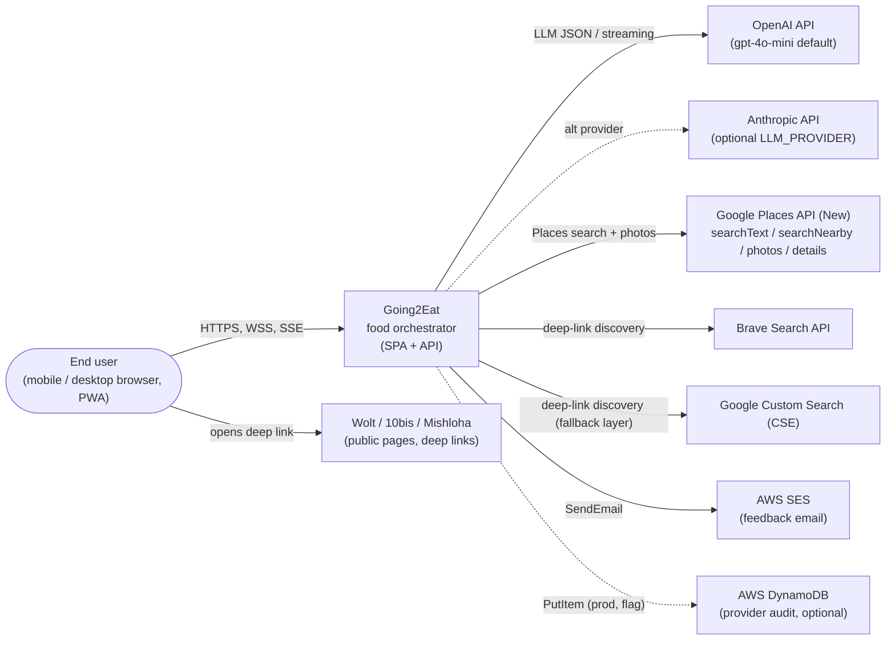
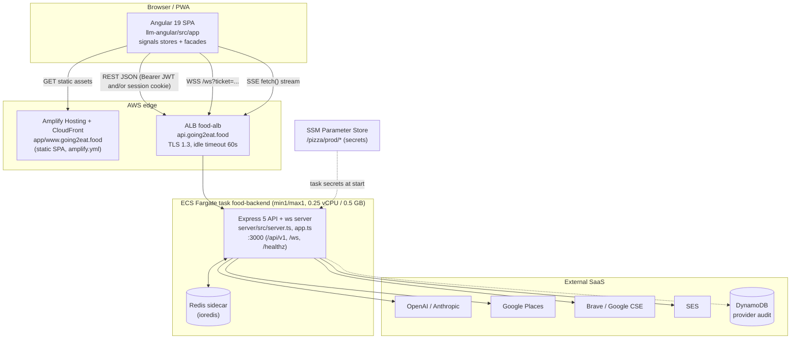
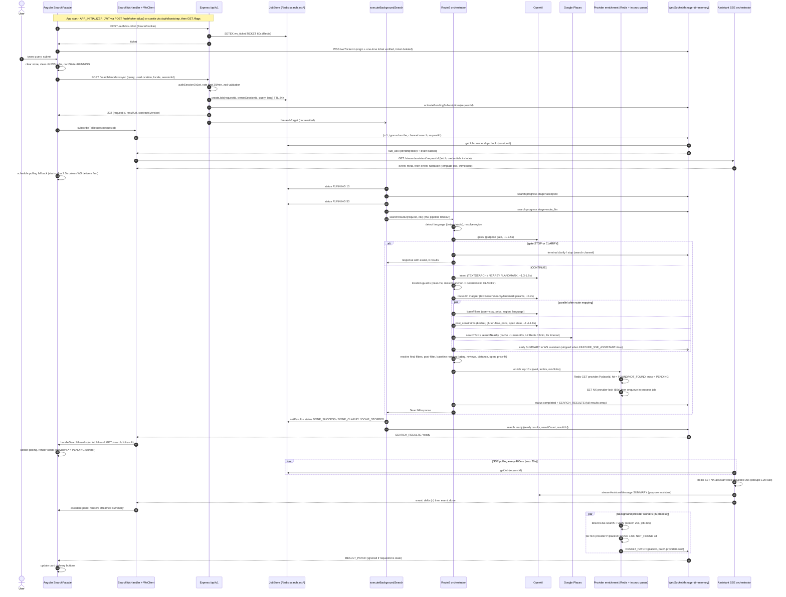
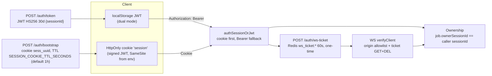
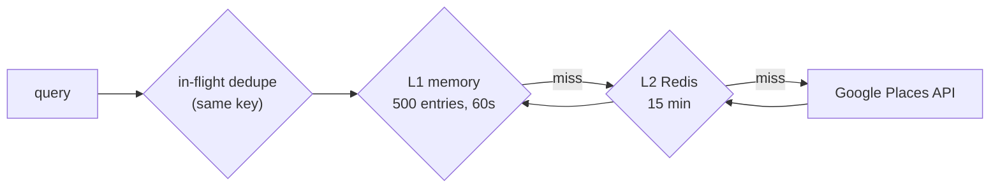
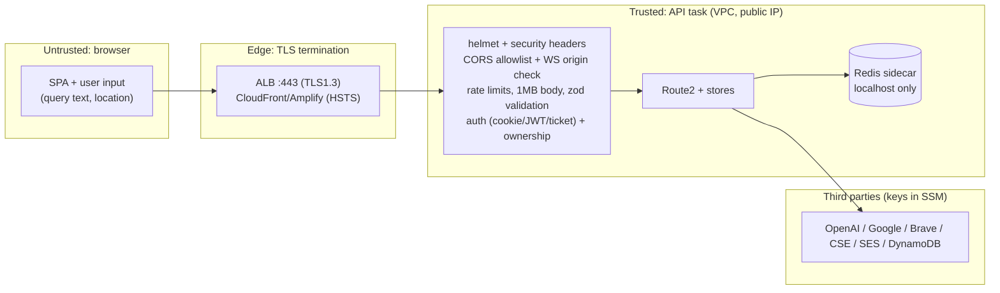
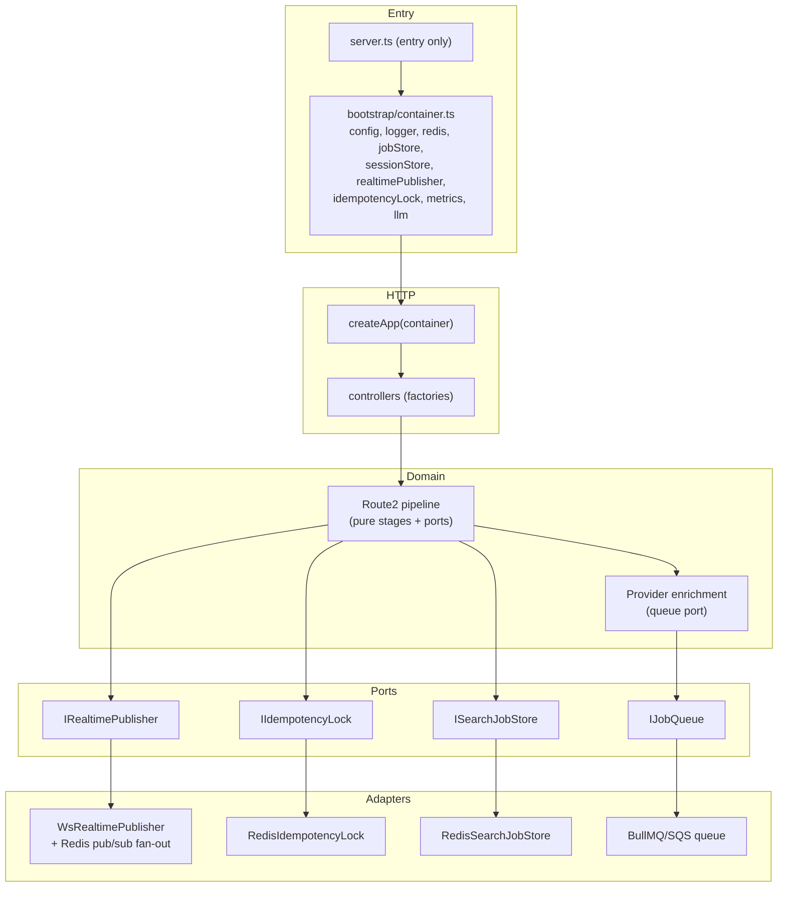

# 02 - System Architecture (end-to-end view)

> Scope: how the Angular front end, the Node/Express API, Redis, DynamoDB, the LLM providers, Google Places and the delivery-provider resolvers fit together at runtime. Per-tier details live in the frontend, backend and AWS documents. This page covers what crosses those boundaries.
>
> Source of truth: the code on branch `refactor/phase-1-hygiene` (HEAD `2c11e9c`, 2026-10-05). Where docs and code disagree, this page follows the code and says so.

---

## TL;DR

- **What it is:** "Going2Eat", a natural-language restaurant search. A user types a free-text query (Hebrew, English and others). The backend runs a multi-stage **LLM + Google Places pipeline** called **Route2**: gate, intent, route-mapping, filters, Google search, post-filter, ranking, delivery-provider enrichment. It returns ranked restaurants plus a short **assistant narration**.
- **Shape:** an Angular 19 SPA (AWS Amplify/CloudFront) talks to **one** stateful Express 5 process (ECS Fargate, 1 task) that has a **Redis sidecar**. External calls go to OpenAI (or Anthropic), Google Places (New), Brave Search / Google CSE (provider deep links), AWS SES (feedback) and, optionally, DynamoDB (provider audit).
- **Protocol mix:** `POST /api/v1/search?mode=async` returns **202 + requestId**. Progress and results come back over **WebSocket** (`/ws`, ticket-authenticated, channel `search`). Assistant narration streams over **SSE** (`GET /api/v1/stream/assistant/:requestId`). **HTTP polling** of `/search/:id/result` is the fallback. Delivery-link enrichment arrives later as WS `RESULT_PATCH` events.
- **State:** Redis holds the job store (24h), WS tickets (60s), the provider link cache (14d/7d), the Google cache L2 (15 min), rate limits, locks and the LLM budget. **Process memory** holds the WS connections, subscriptions, backlog, pending subscriptions, the in-process provider job queue, Google cache L1 and analytics events. DynamoDB holds only the optional provider audit (90d TTL).
- **Scale reality:** the system is built for, and deployed as, a **single instance**. Several stateful pieces (in-memory WS fan-out, in-memory queue, backlog, analytics) block horizontal scaling unless you add sticky sessions plus Redis pub/sub.
- **Typical latency** (local logs, `search_audit`): about **5.5 to 7.5 s** end to end. Breakdown: gate2 about 1 to 2.5 s, intent about 1.3 to 1.7 s, route-LLM about 0.7 s, Google about 1.2 to 1.4 s (3 ms when cached), with post-constraints running in parallel. Hard caps: pipeline **45 s**, LLM default **4 s** per call, Google **8 s**, SSE **20 s** wait.
- **Refactor in flight:** Phase 0 (baseline) is done. Phase 1 (hygiene, removing the duplicate server tree inside `llm-angular/src`) is **in progress and not yet merged**. Phase 2 (composition root / DI, removing `import ... from 'server.js'`) is **planned**.

---

## Table of contents

1. [System context (C4 level 1)](#1-system-context-c4-level-1)
2. [Containers (C4 level 2)](#2-containers-c4-level-2)
3. [Component responsibilities](#3-component-responsibilities)
4. [Core search request lifecycle](#4-core-search-request-lifecycle)
5. [Communication protocols and message contracts](#5-communication-protocols-and-message-contracts)
6. [Auth and session model](#6-auth-and-session-model)
7. [State, data stores and data lifecycle](#7-state-data-stores-and-data-lifecycle)
8. [Caching layers](#8-caching-layers)
9. [Failure modes, timeouts, retries, fallbacks, idempotency](#9-failure-modes-timeouts-retries-fallbacks-idempotency)
10. [Scalability and statefulness](#10-scalability-and-statefulness)
11. [Security boundaries](#11-security-boundaries)
12. [Key architecture decisions (ADR-style)](#12-key-architecture-decisions-adr-style)
13. [Architectural risks](#13-architectural-risks)
14. [Refactor plan status and target architecture](#14-refactor-plan-status-and-target-architecture)
15. [File index](#15-file-index)

---

## 1. System context (C4 level 1)

Notes
- Only the backend holds third-party keys. The browser never talks to Google directly: photos go through the `/api/v1/photos` proxy (`server/src/controllers/photos/photos.controller.ts`, `server/docs/SECURITY_PHOTOS_PROXY.md`).
- Provider deep links (Wolt, 10bis, Mishloha) are found server-side through Brave/CSE and verified (`server/src/services/search/route2/enrichment/provider-strategies/*`). The user opens them directly.

---

## 2. Containers (C4 level 2)

Deployment facts are taken from `docs/infra/ONE_ALB_PLAN.md`, `docs/infra/COST_REDUCTION_GOING2EAT.md`, `docs/infra/ONE_VM_PLAN.md`, `server/docs/aws-deployment.md` and `amplify.yml`:
- API: ECS `food-cluster` / `food-backend-service` in eu-north-1. **1 task (min1/max1)**, with Redis as a **sidecar container in the same task**, not ElastiCache, although older docs still say ElastiCache. Night schedule is off from 23:00 to 08:00.
- Measured load is about 2,000 ALB requests/day, with CPU peaks around 13% of 1 vCPU and memory around 70 to 110 MB.
- Plans to move the API behind the shared dating ALB (Plan A) or onto one EC2 VM (Plan B) are **documented only, not applied**.
- Redis is a sidecar, so **all Redis data (jobs, tickets, provider cache, sessions) is lost on every task restart or deploy**.

---

## 3. Component responsibilities

### 3.1 Frontend (`llm-angular/src/app`)

| Layer | Key files | Responsibility |
|---|---|---|
| Bootstrap | `app.config.ts` | Runs 3 `APP_INITIALIZER`s: `initializeSession` (fetch JWT/session before any WS), `localeSyncInit`, `initializeFeatureFlags` (`GET /api/v1/flags`). Sets up the HTTP interceptors. |
| Interceptors | `core/interceptors/auth.interceptor.ts`, `http-timeout-retry.interceptor.ts` (20 s timeout, 1 retry on 0/5xx), `http-error.interceptor.ts` | Add Bearer JWT (dual mode), handle timeout/retry, normalize errors. |
| Auth | `core/auth/auth.service.ts` (JWT in localStorage), `core/services/session-bootstrap.service.ts` (`POST /auth/bootstrap`, cookie), `core/services/http-401-retry.service.ts` | Hold the session identity. |
| API clients | `api/search.api.ts`, `api/session.api.ts`, `api/flags.api.ts`, `api/actions.api.ts` | Thin `HttpClient` wrappers. |
| Facades | `facades/search.facade.ts` (881 lines, the coordinator), `search-api.facade.ts` (HTTP + polling), `search-ws.facade.ts` (WS subscribe + SSE routing), `search-assistant.facade.ts`, `search-state.facade.ts`, `assistant-dedup.service.ts` | Search lifecycle state machine, stale-request guards, deciding between WS, SSE and polling. |
| Realtime | `core/services/ws-client.service.ts`, `core/services/ws/ws-connection.ts` (ticket + backoff, max 10 reconnects), `ws-subscriptions.ts`, `ws-router.ts`; `core/services/assistant-sse.service.ts` (fetch-based SSE parser) | Transport. |
| State | `state/search.store.ts`, `session.store.ts`, `flags.store.ts`, `actions.store.ts`, `active-request-id.service.ts` | Signal-based stores. |
| Contracts | `contracts/search.contracts.ts`, `core/models/ws-protocol.types.ts`, `core/models/async-search.types.ts`, `domain/types/search.types.ts` | **Hand-copied** from the server (see section 5.5). |
| Features | `features/unified-search/*`, `features/restaurant-details/*`; routes `/search`, `/q`, `/p/:prefix`, `/r/:placeId` (`app.routes.ts`) | UI. |

### 3.2 Backend (`server/src`)

| Area | Key files | Responsibility |
|---|---|---|
| Entry / boot | `server.ts` | Loads env, **eagerly inits Redis** (retries, fail-fast in prod/staging when `WS_REQUIRE_AUTH`), inits the Redis session store, creates `InMemoryRequestStore`, `createApp()`, `listen`, `new WebSocketManager(server, …)`, graceful shutdown (10 s). **Exports `wsManager` and `requestStateStore` as module singletons.** |
| HTTP app | `app.ts` | Global rate limit (300/min/IP), 30 s req/res timeouts, helmet + custom security headers, compression, 1 MB body limit, request context/trace, env-aware CORS (allowlist), `/healthz`, cookie auto-refresh, `/api/v1` router, deprecated `/api` alias. |
| Routes | `routes/v1/index.ts` | `/flags`, `/feedback`, `/auth/*`, `/search` (auth + 30/min), `/restaurants` (auth + 60/min), `/stream` (SSE), `/analytics` (auth), `/photos` (public proxy), debug endpoints. |
| Search controller | `controllers/search/search.controller.ts`, `search.async-execution.ts`, `search.security.ts`, `search.validation.ts` | Validate, create job, return 202, run the pipeline in the background, serve `GET /:id/result` with an ownership check. |
| Pipeline | `services/search/route2/route2.orchestrator.ts` + `orchestrator.*.ts`, `stages/*`, `guards/*`, `shared/*`, `post-filters/*`, `ranking/*`, `enrichment/*`, `assistant/*` | Route2: gate2, intent, route-llm, filters, Google, post-filter, ranking, provider enrichment, response. |
| LLM | `llm/factory.ts`, `llm/openai.provider.ts`, `llm/anthropic.provider.ts`, `lib/llm/llm-config.ts`, `llm-purpose.ts`, `session-model-budget.ts` | Provider abstraction, per-purpose model and timeout, retry, per-session daily budget (40 calls/day). |
| Realtime | `infra/websocket/websocket-manager.ts` + `subscription-manager.ts`, `publish-manager.ts`, `backlog-manager.ts`, `pending-subscriptions.ts`, `auth-verifier.ts`, `websocket-protocol.ts`; `search-ws.publisher.ts`, `assistant-ws.publisher.ts` | WS server, ticket auth, per-request channel subscriptions, ownership checks, backlog replay. |
| SSE | `controllers/stream/assistant-sse/*` (orchestrator 882 lines, state machine, polling strategy, writer) | Narration first, then poll the job store, then generate SUMMARY via LLM (streamed), then `done`. |
| Job store | `services/search/job-store/*` (Redis or in-memory, wrapped in a **Proxy** singleton) | Async job status and result for polling, SSE and WS ownership. |
| Auth | `controllers/auth/*`, `middleware/auth-session-or-jwt.middleware.ts`, `middleware/auth.middleware.ts`, `lib/session-cookie/*`, `lib/session/redis-session.store.ts`, `middleware/auto-refresh-expired-cookie.middleware.ts` | JWT, signed session cookie, WS tickets. |
| Cross-cutting | `lib/redis`, `lib/cache`, `lib/reliability` (timeout-guard, retry), `lib/logger` (pino), `lib/telemetry`, `lib/audit` (DynamoDB), `lib/metrics`, `lib/security` | Shared infrastructure. |

---

## 4. Core search request lifecycle

### 4.1 Happy path (async mode, SSE assistant enabled, which is the production config)

Production config: `environment.production.ts` sets `features.useSseAssistant: true` and `authMode: 'dual'`. The backend must also set `FEATURE_SSE_ASSISTANT=true`. Otherwise the pipeline still publishes assistant messages to the WS `assistant` channel, which the client no longer subscribes to in SSE mode. See risk R9.

### 4.2 Alternative and degraded paths

| Path | Trigger | Behaviour | Code |
|---|---|---|---|
| **Sync mode** | `POST /search` without `?mode=async` | Pipeline runs inline and returns 200 with a sanitized `SearchResponse`. The SPA still handles a 200 (`search.api.ts`, "sync fallback"). | `search.controller.ts` |
| **Polling fallback** | WS missing or slow | Starts 2.5 s after the 202. Polls about every 1.4 s ±0.2 s, slows to 4 s after 12 s, stops at 45 s. A 404 means "Search expired". | `facades/search-api.facade.ts`, `search.facade.types.ts` (`DEFAULT_POLLING_CONFIG`) |
| **WS assistant (legacy)** | `useSseAssistant=false` | Client subscribes to the `assistant` channel. The pipeline publishes `assistant` messages (`GATE_FAIL`, `CLARIFY`, `SUMMARY`, …). | `search-ws.facade.ts`, `route2/assistant/assistant-integration.ts` |
| **Gate STOP / CLARIFY** | gate2 says not food or uncertain, or there is no location anchor | Terminal `clarify` or `ready{ready:'stop'}`. The job ends `DONE_CLARIFY` / `DONE_STOPPED`. SSE sends the stored assist instead of a SUMMARY, with `blocksSearch: true`. | `orchestrator.guards.ts`, `orchestrator.search-terminal.ts`, `search.async-execution.ts` |
| **Budget exceeded** | more than 40 LLM calls per session per UTC day | `ModelBudgetExceededError` gives HTTP 429 (sync) or WS `error` with code `MODEL_BUDGET_EXCEEDED` (async). | `lib/llm/session-model-budget.ts` |
| **Pipeline error / timeout** | exception, or 45 s pipeline timeout | `handlePipelineError`, then the job is `DONE_FAILED` and WS sends `error`. SSE emits `SEARCH_FAILED`. | `orchestrator.error.ts`, `search.async-execution.ts` |

### 4.3 Latency budget

Observed in local dev logs (`server/logs/*.log.gz`, `search_audit` events, 12 requests, 2026-09-29 to 10-02):

| Stage | Observed | Configured cap | Where configured |
|---|---|---|---|
| gate2 LLM | 0.96 to 2.5 s | 4 s (`gate`) | `lib/llm/llm-config.ts` `DEFAULT_TIMEOUTS`; env `*_TIMEOUT_MS` |
| intent LLM | 1.3 to 1.7 s | 4 s | same |
| route-llm mapper | about 0.7 s (derived) | 4 s | same |
| base_filters / post_constraints (parallel) | 1.35 to 1.75 s | 4 s | same |
| Google Places | 1.2 to 1.4 s, **3 ms cache hit** | 8 s (`GOOGLE_PLACES_TIMEOUT_MS`) | `stages/google-maps/text-search.handler.ts` |
| post-filter + ranking + response build | under 5 ms | n/a | n/a |
| **Pipeline total** (`search_audit.durationMs`) | **5.7 to 7.3 s** | **45 s** (`ROUTE2_PIPELINE_TIMEOUT_MS`) | `route2/route2.config.ts` |
| Early SUMMARY (WS path) | 6 to 10 ms when skipped | 1.2 to 1.8 s (default 1.5 s) | `route2.config.ts` |
| SSE wait for result | n/a | 20 s (`ASSISTANT_SSE_TIMEOUT_MS`); stream socket 120 s | `assistant-sse.router.ts` |
| Provider job | async | search 20 s, job 30 s | `enrichment/provider/provider.contracts.ts` |
| Client HTTP | n/a | 20 s, 1 retry | `http-timeout-retry.interceptor.ts` |
| Express request | n/a | 30 s (`req.setTimeout`) | `app.ts` |

The critical path is the **sequential gate2, intent and route-llm chain**: three LLM round-trips, about 3 to 4.5 s, before Google is called. Parallelizing base filters, post-constraints and Google saves about 1.3 to 1.7 s per request (`google_parallel_completed.criticalPathSavedMs`).

---

## 5. Communication protocols and message contracts

### 5.1 REST (JSON over HTTPS)

| Endpoint | Auth | Purpose | Response shape |
|---|---|---|---|
| `POST /api/v1/auth/token` | public | Issue an HS256 JWT `{sessionId}` with a 30-day expiry | `{token, sessionId, traceId}` |
| `POST /api/v1/auth/bootstrap` | public | Issue an HttpOnly `session` cookie (signed JWT, `sess_<uuid>`) | `{ok, sessionId, traceId}` |
| `POST /api/v1/auth/session` | Bearer | Exchange a JWT for a session cookie | n/a |
| `POST /api/v1/auth/ws-ticket` | cookie or Bearer | One-time WS ticket, 60 s | `{ticket, ttlSeconds}` |
| `POST /api/v1/search[?mode=async]` | cookie or Bearer, 30/min | Start a search | 202 `SearchStartResponse202` or 200 `SearchResponse` |
| `GET /api/v1/search/:id/result` | cookie or Bearer + owner check | Poll | 202 `{requestId,status,progress}`, 200 `SearchResponse`, 404, 500 |
| `GET /api/v1/search/:id` | cookie or Bearer | Status only | `{status, progress}` |
| `GET /api/v1/restaurants/:id` | cookie or Bearer, 60/min | Place details | n/a |
| `GET /api/v1/photos/*` | public, CORP cross-origin | Google photo proxy (hides key) | image |
| `POST/GET/DELETE /api/v1/analytics/events`, `GET /stats` | cookie or Bearer | Client events (**in-memory array**) | n/a |
| `GET /api/v1/flags` | public | `{unifiedSearch, actionProposals}` | n/a |
| `POST /api/v1/feedback` | public, 10/min | SES email | n/a |
| `GET /healthz` | public | Liveness + Redis | n/a |

The deprecated alias `/api/*` is mounted on the same router with `Deprecation`/`Sunset` headers. Its default sunset date (2026-06-01) is already in the past (`app.ts`).

### 5.2 WebSocket (`wss://api…/ws?ticket=…`, library `ws`)

- Server: `infra/websocket/websocket-manager.ts`, heartbeat every 30 s, `path:'/ws'` (`server.ts`).
- Client to server (`infra/websocket/websocket-protocol.ts`): canonical envelope `{v:1, type:'subscribe'|'unsubscribe'|'event', channel:'search'|'assistant', requestId, sessionId?}`. The legacy `{type:'subscribe', requestId}` is normalized to channel `search`. Also `action_clicked` and `ui_state_changed`.
- Server to client, connection-level: `sub_ack{channel,requestId,pending}`, `sub_nack{reason: session_mismatch|invalid_request|unauthorized}`, `ws_status`.
- Server to client, `search` channel:
  - `WsSearchEvent` (`contracts/search.contracts.ts`, `CONTRACTS_VERSION = "search_contracts_v1"`):
    - `progress{stage, progress, status}`
    - `ready{ready:'results'|'ask'|'stop', decision, resultCount, resultUrl}`
    - `clarify{message}`
    - `error{code, message}`
  - Pipeline extras that are not in `WsSearchEvent`: `status{status:'completed'}`, `SEARCH_RESULTS{results[], resultCount, servedFrom}` (`orchestrator.response.ts`), and `RESULT_PATCH{placeId, patch.providers.{wolt|tenbis|mishloha}: {status: PENDING|FOUND|NOT_FOUND, url, updatedAt, meta}}` (`provider-worker.ts`).
- Server to client, `assistant` channel: `assistant{payload:{type: GATE_FAIL|CLARIFY|SUMMARY|SEARCH_FAILED|GENERIC_QUERY_NARRATION|NUDGE_REFINE, message, question, blocksSearch, language, suggestedAction?}}` and `assistant_error{errorCode}`.
- Delivery semantics: **at most once, best effort, single process**.
  - Late subscribers get a replay from `BacklogManager`: in-memory, 2 min TTL, 50 items per request, 10k total.
  - Subscribing before the job exists creates a `PendingSubscription` (90 s TTL).
  - `InMemoryRequestStore` is passed to the WS manager for "late-subscriber replay", but **nothing in `server/src` ever calls `.set()` on it**, so that replay path is effectively dead.

### 5.3 SSE (`GET /api/v1/stream/assistant/:requestId`)

- The client uses `fetch` + `ReadableStream`, not `EventSource`, so it can send `Authorization` and `credentials:'include'` (`core/services/assistant-sse.service.ts`).
- Events (`controllers/stream/assistant-sse/sse-writer.ts`, `models.ts`): `meta`, then `narration` (template, immediate), then `delta`* (LLM stream), with `message` (full CLARIFY/GATE_FAIL/SUMMARY, legacy) and `ping` (heartbeat every 25 s against the ALB 60 s idle timeout), and finally `done` or `error`.
- State machine: `sse-state-machine.ts`. The result wait polls the job store every 400 ms for up to 20 s (`polling-strategy.ts`).
- Ownership is checked against the job's `ownerSessionId` (`ownership-validator.ts`).

### 5.4 Version negotiation

`contractsVersion` is included in the 202 and in every `WsSearchEvent`, but **no side checks it**. It is informational only.

### 5.5 Contract duplication (front vs back)

| Server (source) | Client copy | State |
|---|---|---|
| `server/src/contracts/search.contracts.ts` | `llm-angular/src/app/contracts/search.contracts.ts` | Near-identical hand copy. The client lacks `progress`/`status` on `progress` events. |
| `server/src/infra/websocket/websocket-protocol.ts` | `llm-angular/src/app/core/models/ws-protocol.types.ts` | Rewritten by hand ("matching backend"), not generated. The shapes have drifted (for example `ActionDefinition`, `AssistantStatus` exist only on the client). |
| `server/src/services/search/types/search-response.dto.ts` | `llm-angular/src/app/domain/types/search.types.ts` | Hand copy. |
| Job status enum `PENDING/RUNNING/DONE_*` (job store) | `SearchResultRunning202.status: "running"` in contracts | **The contract and the implementation disagree.** The controller returns the raw job status. The error code `TIMEOUT` is cast with `as any` because it is not in `ReasonCode`. |

There is also a **third copy**: the whole server tree under `llm-angular/src/{controllers,services,infra,lib,…}`, which Phase 1 removes (section 14). A shared `packages/contracts` workspace, or schema-first generation from the existing zod schemas, is the recommended fix.

---

## 6. Auth and session model

- **Identity is anonymous and session-scoped.** There are no user accounts. `sessionId` is the security principal, and `userId` is optional and usually absent.
- **Two credentials:** a JWT (`JWT_SECRET`, 30 days, sent as Bearer) and a session cookie (`SESSION_COOKIE_SECRET`, HttpOnly, `secure` in production, `COOKIE_DOMAIN` for cross-subdomain `app.` to `api.`). The middleware tries the cookie first and falls back to the JWT (`middleware/auth-session-or-jwt.middleware.ts`). The frontend's `authMode: 'dual' | 'cookie_only'` controls whether it sends a JWT at all.
- **Auto-refresh:** `middleware/auto-refresh-expired-cookie.middleware.ts` silently re-issues expired (1 h) cookies for mobile users, using the Redis session store (`session:*`, 7-day sliding TTL, `lib/session/redis-session.store.ts`).
- **WS:** a browser cannot set headers on a WS upgrade, so the client first gets a **one-time ticket** over authenticated REST and connects with `?ticket=`.
  - `auth-verifier.ts` checks the origin against the allowlist (in production a wildcard is rejected and replaced by a sentinel), then consumes the ticket from Redis (or from the in-memory fallback in dev).
  - The connection is bound to the ticket's `sessionId`.
- **Authorization:** every per-request resource checks that the caller's `sessionId` equals `job.ownerSessionId`. This covers the result endpoint (`search.security.ts`), WS subscribe (`subscription-manager.ts`, `sub_nack session_mismatch`) and SSE (`ownership-validator.ts`).
  - In production, async job creation without an authenticated session returns 401 (`search.controller.ts`).
  - In dev with `WS_REQUIRE_AUTH=false`, anonymous connections skip the session check.

---

## 7. State, data stores and data lifecycle

| Data | Store | Key / shape | TTL / lifetime | Written by | Read by |
|---|---|---|---|---|---|
| Search job (status, progress, result, owner) | **Redis** (`ENABLE_REDIS_JOBSTORE=true`), else in-memory Map | `search:job:<requestId>` JSON | 24 h (`REDIS_JOB_TTL_SECONDS`) | search controller, background executor | result polling, SSE, WS ownership |
| WS tickets | **Redis**, in-memory fallback in dev | `ws_ticket:<t>` | 60 s, deleted on use | `ws-ticket.controller.ts` | `auth-verifier.ts` |
| Server sessions | **Redis** | `session:<id>` | 7 d sliding | session/bootstrap/auto-refresh | auto-refresh, readiness |
| Provider deep-link cache | **Redis** | `provider:<wolt\|tenbis\|mishloha>:<placeId>` | FOUND 14 d, NOT_FOUND 7 d | `provider-worker.ts` | `provider-enrichment.service.ts` |
| Provider anti-thrash lock | **Redis** SET NX | `provider:
:lock:<placeId>` | 60 s | enrichment service | same |
| Assistant generation lock | **Redis** SET NX | `assistant:lock:<requestId>` | 30 s | SSE orchestrator | same |
| Google results L2 | **Redis** (`ENABLE_REDIS_CACHE`) | prefix `cache:` (`REDIS_CACHE_PREFIX`) | 900 s (`GOOGLE_CACHE_TTL_SECONDS`) | `lib/cache/googleCacheService.ts` | same |
| Rate-limit counters | Redis pipeline, else in-memory | `<prefix>:<ip>[:session]` | 60 s window | `rate-limit.middleware.ts` | same |
| LLM budget counter | Redis INCR, in-memory fallback | `llm-budget:<sessionBucket>:<utcDay>` | 48 h | `session-model-budget.ts` | same |
| Google results L1 + in-flight dedupe | **process memory** | Map, max 500 | up to 60 s | `googleCacheService.ts` | same |
| WS sockets, subscriptions, pending subs, backlog | **process memory** | Maps | backlog 2 min, pending 90 s | `infra/websocket/*` | same |
| Provider job queue | **process memory** | array per provider | until processed; **lost on restart** | `provider-job-queue.ts` | `provider-worker.ts` |
| Request state store | process memory | Map | 300 s | **nobody** (dead) | subscription-manager |
| Analytics events | **process memory** array | n/a | until restart | `analytics.controller.ts` | `GET /analytics/*` |
| Provider audit | **DynamoDB** (`PROVIDER_AUDIT_TABLE_NAME`, `ENABLE_PROVIDER_AUDIT=true`, prod only) | item + `ttl` | 90 days | `lib/audit/providerAudit.store.ts` (fire-and-forget, optional await 250 ms) | offline analysis |
| Logs | stdout (CloudWatch `/ecs/food-backend`, **no retention set**); rotated files in dev | pino JSON | n/a | `lib/logger` | ops |
| Client session state | browser localStorage (JWT, recent searches, language), cookies | n/a | JWT 30 d, cookie TTL | Angular services | same |

**DynamoDB is not a primary data store.** No user or business data is persisted. The system is effectively stateless, apart from caches and short-lived job state.

---

## 8. Caching layers

| Layer | What | TTL | Invalidation |
|---|---|---|---|
| Browser | SPA assets via Amplify/CloudFront. `index.html` is `no-store` (`app.ts`, `docs/pwa-hosting-headers.md`). | CDN policy | deploy |
| Google search results | L1 memory, L2 Redis (`googleCacheService.ts`, `stages/google-maps/cache-manager.ts`) | 60 s / 900 s | TTL only |
| Intent cache | optional (`CACHE_INTENT=true`) | `INTENT_CACHE_TTL_SECONDS` (default 600 s) | TTL |
| Provider deep links | Redis | 14 d / 7 d | TTL; cleanup scripts in `server/src/scripts/cleanup-*-legacy-cache.ts` |
| Place-details hints | Policy only. The cache lookup is a `TODO` (`new Set()` in orchestrator). | 24 h (planned) | n/a |
| LLM config | process (loaded once) | process lifetime | restart |

---

## 9. Failure modes, timeouts, retries, fallbacks, idempotency

### 9.1 Timeouts (outer to inner)

| Layer | Value | Source |
|---|---|---|
| ALB idle | 60 s (docs recommend 120 s or more for SSE) | `docs/infra/ONE_ALB_PLAN.md`, `server/docs/aws-deployment.md` |
| Express request/response | 30 s (SSE route raises to at least 120 s) | `app.ts`, `assistant-sse.router.ts` |
| Client HTTP | 20 s + 1 retry (0/5xx) | `http-timeout-retry.interceptor.ts` |
| Client polling | 45 s max | `search.facade.types.ts` |
| Route2 pipeline | 45 s, aborts the internal `AbortController` | `route2.config.ts`, `route2.orchestrator.ts` |
| Background executor | 30 s `AbortController`, but see risk R6 | `search.async-execution.ts` |
| LLM per purpose | 4 s default (env per purpose). Provider default 30 s if no option is passed. | `lib/llm/llm-config.ts`, `config/index.ts` |
| Early summary / message-only LLM | 1.5 s / 1.0 s | `route2.config.ts` |
| Google Places | 8 s | `text-search.handler.ts` |
| Provider job | 20 s search, 30 s total | `provider.contracts.ts` |
| Redis boot | 3 attempts, 8 s connect (prod), 2 s delay | `server.ts` |
| Graceful shutdown | 10 s force exit | `server.ts` |

### 9.2 Retries

- **LLM:** `retryWithBackoff` with backoffs `[0, 250, 750] ms`. Only transport errors (429, 5xx, timeouts) are retried; parse errors are not (`llm/openai.provider.ts`, `config/index.ts`).
- **Provider worker:** retries timeouts, network errors and 5xx. Writes `NOT_FOUND` and publishes a patch on the final failure. The job-queue header comment still says "no retries"; the worker code is the truth.
- **WS client:** exponential backoff + jitter, a **fresh ticket per attempt**, max 10 reconnects (`ws-connection.ts`).
- **Client HTTP:** 1 retry on 0/5xx.
- **There is no retry around Google Places in the orchestrator**: a failure goes to the pipeline error path.

### 9.3 Fallbacks / graceful degradation

- **Redis down at boot.** In prod/staging with `WS_REQUIRE_AUTH`, boot **fails fast**. In dev it continues, using in-memory tickets, job store, rate limits and budget.
- **Redis write failures during a search are non-fatal.** The pipeline still runs and WS still delivers. Polling then 404s (`search.controller.ts`, `search.async-execution.ts`).
- **Gate/intent uncertainty** leads to deterministic CLARIFY responses (`guards/shared/response-builder.ts`).
- **LLM assistant failures:**
  - On the WS path: `fallback-messages.ts` and `assistant_error`.
  - On the SSE path: a timeout message, or `SEARCH_FAILED` with `suggestedAction:'RETRY'`.
- **Provider enrichment** never blocks results. Results ship with `PENDING`, and patches arrive later. A lock error leaves the result at `PENDING` forever (documented in code).
- **Unhandled rejections and uncaught exceptions are logged, not fatal** (`server.ts`). This keeps the server up but can leave it in an inconsistent state.

### 9.4 Idempotency and dedupe

| Mechanism | Scope | Behaviour |
|---|---|---|
| `assistant:lock:<requestId>` (SET NX EX 30) | SSE SUMMARY generation | Duplicate SSE connections do not double-bill the LLM. **Fails open** if Redis is down or erroring. |
| `provider:
:lock:<placeId>` (SET NX, 60 s) | Provider jobs across requests (and instances) | One resolution per place. |
| Google in-flight Map | Same Google key in-process | Concurrent identical queries share one call. |
| Client stale-request guard | `currentRequestId` and query compare | Old WS/SSE/poll messages are dropped (`search.facade.ts`). |
| `search.idempotency-key.generator.ts` | Search POST | **Exists but is not wired.** Each POST creates a new `requestId` (`req-<ts>-<rand>`), so a client retry (the HTTP interceptor retries on 5xx/0) can start **two pipelines**. |

---

## 10. Scalability and statefulness

**Today:** one Fargate task with a sidecar Redis. This is correct for the current load (about 2k requests/day). Below is what breaks when `desiredCount > 1`:

| Concern | Why it breaks | Mitigation needed |
|---|---|---|
| WS fan-out | `publishToChannel` delivers only to sockets on **this** process. The pipeline runs on the instance that received the POST, which may not be the one holding the user's socket. | Redis pub/sub (or Streams) fan-out behind an `IRealtimePublisher` (Phase 2 interface, Phase 3 implementation), **or** sticky sessions plus routing the POST to the same node. |
| Backlog / pending subscriptions | In-memory per node | Move to Redis lists with TTL. |
| Provider job queue | In-process array, lost on restart, no back-pressure | BullMQ/SQS. Redis locks already work across instances. |
| SSE | Reads the job store every 400 ms, so it works across nodes **only if** the job store is Redis | Keep `ENABLE_REDIS_JOBSTORE=true`; replace polling with keyspace notifications or pub/sub. |
| Redis itself | **Sidecar per task.** Two tasks would mean two independent Redis instances (no shared tickets, jobs or caches). | ElastiCache or a shared Redis before any scale-out. |
| Rate limits / budget | Fall back to per-process memory without Redis | Shared Redis. |
| Analytics | In-memory array | Persist (DynamoDB/CloudWatch) or remove. |
| CPU | Node is single-threaded, but the work is I/O-bound (LLM/Google). One small task handles current load. | Horizontal scaling only after the items above. |

**Sticky sessions:** not configured, and not needed with one task. If you scale out before adding pub/sub, enable ALB target-group stickiness (cookie-based). That still does not solve "POST lands on node A, WS lives on node B" unless both requests carry the same stickiness cookie. Same hostname plus `credentials:'include'` makes this feasible for REST and SSE. The WS upgrade also sends cookies, so it can work, but it is fragile.

---

## 11. Security boundaries

- **Secrets:** SSM SecureString `/pizza/prod/{BRAVE_SEARCH_API_KEY, GOOGLE_API_KEY, JWT_SECRET, OPENAI_API_KEY}`. Some (for example `SESSION_COOKIE_SECRET`) are **plain task env** according to `ONE_ALB_PLAN.md` and should move to SSM. Boot logs show only key length and last 4 characters (`server.ts maskKey`).
- **Key hiding:** Google photo URLs are rewritten to the proxy (`sanitizePhotoUrls` in `utils/security.utils.ts`) on every result path.
- **Prompt injection surface:** the user query flows into LLM prompts. Outputs are constrained by JSON schemas (zod to JSON schema, `llm/*`) and deterministic guards. The LLM never calls tools and never writes data, which limits the blast radius.
- **CORS:** production uses a strict allowlist and fails safe (rejects browser origins) when `FRONTEND_ORIGINS` is missing. Requests without an `Origin` header are allowed (health checks).
- **Debug surface:**
  - `/api/v1/debug/env` returns 403 in production.
  - `/api/v1/debug/prod-config` requires the `X-Debug-Key` header.
  - `/api/v1/debug/redis` is disabled in production unless `ENABLE_DEBUG_REDIS=true`.
- **Data protection:** query hashes and previews are used in most logs (`lib/telemetry/query-sanitizer.ts`), **but** `search_audit` logs the full raw query, `clientIp` and full `sessionId` (risk R11).

---

## 12. Key architecture decisions (ADR-style)

| # | Decision | Rationale (inferred) | Consequence |
|---|---|---|---|
| ADR-01 | **Async 202 + push** (`POST ?mode=async` returns `requestId`, results over WS) instead of a long synchronous request | Pipelines take 5 to 8 s and can exceed proxy/client timeouts; progress UX; mobile resilience | Three delivery paths to keep consistent (WS, polling, sync); more client state-machine complexity (`search.facade.ts` 881 lines). |
| ADR-02 | **Multi-stage LLM pipeline (Route2)** with small, schema-constrained calls per purpose (gate, intent, routeMapper, baseFilters, assistant) | Cheap models (gpt-4o-mini), per-stage timeouts and models, deterministic guards between stages, observability per stage | Latency is about 3 sequential LLM hops; many prompts to maintain; behaviour spread across about 100 files. |
| ADR-03 | **Parallelize** base filters, post-constraints and Google after route mapping | Saves about 1.3 to 1.7 s per search | Barrier and drain logic (`orchestrator.parallel-tasks.ts`); early-context and final-filters mismatch must be reconciled. |
| ADR-04 | **Assistant over SSE**, with the WS assistant as legacy | Token streaming, narration-first UX, a standard HTTP auth path (cookie), easier through proxies | Two feature flags in two tiers must agree (`FEATURE_SSE_ASSISTANT`, `useSseAssistant`); the SSE endpoint polls the job store. |
| ADR-05 | **WS ticket auth** (one-time, 60 s, Redis) instead of a JWT in the query string | Tokens must not leak into URLs or logs; works without headers on upgrade | Redis becomes boot-critical in prod (fail-fast). |
| ADR-06 | **Anonymous session identity** (JWT and/or signed cookie) plus **ownership binding** of jobs | No accounts needed; prevents IDOR on `requestId` | Dual auth modes add code paths; JWT minting is public (R10). |
| ADR-07 | **Non-blocking provider enrichment** (PENDING, background job, `RESULT_PATCH`) with long-TTL Redis cache and SET NX locks | Delivery-link discovery is slow (Brave/CSE + verification, up to 30 s) and must not delay results | In-process queue (lost on restart); patches only reach sockets on the same node. |
| ADR-08 | **Redis is optional in dev and required in prod**, with in-memory fallbacks for every Redis feature | Easy local development | Dual implementations; behaviour differs by environment (single-instance assumptions hidden in fallbacks). |
| ADR-09 | **LLM provider abstraction** (`LLM_PROVIDER=openai\|anthropic`) + per-purpose model/timeout env + per-session daily budget | Vendor flexibility, cost control | Anthropic path is less exercised; budget is per session, so it can be bypassed by minting new sessions. |
| ADR-10 | **Single small Fargate task with a Redis sidecar**, night shutdown, Amplify for the SPA | Demo-scale cost optimization (`docs/infra/*`) | No HA; every deploy or restart wipes Redis state; scale-out needs redesign (section 10). |
| ADR-11 | **Composition root + interfaces** (Phase 2, planned) | Break `services -> server.ts` cycles, enable unit tests and a Redis-backed publisher | Prerequisite for scale-out (Phase 3). |

---

## 13. Architectural risks

| ID | Risk | Severity | Evidence |
|---|---|---|---|
| R1 | **Circular dependency / service locator via `server.ts`**. `wsManager` is imported from `server.js` by `search.controller.ts`, `route2.orchestrator.ts`, `provider-worker.ts`, `search-ws.publisher.ts`; `provider-job-queue.ts` uses dynamic `import('…/server.js')` twice. Importing these modules in a test boots the server. | High (maintainability/testability) | `docs/sprints/phase-2-composition-root.md`, grep |
| R2 | **Stateful single instance** (in-memory WS fan-out, backlog, queue, analytics; sidecar Redis). Cannot scale horizontally or survive restarts without losing state. | High (at growth) | section 10 |
| R3 | **Duplicate server tree in `llm-angular/src`** (322 files, 103 diverged) causes edits to the wrong copy, and jest picks up server tests. | Medium (Phase 1 fixes it) | `docs/sprints/phase-1-diff-report.md`, `baseline.md` |
| R4 | **Contract drift** between hand-copied front/back types; `contractsVersion` never checked; job status enum differs from the contract. | Medium | section 5.5 |
| R5 | **No idempotency on `POST /search`** + client retry on 5xx/0 can produce duplicate pipelines, LLM spend and orphaned WS subscriptions. | Medium | `http-timeout-retry.interceptor.ts`, unused `search.idempotency-key.generator.ts` |
| R6 | **Background 30 s abort is not wired.** `executeBackgroundSearch` sets `ctx.signal`, but Route2 reads `ctx.abortSignal`, so the effective cap is the 45 s pipeline timeout. That is longer than the client's 45 s polling window starting at 2.5 s, and longer than the SSE 20 s wait. | Medium | `search.async-execution.ts`, `route2/types.ts shouldAbort` |
| R7 | **Rate limiter probably always in-memory.** `rate-limit.middleware.ts` calls `getExistingRedisClient()` at **module load**. ESM static imports in `server.ts` are evaluated before `await initializeRedis()`, so Redis is likely `null` at that point. Verify via the `[RateLimit] Using in-memory` boot log. Also, the IP is taken from the first `X-Forwarded-For` entry, which is client-spoofable behind the ALB. | Medium | `middleware/rate-limit.middleware.ts`, `server.ts` |
| R8 | **Job-store Proxy** turns every property into an async function, hiding types and failing subtly for non-function access. | Low/Medium | `services/search/job-store/index.ts` |
| R9 | **Split feature flags for SSE.** Front (`environment.*.ts`, build-time) and back (`FEATURE_SSE_ASSISTANT`, runtime) must match. Otherwise narration is duplicated (both paths) or lost (WS publishes to an unsubscribed channel). | Medium | `search-ws.facade.ts`, `assistant-integration.ts` |
| R10 | **Public JWT minting accepts a client-supplied `sessionId`** (`token.controller.ts`). Anyone who learns another user's sessionId can mint a token for it and pass ownership checks. Session IDs are random UUIDs, so exploitability is low, but the design is weak. | Medium (security) | `controllers/auth/token.controller.ts` |
| R11 | **PII in logs.** `search_audit` logs the raw query, client IP and full sessionId; CloudWatch log group has no retention. | Medium (privacy) | `route2/search-audit.ts`, `ONE_ALB_PLAN.md` |
| R12 | **Process-level error policy.** `uncaughtException` is logged but not fatal, so the process may continue in a corrupted state. | Low/Medium | `server.ts` |
| R13 | **Dead or half-built paths:** `InMemoryRequestStore` never written; place-details cache `TODO`; `google-maps.stage.new.ts` orphan; `/api` legacy alias past its sunset; `controllers.zip` inside `server/src`. | Low | grep |
| R14 | **Test safety net is weak.** Server: 9 failing / 39; front: 281 failing / 679 tests; no lint scripts. Refactors rely on typecheck and manual smoke tests. | High (for refactor) | `docs/sprints/baseline.md` |
| R15 | **Big files:** `assistant-sse.orchestrator.ts` 882, `text-search.handler.ts` 675, `route2.orchestrator.ts` 667, `websocket-manager.ts` 564, `search.facade.ts` 881, `restaurant-card.component.ts` 1047. | Medium | `baseline.md` |
| R16 | **Docs drift:** `docs/INFRASTRUCTURE_HIGH_LEVEL.md` describes gate2 at 900 ms and intent at 2 s timeouts, `intent2.stage.ts`, ElastiCache. Code uses 4 s defaults, `intent.stage.ts` and a Redis sidecar. | Low | compare |

---

## 14. Refactor plan status and target architecture

### 14.1 Phase status (`docs/sprints/*`)

| Phase | Story | Goal | Status (2026-10-05) |
|---|---|---|---|
| **0 - Baseline** | FOOD-CR-P0 | Record tsc/build/test/metrics as the "no-regression" gate | **Done.** `docs/sprints/baseline.md` at SHA `b491958`. Gate: server `tsc` 0 errors, `ng build` passes, no new test failures (server 30 pass / 9 fail; front 398 pass / 281 fail), metrics must not grow (`any` 380/459, `console.*` 66/281, 3 `server.js` imports). |
| **1 - Hygiene** | FOOD-CR-P1 | Delete the duplicated server tree in `llm-angular/src`; untrack logs, reports and zips; delete orphans (`google-maps.stage.new.ts`) and root junk (`tsc`, `cd`, `CACHED`, `[builder`, `server@1.0.0`) | **In progress** on `refactor/phase-1-hygiene`. Diff report for 103 diverged files is written (`docs/sprints/phase-1-diff-report.md`). One port done (`fca0ad7`: `requestLocationPermission` moved to the server). `.gitignore` modified but uncommitted. **The duplicate tree, orphan and root junk are still present** in the working tree. |
| **2 - Composition root** | FOOD-CR-P2 | `bootstrap/container.ts` (`buildContainer(config)`), `createApp(container)`, interfaces `IRealtimePublisher` and `IIdempotencyLock`, remove all `server.js` imports and the job-store Proxy, extract the assistant lock, lint rule against regressions | **Planned**, not started (no `bootstrap/` directory; `wsManager` is still imported from `server.js`). |
| 3 - Scale-out | referenced | Redis pub/sub, external job queue, move the state store | Not specified yet. |
| 4 - Decompose big files | referenced | Split the files above 400 lines (see also `new-docs/backend-solid-kiss-refactor-map.md`) | Not specified yet. |
| 5-6 | referenced | n/a | n/a |

`new-docs/backend-solid-kiss-refactor-map.md` is an earlier, broader SOLID/KISS map: the top-10 large files, anti-patterns such as "cache + HTTP + retry in one file", and a 4-week plan of extracting helpers, then interfaces, then splitting files, then barrels. The sprint phases are the current, more incremental execution of that map.

### 14.2 Target architecture (recommended)

Recommendations, in order:
1. **Finish Phase 1.** It removes the biggest source of confusion (R3). Also fix the jest config so it only collects `src/app/**`.
2. **Phase 2 as specified.** Add a **dependency-cruiser** rule for `server.ts` imports and for `services -> controllers` imports. While touching the background executor, wire the abort signal (R6) and initialize the rate limiter lazily (R7).
3. **Shared contracts package.** Generate TS types for both tiers from one zod source (`server/src/contracts` + WS protocol). Make the client check `contractsVersion`. Align the job-status enum (R4).
4. **Idempotency key on `POST /search`** (header or body hash per session with a short TTL in Redis), returning the existing `requestId` (R5).
5. **Before any scale-out (Phase 3):**
   - Move from the sidecar to ElastiCache (or a shared Redis on the single VM in Plan B).
   - Redis pub/sub behind `IRealtimePublisher`.
   - BullMQ for provider jobs.
   - Backlog in Redis.
   - Delete `InMemoryRequestStore`, or make it Redis and actually write to it.
   - Persist analytics or drop it.
6. **Unify the assistant transport.** Make SSE the single source and remove the WS assistant channel and `FEATURE_SSE_ASSISTANT` (R9). Replace SSE polling of the job store with a pub/sub notification.
7. **Security hygiene:**
   - Stop accepting client `sessionId` on `/auth/token` (R10).
   - Move all secrets to SSM.
   - Use the ALB-appended XFF entry or `trust proxy` for client IPs.
   - Redact `search_audit` and set CloudWatch retention (R11).
   - Make `uncaughtException` exit and let ECS restart the task (R12).
8. **Latency:** consider merging gate2 and intent into one LLM call, or speculatively starting intent in parallel with gate. The sequential chain is about 50% of p50 latency.

---

## 15. File index

| Concern | Path |
|---|---|
| Boot, Redis init, WS manager singleton | `server/src/server.ts` |
| Middleware chain, CORS | `server/src/app.ts` |
| Route table | `server/src/routes/v1/index.ts` |
| Search HTTP + async executor | `server/src/controllers/search/search.controller.ts`, `search.async-execution.ts`, `search.security.ts` |
| Pipeline | `server/src/services/search/route2/route2.orchestrator.ts`, `route2.config.ts`, `orchestrator.*.ts`, `stages/**` |
| Provider enrichment | `server/src/services/search/route2/enrichment/provider/*` (`provider.contracts.ts` for keys/TTLs) |
| Job store | `server/src/services/search/job-store/*` |
| WS server / protocol | `server/src/infra/websocket/*` |
| SSE assistant | `server/src/controllers/stream/assistant-sse/*` |
| LLM | `server/src/llm/*`, `server/src/lib/llm/*`, `server/src/config/index.ts` |
| Caches | `server/src/lib/cache/googleCacheService.ts`, `server/src/services/search/route2/stages/google-maps/cache-manager.ts` |
| Auth | `server/src/controllers/auth/*`, `server/src/middleware/auth-session-or-jwt.middleware.ts`, `server/src/lib/session-cookie/*`, `server/src/lib/session/redis-session.store.ts` |
| DynamoDB audit | `server/src/lib/audit/providerAudit.store.ts` |
| Contracts | `server/src/contracts/search.contracts.ts`; client copies `llm-angular/src/app/contracts/search.contracts.ts`, `llm-angular/src/app/core/models/ws-protocol.types.ts` |
| Front search flow | `llm-angular/src/app/facades/search.facade.ts`, `search-api.facade.ts`, `search-ws.facade.ts` |
| Front transport | `llm-angular/src/app/core/services/ws/*`, `core/services/assistant-sse.service.ts`, `api/search.api.ts` |
| Front bootstrap | `llm-angular/src/app/app.config.ts`, `llm-angular/src/environments/*` |
| Infra | `amplify.yml`, `server/docs/aws-deployment.md`, `docs/infra/*.md`, `docs/INFRASTRUCTURE_*.md` |
| Refactor | `docs/sprints/phase-0-baseline.md`, `baseline.md`, `phase-1-hygiene.md`, `phase-1-diff-report.md`, `phase-2-composition-root.md`, `new-docs/backend-solid-kiss-refactor-map.md` |
