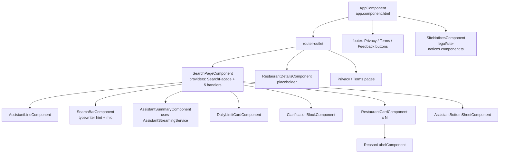
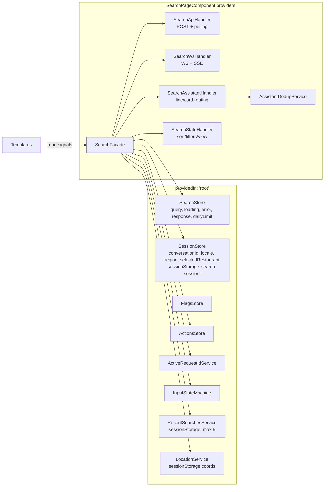

# 03 — Frontend (`llm-angular/`)

> Scope: the Angular single-page app that hosts the **going2eat** natural-language restaurant search. It is based on the code at branch `refactor/phase-1-hygiene` (2026-10-05). When code and the older `.md` files disagree, this document follows the code and calls out the conflict.

---

## TL;DR

- **What it is:** an Angular **19.2** standalone-component SPA. Its main screen is `/search`: the user types or speaks a free-text food query, gets restaurant cards, and sees an AI "assistant" summary or clarification streamed in alongside. All routes lazy-load. The one real page is `SearchPageComponent`.
- **State:** Angular **signals** throughout. There are root stores (`state/*.store.ts`) and a component-scoped `SearchFacade` that delegates to 4 handlers (API/polling, WS, assistant, UI state). RxJS is used only at the HTTP/WS/SSE edges.
- **Search transport:** `POST /api/v1/search?mode=async` returns **202** `{requestId, resultUrl}`. The client then does three things in parallel: (1) subscribes to the **WebSocket** `search` channel (ticket-auth), (2) opens an **SSE** stream `GET /api/v1/stream/assistant/:requestId` for assistant narration, and (3) starts **polling** `GET /search/:id/result` as a fallback after 2.5 s.
- **Auth:** "dual" mode. An anonymous **JWT** is kept in `localStorage` and sent as a Bearer token, plus an HttpOnly **session cookie** (`POST /auth/session`), plus an `x-session-id` header. The WS uses a one-time **ticket** from `POST /auth/ws-ticket`.
- **i18n:** a hand-rolled dictionary for 9 languages (`he, en, ru, ar, fr, es, de, it, am`). RTL is set on `<html dir>` for `he`/`ar`. The UI language can follow the backend's detected `uiLanguage`.
- **Hosting:** AWS **Amplify** (`amplify.yml`) serves `llm-angular/dist/llm-angular/browser`. The API is `https://api.going2eat.food` for both dev and prod builds.
- **Biggest risks:**
  1. The **unit-test suite is red**: 30 of 51 suites and 281 of 681 tests fail. Statement coverage is about 41%.
  2. A **stale copy of the backend** sits inside `llm-angular/src/`, and Jest picks up its 72 tests.
  3. The **"PWA/offline" claims are false**. `public/ngsw-worker.js` is a *kill-switch* that unregisters itself, and `ngsw-config.json` is unused.
  4. **Leaflet and Tailwind ship but are effectively unused.** There is no map in the UI.
  5. **Much dead code**: about 15 unused components and services, a POC page that calls OpenAI from the browser, and API clients for endpoints the server does not expose.
  6. **Polling timeout fails silently**: after 45 s it stops without surfacing an error, so the spinner can hang.
  7. **Heavy console logging in production** (117 `console.log` calls plus an ungated `safeLog`), including user coordinates.

---

## Table of contents

1. [Purpose](#1-purpose)
2. [Tech stack](#2-tech-stack)
3. [Run, build, test](#3-run-build-test)
4. [Folder structure](#4-folder-structure)
5. [Routing](#5-routing)
6. [Pages, features and components](#6-pages-features-and-components)
7. [State management](#7-state-management)
8. [API layer and backend contracts](#8-api-layer-and-backend-contracts)
9. [i18n, RTL and Hebrew](#9-i18n-rtl-and-hebrew)
10. [Analytics](#10-analytics)
11. [PWA, service worker and caching](#11-pwa-service-worker-and-caching)
12. [Styling system](#12-styling-system)
13. [Testing](#13-testing)
14. [Build output and deployment](#14-build-output-and-deployment)
15. [Performance notes](#15-performance-notes)
16. [Issues, tech debt and risks](#16-issues-tech-debt-and-risks)
17. [Recommended next steps](#17-recommended-next-steps)

---

## 1. Purpose

The frontend is a thin, mobile-first client for the "food orchestrator" backend:

- It takes a **free-text query** (typed, or dictated via the Web Speech API in `llm-angular/src/app/core/services/speech-to-text.service.ts`) and the user's **geolocation** (`llm-angular/src/app/services/location.service.ts`).
- It sends both to the backend, which runs the LLM pipeline and Google Places.
- It renders **restaurant cards** with open/closed status, rating, distance, photos (proxied through the backend), Navigate/Call actions, and delivery-provider deep links (Wolt / 10bis / Mishloha).
- It shows the **assistant** output: a progress "line", a streamed SUMMARY card, CLARIFY questions, or GATE_FAIL messages.
- It handles the **missing-location** flow (ask permission, then auto-resume the search), a **daily limit** notice, and **tracked entry links** (`/q`, `/p/:prefix`) for QR codes and partner analytics.

The brand is "going2eat" (`llm-angular/src/index.html`, `llm-angular/public/manifest.webmanifest`).

## 2. Tech stack

Source: `llm-angular/package.json`.

| Area | Choice | Version | Notes |
|---|---|---|---|
| Framework | Angular (standalone, no NgModules) | `^19.2.0` (CLI `^19.2.15`) | `bootstrapApplication` in `llm-angular/src/main.ts` |
| Reactivity | Angular signals (`signal`, `computed`, `effect`, `input()`, `output()`) | — | 36 signal `input/output` usages vs 25 legacy `@Input/@Output` |
| Change detection | zone.js `~0.15.0` + `provideZoneChangeDetection({eventCoalescing:true})` | — | 16 components are `OnPush` |
| Async | RxJS `~7.8.0` | — | HTTP, WS stream, SSE Observable |
| Language | TypeScript `~5.7.2`, `strict` + `strictTemplates` | — | `llm-angular/tsconfig.json` (extends `../tsconfig.base.json`) |
| Builder | `@angular-devkit/build-angular:application` (esbuild) | `^19.2.15` | `llm-angular/angular.json` |
| Styling | SCSS per component + global tokens; Tailwind **3.4** wired but barely used | `tailwindcss ^3.4.17` | see [§12](#12-styling-system) |
| Maps | `leaflet ^1.9.4`, `@types/leaflet` | — | **Only the CSS is imported; no map exists in code** |
| Typewriter | `ngx-typed-js ^2.1.1` | — | **Unused**; the search bar has its own typewriter |
| PWA | `@angular/service-worker ^19.2.14` | — | **Not registered**; see [§11](#11-pwa-service-worker-and-caching) |
| Unit tests | Jest `^29.7` + `jest-preset-angular ^14.6` + jsdom | — | Karma/Jasmine deps are still installed (legacy) |

## 3. Run, build, test

### npm scripts (`llm-angular/package.json`)

| Script | Command | Port | Environment file | API target |
|---|---|---|---|---|
| `npm start` / `npm run local` | `ng serve --port 4200 --proxy-config proxy.conf.json` | 4200 | `environment.ts` (config `local`, the default) | same origin, proxied to `127.0.0.1:3000` |
| `npm run dev` / `npm run aws` | `ng serve --port 4201 --configuration=development …` | 4201 | `environment.development.ts` | `https://api.going2eat.food` (absolute, **proxy ignored**) |
| `npm run prod` | `ng serve --configuration=production …` | 4200 | `environment.production.ts` | `https://api.going2eat.food` |
| `npm run build` / `build:prod` | `ng build --configuration=production` | — | production | — |
| `npm run build:dev` | `ng build --configuration=development` | — | development | — |
| `npm test` | `jest --watch` | — | — | — |
| `npm run test:ci` | `jest --ci --coverage` | — | — | — |
| `serve-coverage` | coverage, then `serve coverage/lcov-report -l 5530` | 5530 | — | — |
| `prev-secondery` (sic) | `jest --ci && serve reports -l 5520` | 5520 | — | — |

### Dev proxy (`llm-angular/proxy.conf.json`)

- `/api` goes to `http://127.0.0.1:3000`.
- `/ws` goes to `http://127.0.0.1:3000` with `ws: true`.

The local environment sets `apiUrl: ''` and `wsBaseUrl: 'ws://localhost:4200'`, so both HTTP and WS go through the proxy. The WS port is **hard-coded to 4200**, so serving the local config on another port breaks the WebSocket.

### Environments (`llm-angular/src/environments/`)

| File | `apiUrl` | `wsBaseUrl` | `authMode` | `features.useSseAssistant` |
|---|---|---|---|---|
| `environment.ts` (local) | `''` | `ws://localhost:4200` | `dual` | `true` |
| `environment.development.ts` | `https://api.going2eat.food` | `wss://api.going2eat.food` | `dual` | `true` |
| `environment.production.ts` | `https://api.going2eat.food` | `wss://api.going2eat.food` | `dual` | `true` |

- `environment.production.ts` throws at build/load time if the URLs contain `localhost` or are not `https`/`wss`.
- **dev and prod point at the same API host**, so there is no separate staging backend from the frontend's point of view.
- `angular.json` has three build configurations: `production` (budgets, hashing, file replacement), `development` (source maps, file replacement), and `local` (default, no replacement).
- `llm-angular/src/index.html` documents a `window.__API_BASE_URL__` runtime override, but **no code reads it**. It is dead documentation.

### Feature-flag overrides

At startup `GET /api/v1/flags` fills `FlagsStore`, which you can override per key with `localStorage['ff_<key>'] = 'true'|'false'` (`llm-angular/src/app/app.config.ts`). Today, no route or template reads the flags; `featureFlagGuard` is defined but never used.

## 4. Folder structure

```
llm-angular/
├─ angular.json, proxy.conf.json, ngsw-config.json (unused), jest.config.ts, setup-jest.ts
├─ tailwind.config.js (v3 config) + tailwind.config.ts (empty duplicate), postcss.config.js
├─ public/                     static assets copied as-is: icons, logo, manifest, ngsw-worker.js (kill-switch)
├─ shared/api/*.dto.ts         legacy DTOs (food/chat/order), consumed by the *server* via the @api path alias
├─ src/
│  ├─ main.ts, index.html, styles.scss, environments/
│  ├─ app/                      <<< THE FRONTEND
│  │  ├─ app.component.*, app.config.ts, app.routes.ts, main.ts (duplicate bootstrap, unused)
│  │  ├─ api/                   thin HttpClient clients (search, flags, session*, actions*)
│  │  ├─ contracts/             search_contracts_v1 WS/HTTP types
│  │  ├─ core/                  auth, interceptors, guards, WS client, SSE, i18n, language, speech
│  │  │  ├─ auth/auth.service.ts
│  │  │  ├─ interceptors/       auth, timeout+retry, error
│  │  │  ├─ models/             ws-protocol.types, async-search.types, ws-close-reasons
│  │  │  ├─ services/ws/        ws-connection (lifecycle), ws-subscriptions, ws-router, ws-types
│  │  │  └─ qr-entry.ts         tracked-entry (/q, /p/:prefix) helpers
│  │  ├─ domain/types/          Restaurant, SearchResponse, actions, card state
│  │  ├─ facades/               SearchFacade + handlers (api, ws, assistant, state), dedup, dev-tools
│  │  ├─ features/
│  │  │  ├─ unified-search/      search-page/, components/ (13), daily-limit/, services/, config/
│  │  │  ├─ restaurant-details/  /r/:placeId placeholder
│  │  │  └─ evaluate-poc/       unrouted OpenAI POC (see §16)
│  │  ├─ legal/                 privacy/terms pages + site-notices modal (privacy/terms/feedback)
│  │  ├─ services/              location, analytics, landing-open-log, result-action-log, PWA install, recent searches, input state machine, actions
│  │  ├─ shared/                api.config (ENDPOINTS), api-session interceptor, error mapper, safe-logger, misc
│  │  ├─ state/                 SearchStore, SessionStore, FlagsStore, ActionsStore, ActiveRequestIdService
│  │  └─ utils/                 distance, photo-src, provider-url-builder, wolt-deeplink
│  └─ controllers/ services/ infra/ lib/ llm/ middleware/ config/ routes/ search-async/
│     server.ts app.ts utils/ contracts/ scripts/ controllers.zip
│                               <<< STALE DUPLICATE OF BACKEND CODE — NOT FRONTEND (321 files)
├─ docs/, *.md (≈20 root notes)  historical notes; several are stale (see §16)
├─ coverage/ (Aug 2025, stale), reports/ (jest-html-reporters, tracked in git), dist/, front.zip
```

> **Known issue:** `llm-angular/src/` contains a duplicated, outdated copy of the Node/Express server (`src/server.ts`, `src/app.ts`, `src/controllers/**`, `src/services/**`, `src/infra/**`, `src/lib/**`, `src/llm/**`, `src/middleware/**`, …, 321 files plus `src/controllers.zip`). The Angular build ignores it, because `tsconfig.app.json` compiles only from `src/main.ts`. **Jest and Tailwind's content glob do not ignore it.** It is not documented here; see the backend docs for the real server under `server/`.

## 5. Routing

Source: `llm-angular/src/app/app.routes.ts`. Every route uses `loadComponent` (lazy). There are no guards or resolvers.

| Path | Component | Purpose |
|---|---|---|
| `''` | redirect → `search` | |
| `search` | `SearchPageComponent` | main experience |
| `q` | `SearchPageComponent` | **tracked QR entry**: entry id `qr` |
| `p/:prefix` | `SearchPageComponent` | **tracked partner entry**: entry id `p:<prefix>`. The prefix must match `^[a-z0-9][a-z0-9-]{0,23}$` (`core/qr-entry.ts`) |
| `search-preview` | `SearchPageComponent` | legacy alias (old "preview" route; `run.ps1` still refers to it) |
| `r/:placeId` | `RestaurantDetailsComponent` | **placeholder**: shows only the place id. Invalid ids (not `^[a-zA-Z0-9_-]+$`) redirect to `/search` |
| `privacy`, `terms` | `PrivacyPageComponent`, `TermsPageComponent` | static legal pages (`legal/`) |
| `**` | redirect → `search` | |

> Note: the route parameter is named `:prefix` in code. Commit messages and some notes call it `/p/:name`.

**Tracked entry links** (`SearchPageComponent.ngOnInit`, `llm-angular/src/app/features/unified-search/search-page/search-page.component.ts`):

1. The entry is derived from `routeConfig.path` (`q` gives `qr`; `p/:prefix` gives `p:<prefix>`).
2. `rememberSearchEntry()` stores it in `sessionStorage['g2eEntry']`.
3. `LandingOpenLogService.track()` POSTs `{event:'landing_open', data:{entry}}` to `/analytics/events`. It does this **once per entry per tab**, using `sessionStorage['g2eLandingSent']` (`services/landing-open-log.service.ts`).
4. Every subsequent search sends `entry: currentSearchEntry()` in the POST body (`facades/search.facade.ts`).

**Query params:** an old `?q=…&openNow=&price=&dietary=&sort=&lat=&lng=` link restores the input box, sort, and filter chips **without running a search** (`search-params.util.ts`). The params are then stripped from the URL with `router.navigate([], {queryParams:{}, replaceUrl:true})`, so the current URL is never shareable or deep-linkable for a search.

## 6. Pages, features and components

### Component tree (as actually rendered)



### Key pieces

| Component / file | Responsibility |
|---|---|
| `features/unified-search/search-page/search-page.component.{ts,html,scss}` (826 / 305 / 1115 lines) | Hero (logo, "about" lines, collapse-on-scroll with hysteresis in `hero-collapse.ts`), location toggle and tooltip, search bar, assistant summary toggles (contextual vs global), recent searches, loading/error/daily-limit/clarify/recovery states, filter-enforcement sections (`hard/soft/hint/not_applied` from `filter-enforcement.util.ts`), result list with "show more" (`visibleCount` starts at 10), pending-action panel. It also contains the localized **missing-location** copy (he/ar/ru/en, chosen by the script of the query). |
| `components/search-bar/*` | Input with an animated typewriter placeholder (custom, signal-driven), clear button, and **voice input** via `SpeechToTextService` (Web Speech API). |
| `components/restaurant-card/*` (TS 1047 lines, SCSS 672) | Signal inputs `restaurant` (required), `selected`, `isTopResult`, `showReasonLabel`, `compact`, `userLocation`; outputs `cardClick` and `actionClick`. Renders photo (`utils/photo-src.util.ts`, which uses only `photoReference` and goes through `/api/v1/photos/places/…`), open/closed and hours (`shared/utils/time-formatter.ts`), rating and social-proof tags, dietary chips, distance (`utils/distance.util.ts`), Navigate (Google Maps `query_place_id` URL), Call, website, and provider buttons (`utils/provider-url-builder.util.ts`, `utils/wolt-deeplink.util.ts`). Clicks are logged by `ResultActionLogService`. |
| `components/assistant-line/*` | Single status line for the "line" channel (PRESENCE / WS_STATUS / PROGRESS). |
| `components/assistant-summary/*` + `services/assistant-streaming.service.ts` + `config/assistant-streaming.config.ts` | Card-channel messages (SUMMARY / CLARIFY / GATE_FAIL) with a client-side "typing" reveal; `cap-assistant-text.ts` caps the length. |
| `components/clarification-block/*` | Renders `response.clarification` choices; a choice re-runs the search with `constraintPatch`. |
| `components/assistant-bottom-sheet/*` | Mobile bottom sheet for the contextual assistant. |
| `daily-limit/*` | Daily model-call limit card; `isDailyModelLimit()` detects the condition from the error code or message. |
| `legal/site-notices.component.ts` | Modal for privacy/terms/feedback. Feedback POSTs `{mood, note}` to `/api/v1/feedback`. It sets `localStorage['g2e-notices-seen']` **without try/catch**, unlike the rest of the codebase. |
| `features/restaurant-details/*` | Stub page (placeId only). |

**There is no map view.** `SearchStateHandler` still has a `'MAP'` view state (`facades/search-state.facade.ts`), but no Leaflet code exists in `src/app`. Older docs (e.g. `llm-angular/AMPLIFY_SETUP.md`: "leaflet … used by map component", `docs/refactor-two-routes-with-map`) describe a map that has since been removed.

**Unused components and services** (not referenced by any template or route): `AssistantPanelComponent`, `AssistantDesktopPanelComponent`, `AssistantStripComponent`, `AssistantBottomPlaceholderComponent`, `GroupedResultsComponent`, `RankedResultsComponent`, `DisclosureBannerComponent`, `WsStatusBannerComponent` (`shared/components/`), `CurrencyIlsPipe`, `PrefsService`, `DialogueApiService`, `PlacesApiService`, `SessionApiClient`, `ActionsApiClient`, `Http401RetryService`, `SessionBootstrapService`, `featureFlagGuard`, `EvaluatePocComponent`, plus `search-page.component_old.html`, `src/app/main.ts`, and `src/app/_contract.smoke.ts`.

## 7. State management

The pattern is **signal stores plus a component-scoped facade**. There is no NgRx.



- **Stores** (`llm-angular/src/app/state/`) keep private `signal`s, expose `asReadonly()` and `computed` views, and offer explicit mutators. `SearchStore` derives `results`, `chips`, `meta`, `groups` (`EXACT`/`NEARBY`), and `clarification` from one `response` signal, and has `patchRestaurant()` for WS `RESULT_PATCH`.
- **`SearchFacade`** (`facades/search.facade.ts`, 881 lines) is the orchestrator. It owns `currentRequestId`, a **card state machine** `RUNNING → CLARIFY | STOP` (`domain/types/search-card-state.types.ts`), the missing-location auto-resume (`pendingLocationResume`), and the side effects of terminal assistant messages. Because it is provided **per page instance**, its WebSocket connection starts in the constructor (`wsHandler.connect()`).
- **Stale-event protection:** before each search it clears the store and assistant, unsets `currentRequestId`, and drops all WS subscriptions. Responses are then ignored unless `requestId === currentRequestId()` and `query === store.query()`. SSE events are ignored unless `ActiveRequestIdService.activeRequestId() === requestId`.
- **Assistant routing** (`facades/assistant-routing.types.ts`, `search-assistant.facade.ts`): message types are split into a **line** channel (PRESENCE, WS_STATUS, PROGRESS) and a **card** channel (SUMMARY, CLARIFY, GATE_FAIL), with deduplication. `assistant-dev-tools.ts` is **imported unconditionally** by the search page and registers `window.assistantDevTools` in production.
- **Persistence:**
  - `localStorage`: JWT `g2e_jwt`, session id `api-session-id`, `ff_*` flags, `favorites`, `g2e-notices-seen`.
  - `sessionStorage`: session store, recent searches, location, entry tracking.

## 8. API layer and backend contracts

### Endpoint map

All URLs are built from `API_BASE = environment.apiUrl + '/api/v1'` (`shared/api/api.config.ts`).

| Call site | Method + path | Purpose | Server exists? |
|---|---|---|---|
| `core/auth/auth.service.ts` | `POST /auth/token` (body `{sessionId?}`) | Get an anonymous JWT and `sessionId` | yes |
| `core/auth/auth.service.ts` | `POST /auth/session` (Bearer, `withCredentials`) | Set the HttpOnly session cookie | yes |
| `core/services/auth-api.service.ts` | `POST /auth/ws-ticket` | One-time WS ticket (retries 503 `WS_TICKET_REDIS_NOT_READY` up to 3×, and 401 once) | yes |
| `api/flags.api.ts` | `GET /flags` | Feature flags (falls back to `{unifiedSearch:false, actionProposals:false}`) | yes |
| `api/search.api.ts` | `POST /search?mode=async` | Start a search: **202** `{requestId,resultUrl,contractsVersion}` or a **200** sync `SearchResponse` | yes |
| `facades/search-api.facade.ts` | `GET /search/:requestId/result` | Poll: 202 `PENDING`, 200 done, `FAILED` body, or 404 (expired) | yes |
| `core/services/assistant-sse.service.ts` | `GET /stream/assistant/:requestId` (`fetch`, `text/event-stream`) | Assistant narration stream | yes |
| WS `wss://…/ws?ticket=…` | subscribe `{channel:'search'\|'assistant', requestId, sessionId}` | Progress, ready, results, patches | yes |
| `utils/photo-src.util.ts` | `GET /photos/places/:placeId/photos/:photoId?maxWidthPx=` | Photo proxy (used as an ``) | yes |
| analytics / landing / result-action services | `POST /analytics/events` | Telemetry | yes |
| `legal/site-notices.component.ts` | `POST /feedback` | Feedback | yes |
| `shared/services/dialogue-api.service.ts`, `places-api.service.ts`, `api/session.api.ts`, `api/actions.api.ts` | `/dialogue*`, `/chat`, `/places/search`, `/session*`, `/actions*` | Legacy | **no**: not mounted in `server/src/routes/v1/index.ts`; the clients are also unused |
| `ENDPOINTS.WS_TICKET` | `/ws-ticket` | — | **wrong path** (the server uses `/auth/ws-ticket`); the constant is unused, but it is a trap |

Contract types live in `llm-angular/src/app/contracts/search.contracts.ts` (`search_contracts_v1`), `core/models/async-search.types.ts`, `core/models/ws-protocol.types.ts`, and `domain/types/search.types.ts`. These are **hand-copied** from the server; nothing shares them or checks them against it. `async-search.types.ts` uses `status:'PENDING'|'FAILED'`, while `search.contracts.ts` uses `status:'running'|'done'`. The two do not agree, and the facade checks only for `'FAILED'` and the presence of `results`.

### Search sequence (async 202 + WS + SSE + polling)

```mermaid
sequenceDiagram
  autonumber
  participant U as User
  participant P as SearchPage / SearchFacade
  participant API as API (api.going2eat.food/api/v1)
  participant WS as WebSocket /ws
  participant SSE as SSE /stream/assistant
  U->>P: submit query
  P->>P: clear store, assistant, WS subs; cardState=RUNNING
  P->>API: POST /search?mode=async {query, filters, sessionId, userLocation, clearContext, locale, entry}
  API-->>P: 202 {requestId, resultUrl}
  P->>WS: ensure connected (JWT → POST /auth/ws-ticket → wss://…/ws?ticket=…)
  P->>WS: {subscribe, channel:'search', requestId, sessionId}
  P->>SSE: fetch GET /stream/assistant/:requestId (cookie + Bearer)
  P->>P: schedule polling after 2.5s
  SSE-->>P: meta → narration → delta* → message(SUMMARY|CLARIFY|GATE_FAIL|SEARCH_FAILED) → done
  WS-->>P: progress(stage) … ready{ready: results|ask|stop}
  alt WS ready=results/ask
    P->>API: GET /search/:id/result
    API-->>P: 200 SearchResponse
    P->>P: cancel polling
  else WS SEARCH_RESULTS
    WS-->>P: results inline → handleSearchResponse
  else WS silent / degraded
    loop every ~1.4s (±200ms), 4s after 12s, max 45s
      P->>API: GET /search/:id/result
    end
  end
  WS-->>P: RESULT_PATCH {placeId, providers} (Wolt/10bis/Mishloha enrichment)
  P->>U: cards + assistant; if meta.requestLocationPermission → ask geolocation → auto re-search
```

The polling timings come from `DEFAULT_POLLING_CONFIG` in `facades/search.facade.types.ts`: `delayMs 2500, fastIntervalBase 1400, fastJitter 200, slowInterval 4000, backoffAt 12000, maxDuration 45000`.

### WebSocket details

Sources: `core/services/ws-client.service.ts` and `core/services/ws/*`.

- `WSConnection` fetches a **fresh one-time ticket for every connect attempt** and puts it in the query string; it logs the URL with the ticket masked.
- If the ticket response has `wsAvailable:false`, the client runs in **degraded** mode and relies on polling and SSE.
- Reconnection uses exponential backoff starting at 250 ms, capped at 5 s, with ±25% jitter and a maximum of 10 attempts. 401/503 and "hard" close reasons (`core/models/ws-close-reasons.ts`) stop reconnection.
- `ws-subscriptions.ts` queues subscribes while disconnected and re-subscribes to the last `requestId` on reconnect.
- `features.useSseAssistant = true` in every environment, so the WS `assistant` channel is not subscribed and assistant text comes from SSE. The WS assistant code path is still there as a fallback (`facades/search-ws.facade.ts`).

### Auth and session

There are three mechanisms, all active in `authMode: 'dual'`:

1. **JWT.** `AuthService.getToken()` fetches from `/auth/token`, caches it in a signal and in `localStorage['g2e_jwt']`, treats it as expired 30 s early, and de-duplicates concurrent fetches. `authInterceptor` attaches `Authorization: Bearer` to every `/api/` request except `/auth/token` and `/auth/bootstrap`, and refreshes once on 401.
2. **Session cookie.** After a token is obtained, `POST /auth/session` with `withCredentials` sets an HttpOnly cookie. The SSE `fetch` uses `credentials:'include'` **and** a Bearer token, because a raw `fetch` bypasses interceptors.
3. **`x-session-id` header.** `apiSessionInterceptor` (`shared/http/api-session.interceptor.ts`) adds it and forces `withCredentials:true` on every API call.

`APP_INITIALIZER`s in `app.config.ts` run in this order: (a) `authService.getToken()`, which does not block on failure; (b) sync the locale from the browser language; (c) load flags. That means every cold start makes two to three round-trips (`/auth/token`, `/auth/session`, `/flags`) before the first search.

The interceptor chain, in order, is `authInterceptor → apiSessionInterceptor → httpTimeoutRetryInterceptor (20 s timeout, 1 retry on status 0/5xx after 300 ms) → httpErrorInterceptor`. The retry also applies to **non-idempotent `POST /search`**: a 5xx after the job has been accepted could start a second pipeline run, unless the server's idempotency-key logic de-duplicates it.

`cookie_only` mode (no JWT, no `x-session-id`) exists behind `environment.authMode` but is not enabled anywhere. The notes `AUTH_MODE_*.md` and `COOKIE_ONLY_*.md` in the `llm-angular/` root describe it.

## 9. i18n, RTL and Hebrew

- **No Angular i18n / `$localize`.** `core/services/i18n.service.ts` (824 lines) holds a typed `I18nKeys` dictionary for `he | en | ru | ar | fr | es | de | it | am`, mostly restaurant-card strings, plus a `t()` lookup.
- `core/services/language.service.ts` picks the initial language from `navigator.language`. It can override that from a **keyboard-layout sample**, where available, for Hebrew, Arabic or Russian (`keyboard-language.ts`). It sets `<html lang>` and `<html dir>` (`rtl` for `he` and `ar`) and exposes `textDirection` as a signal.
- **Server-driven language:** when a response carries `query.parsed.languageContext.uiLanguage`, `SearchFacade.handleSearchResponse` switches the UI language to match (`facades/search.facade.ts`).
- Several strings are **detected from the query's script** rather than taken from the UI language:
  - missing-location copy (`missingLocationCopy()` in `search-page.component.ts`)
  - daily-limit copy (`daily-limit/daily-limit-copy.ts`)
  - hero lines (`search-page/hero-about.ts`)
  - the search-bar hint direction
- **Not localized:** footer buttons, legal pages, the site-notices modal (English only), and many error strings in the facades ("Unable to connect to server…", "Search expired - please retry").
- The supported language list is defined three times: `SupportedUiLang`, `SupportedLang`, and `SessionStore.isSupportedLocale`.

## 10. Analytics

Every event goes to `POST /api/v1/analytics/events` as fire-and-forget, and errors are swallowed.

| Service | Event | Payload |
|---|---|---|
| `services/landing-open-log.service.ts` | `landing_open` | `{entry}` (`qr` or `p:<prefix>`), once per tab |
| `services/result-action-log.service.ts` | `result_action` | `{action: open\|navigate\|call\|wolt\|tenbis\|mishloha, name (≤80 chars), requestId}` |
| `services/analytics.service.ts` | generic `track/trackError/trackTiming` | adds timestamp, `conversationId`, `userAgent`, locale, region; sends `stack` because `isProduction` is hard-coded to `false` (`// TODO`) |
| search body | `entry` | attribution of searches to tracked links |

There is no third-party analytics SDK. Outside its spec, only `services/action.service.ts` uses `AnalyticsService`, for the action-proposal flow.

## 11. PWA, service worker and caching

**The current state contradicts `llm-angular/README.md`**, which claims "offline app shell" and "service worker caching".

- `@angular/service-worker` is a dependency, but **`provideServiceWorker` is not called** and `angular.json` has no `serviceWorker` option. `llm-angular/ngsw-config.json` (prefetch app, lazy assets, `navigationRequestStrategy: performance`) is **not used** by the build.
- `llm-angular/public/ngsw-worker.js` is a hand-written **kill-switch**. On activate it deletes every `ngsw:*` cache, unregisters itself, and reloads open windows. It exists to clean up clients that installed an older Angular SW. It only takes effect for browsers that still have a registration pointing at `/ngsw-worker.js`.
- **Installability** comes only from `public/manifest.webmanifest` (`display: standalone`, theme `#f26522`, icons 192/512) and `services/pwa-install.service.ts`, which captures `beforeinstallprompt` and exposes `canInstall`/`isInstalled` signals. Without a fetch handler, some browsers will not offer install. The `public/icons/icon-*x*.png` set is not referenced by the manifest.
- **HTTP caching** is set in `amplify.yml`:
  - `**/*.js|css`: 1 year `immutable`.
  - images: 7 days.
  - `index.html`, `ngsw-worker.js`, `ngsw.json`, `safety-worker.js`: `no-cache, no-store`.
  - manifest: 1 h.

## 12. Styling system

- **Component SCSS** is the real styling system. `search-page.component.scss` is 1115 lines and `restaurant-card.component.scss` is 672. Production budgets warn at 12 kB and fail at 20 kB per component style (`angular.json`).
- **Global:**
  - `src/styles.scss` holds CSS custom properties (`--bg, --card, --text, --muted, --border, --ring, --radius, --space`) and `min-height: 100dvh` for Android PWA keyboards.
  - Brand orange `#f26522` appears in `index.html` and the manifest.
  - `tailwind.config.js` defines `primary: #ff6b35`, a **different orange**.
- **Tailwind** (`@tailwind base/components/utilities` in `styles.scss`):
  - In practice only **Preflight** (the CSS reset) is in effect. About 1 of 344 `class="…"` attributes in `src/app/**/*.html` uses a Tailwind utility, and there is no `@apply`.
  - There are two configs: `tailwind.config.js` (v3, content `./src/**/*.{html,ts}`, which also scans the stale server copy) and an empty `tailwind.config.ts`.
  - `@tailwindcss/postcss` v4 is installed alongside `tailwindcss` v3.
  - The Angular application builder reads only `postcss.config.json` or `.postcssrc.json`, so `postcss.config.js` is most likely ignored. Tailwind is picked up automatically through `tailwind.config.*`.
- `@import "leaflet/dist/leaflet.css"` pulls Leaflet CSS and three marker/layer PNGs (`dist/llm-angular/browser/media/`) into every build, for a map that does not exist.
- RTL is handled through `[attr.dir]` and `.rtl` classes in about 10 template spots, plus `<html dir>`.

## 13. Testing

- **Runner:** Jest 29 with `jest-preset-angular`, the jsdom environment, and zone setup from `setup-jest.ts`. Styles are mocked by `__mocks__/styleMock.js`. Reporters are `default` and `jest-html-reporters`, which writes to `reports/`. **`reports/` is tracked in git**, so every test run dirties the tree; `reports/jest-html-reporters-attach/index/result.js` is modified in the current working tree.
- The Karma `test` target in `angular.json` and the karma/jasmine devDependencies are leftovers; `ng test` is not the supported path.
- There are **51 spec files** under `src/app`, covering stores, utils, facades, the search page (many scenario specs), the restaurant card, and the WS facade. Nothing tests `SearchFacade` + WS + SSE together against a real or mock server, and there is **no e2e** (no Playwright or Cypress).
- **Measured state (2026-10-05).** Command: `npx jest --ci --roots "<rootDir>/src/app" --coverage`.

| Metric | Value |
|---|---|
| Test suites | **30 failed / 21 passed / 51** |
| Tests | **281 failed / 400 passed / 681** |
| Statements | 41.2% (1872/4539) |
| Branches | 25.7% |
| Functions | 37.5% |
| Lines | 41.0% |
| Wall time | ~2 min |

Main failure causes, from sampled suites:

1. **Jasmine APIs in Jest specs.** `ReferenceError: jasmine is not defined` in 11 spec files that use `jasmine.createSpyObj`.
2. **Missing providers.** `NullInjectorError: No provider for HttpClient` in `app.component.spec.ts`.
3. **Stale expectations.** Examples: `/api/flags` instead of `/api/v1/flags` in `api/flags.api.spec.ts`, and absolute `http://localhost:3000` photo URLs in `utils/photo-src.util.spec.ts`.
4. **Specs for removed UI**, such as the MAP/LIST view and sort chips in `search.facade.spec.ts`.

- **`npm run test:ci` without `--roots` also picks up 72 `*.test.ts` files from the stale server copy in `src/`**, because `jest.config.ts` has no `roots`/`testMatch`. Those depend on server-only modules.
- `coverage/` is from **Aug 2025** and does not reflect current code.

## 14. Build output and deployment

- `ng build --configuration=production` writes to `llm-angular/dist/llm-angular/browser/` (application builder; `prerendered-routes.json` is empty, so there is no SSR or prerender).
- **Last local build (2026-09-30):**
  - initial JS: `main` ~13.5 kB, two preloaded shared chunks ~10 kB and ~254 kB, `polyfills` ~35 kB, `styles` ~18 kB (critical CSS inlined, rest loaded async).
  - The lazy search-page chunk is ~269 kB.
  - Total output is ~1.1 MB including images.
- **Amplify** (`/amplify.yml` at the repo root):
  - `cd llm-angular`, `npm ci`, `npm run build:prod`.
  - Artifacts: `llm-angular/dist/llm-angular/browser/**/*`.
  - `node_modules` is cached, and custom cache headers are set as in §11.
  - `amplify.yml` has **no SPA rewrite rule**. Deep links such as `/q`, `/p/cafe`, `/privacy` and `/r/…` depend on a rewrite-to-`index.html` rule configured in the Amplify console. Verify that it exists, because the QR/partner links rely on it.
- The API runs on a separate origin (`api.going2eat.food`), so the backend must allow CORS **with credentials** from the Amplify domain, and the session cookie must be `SameSite=None; Secure`. That is a backend concern; see the infra/backend docs.
- A build marker is printed on startup: `console.log('[BUILD]', '2026-01-25 ws-ticket-fix v4')` in `app.component.ts`. It is stale and hard-coded.
- `llm-angular/front.zip` (130 kB) and `llm-angular/src/controllers.zip` (124 kB) are committed archives.

## 15. Performance notes

- **Good:**
  - All routes are lazy.
  - `OnPush` on the page and most components.
  - Signals avoid zone churn.
  - `@for … track` everywhere.
  - "Show more" pagination (10 at a time).
  - Critical CSS is inlined.
  - Polling has jitter and backoff, and is cancelled as soon as the WS delivers.
- **Startup latency:** three blocking `APP_INITIALIZER`s, and two of them do network I/O (`/auth/token`, then `/flags`; the `/auth/session` cookie call runs in the background). The flags are not used for anything today, so their fetch is pure cost on the critical path.
- **Assistant latency coupling:** the SSE stream opens only **after** `ensureConnected()` for the WS returns (`search-ws.facade.ts` `subscribeToRequest`). A slow ticket fetch (up to 3 × 503 retries) therefore delays assistant text and the start of polling.
- **Images:**
  - `public/going2eat-logo.png` (177 kB) is the hero LCP image on every visit.
  - `icon-512.png` is 128 kB.
  - There is no WebP/AVIF and no `width`/`height` or `fetchpriority` on the logo ``.
- **Dead weight in the bundle:** Leaflet CSS and images, Tailwind Preflight, `assistant-dev-tools`, and very verbose logging. `safeLog` (`shared/utils/safe-logger.ts`) is not gated on `environment.production`, and there are 117 raw `console.log` calls in `src/app`.
- The restaurant card (1047 lines of TS) computes many derived values per card. With large result lists, consider moving them to `computed` signals per card (several already are) and profiling.

## 16. Issues, tech debt and risks

Severity: **H** high, **M** medium, **L** low.

| # | Sev | Issue | Where |
|---|---|---|---|
| 1 | H | **Test suite red.** 30/51 suites and 281/681 tests fail, and CI cannot gate on tests. Root causes: Jasmine APIs, missing providers, and stale URLs/expectations. | `src/app/**/*.spec.ts`, `jest.config.ts` |
| 2 | H | **Stale backend copy inside the frontend `src/`** (321 files, 72 tests, `controllers.zip`). It confuses tooling (Jest, Tailwind content scan, IDE search) and developers. The server also imports `@api` types from `llm-angular/shared/api` (`server/src/controllers/schemas.ts`, via `tsconfig.base.json`), which couples the two packages in reverse. | `llm-angular/src/{controllers,services,infra,lib,llm,…}`, `llm-angular/shared/` |
| 3 | H | **Polling max-duration ends silently.** After 45 s, `startPolling` calls `cancelPolling()` without `onError`. If the WS is also down or degraded, `loading` stays `true` and the spinner never ends. | `facades/search-api.facade.ts` (`pollingTimeoutId` callback) |
| 4 | M | **The browser POC can call OpenAI with a user-supplied key.** It is not routed, but it ships in source and could be wired up by mistake. Delete it. | `features/evaluate-poc/evaluate-poc.component.ts` |
| 5 | M | **PWA documentation is wrong.** No service worker is registered, and `ngsw-config.json` is dead. The kill-switch worker in `public/` must stay until old clients are cleaned up; a decision on a real SW strategy is pending. | `README.md`, `ngsw-config.json`, `public/ngsw-worker.js` |
| 6 | M | **Production logging.** `safeLog`/`console.log` run in prod and log request ids, session id prefixes, and **user lat/lng** (`location_permission_granted` in `search.facade.ts`). `AnalyticsService.isProduction = false` means stack traces are sent. A dev-tools global is exposed in prod. | `shared/utils/safe-logger.ts`, `facades/search.facade.ts`, `services/analytics.service.ts`, `facades/assistant-dev-tools.ts` |
| 7 | M | **JWT kept in `localStorage`**, which is readable by any XSS, alongside the HttpOnly cookie ("dual" mode). `cookie_only` exists but is off. | `core/auth/auth.service.ts`, `environments/*.ts` |
| 8 | M | **Non-idempotent `POST /search` is retried** on status 0 or 5xx by the global interceptor. | `core/interceptors/http-timeout-retry.interceptor.ts` |
| 9 | M | **Contracts are duplicated by hand** across the frontend and server, and they disagree (`PENDING/FAILED` vs `running/done`). Many `as any` casts sit on WS messages and `response.query.parsed`. | `contracts/search.contracts.ts`, `core/models/*.ts`, `facades/search.facade.ts` |
| 10 | M | **Dead code and unused dependencies.** About 15 unused components/services (listed in §6), and the dependencies `leaflet`, `ngx-typed-js`, `@angular/service-worker` (until a decision is made), karma/jasmine, and `@tailwindcss/postcss`. | see §6, `package.json` |
| 11 | M | **API clients for endpoints the server does not have** (`/actions`, `/session`, `/dialogue`, `/chat`, `/places/search`). `ENDPOINTS.WS_TICKET` has the wrong path. | `shared/api/api.config.ts`, `api/actions.api.ts`, `api/session.api.ts`, `shared/services/*` |
| 12 | M | **The search URL is not shareable.** Query params are stripped on load, and searches never push state. `/r/:placeId` is only a stub. | `search-page.component.ts` `ngOnInit`, `features/restaurant-details/` |
| 13 | L | **Amplify SPA rewrite is not in code.** The tracked QR/partner links (`/q`, `/p/:prefix`) depend on a console-configured rewrite. | `amplify.yml` |
| 14 | L | **Styling inconsistency.** Tailwind is configured but unused, there are two configs, the PostCSS JS config is likely ignored, the brand orange differs (`#f26522` vs `#ff6b35`), and the page SCSS is very large and near the budgets. | `tailwind.config.{js,ts}`, `postcss.config.js`, `src/styles.scss` |
| 15 | L | **Partial i18n.** Footer, legal pages, the feedback modal, and facade error strings are English-only. The language enum is defined three times. | `app.component.html`, `legal/*`, `facades/*` |
| 16 | L | **Repo hygiene.** `reports/` and `front.zip` are tracked, `coverage/` is stale, there are about 20 stale root `.md` notes plus `docs/`, `search-page.component_old.html`, `src/app/main.ts` (a second bootstrap), and a hard-coded `[BUILD]` marker. | `llm-angular/` |
| 17 | L | **Unprotected storage access.** `localStorage.setItem` without try/catch in `SiteNoticesComponent.finish()` and `ActionService` can throw in Safari private mode or under storage restrictions. | `legal/site-notices.component.ts`, `services/action.service.ts` |
| 18 | L | **Hard-coded WS port.** The local environment's `wsBaseUrl` is pinned to `ws://localhost:4200`. | `environments/environment.ts` |
| 19 | L | **Wrong guard default.** `featureFlagGuard` defaults to redirecting to `/food/grid`, a route that no longer exists. | `core/guards/feature-flag.guard.ts` |

**Stale docs and contradictions found:**

- `README.md` says the PWA has offline caching. In code there is no SW registration, only a kill-switch.
- `AMPLIFY_SETUP.md` says Leaflet is "used by map component". In code there is no map component.
- `QUICK_START.md` / `ENVIRONMENT_GUIDE.md` say `npm run aws` targets the "AWS ALB URL". In code it targets `https://api.going2eat.food`, and the proxy is irrelevant there.
- `index.html` documents a `window.__API_BASE_URL__` override. Nothing reads it.
- The `api.config.ts` header comment gives local as `http://localhost:3000/api/v1`. In code local is same-origin `/api/v1` via the proxy.

## 17. Recommended next steps

1. **Delete the stale server copy** from `llm-angular/src/` (and `src/controllers.zip`, `front.zip`). Add `roots: ['<rootDir>/src/app']` to `jest.config.ts` and narrow Tailwind `content` to `./src/app/**/*.{html,ts}`.
2. **Get tests green.** Replace `jasmine.createSpyObj` with `jest.fn()` objects, add `provideHttpClient()`/`provideHttpClientTesting()` where missing, delete specs for removed features (map/sort chips), and fix URL expectations. Then gate CI on `npm run test:ci` and untrack `reports/`.
3. **Fix the silent polling timeout.** Call `onError('Search timed out…')` (localized) when `maxDuration` elapses, and consider starting the SSE stream and polling **before** awaiting the WS connection.
4. **Make a PWA decision.** Either drop `@angular/service-worker` and `ngsw-config.json` and document "installable, not offline", or re-enable `provideServiceWorker` with a reviewed config after the kill-switch has done its job. Update `README.md` either way.
5. **Logging hygiene.** Gate `safeLog` and `console.log` on `!environment.production`, stop logging coordinates, set `AnalyticsService.isProduction` from the environment, and load `assistant-dev-tools` only in dev builds.
6. **Prune dead code and dependencies**, using the lists in §6 and §8: `leaflet`, `ngx-typed-js`, karma/jasmine, `@tailwindcss/postcss` (or migrate to v4 deliberately), the `evaluate-poc` feature, unused `ENDPOINTS`, and `_old.html`.
7. **Share contracts.** Generate or import the search/WS/SSE types from one package used by both `server/` and `llm-angular/`, replacing `llm-angular/shared/api` legacy DTOs. Then remove the `as any` casts in `search.facade.ts`.
8. **Auth hardening.** Evaluate moving to `cookie_only` (drop the `localStorage` JWT), and exclude `POST /search` from automatic retry (or send an idempotency key).
9. **Startup.** Remove or defer the `/flags` initializer until a flag is actually used, and consider running `/auth/token` lazily on first search.
10. **Product gaps.** Make searches shareable (`?q=` that actually runs, or a `/s/:requestId` view), either implement `/r/:placeId` or remove it, localize the footer, legal and error strings, and add an Amplify SPA rewrite to `amplify.yml` (or document the console rule).
11. **Images.** Serve the logo as WebP/AVIF with explicit dimensions and `fetchpriority="high"`, and trim the 512 px icon.
