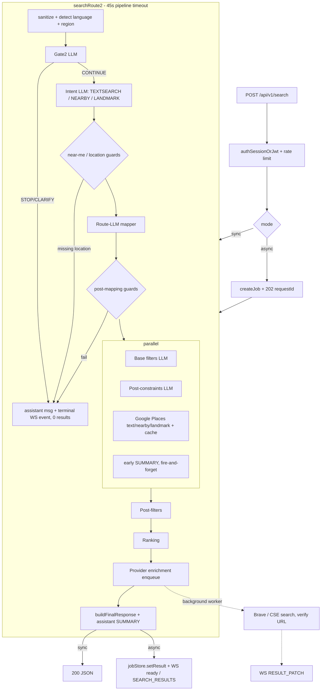
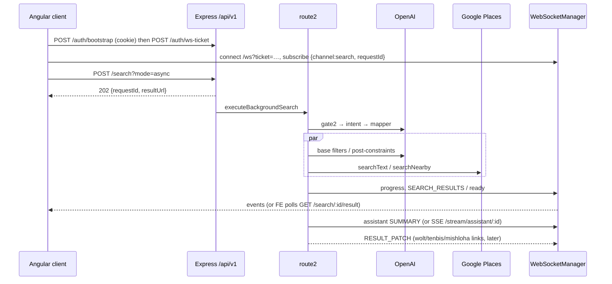

# 04 — Backend (`server/`)

> Written on 2026-10-05, branch `refactor/phase-1-hygiene`, from the real code in `server/`. Paths are relative to `server/` unless stated otherwise. The Markdown files in `server/docs/`, `docs/` and `new-docs/` are often stale; where they disagree with the code, this document follows the code and says so.

## TL;DR

- **What it is:** Express 5 + TypeScript (ESM) service that turns a free-text food query ("pizza near me open now") into a ranked list of restaurants. It uses OpenAI (`gpt-4o-mini` by default) for classification and mapping, Google Places (New) for data, and Brave/Google CSE to find Wolt / 10bis / Mishloha deep links. It runs as one Docker image (`node:24-alpine`) on AWS ECS behind an ALB, with ElastiCache Redis and optional DynamoDB/SES.
- **Core flow:** `POST /api/v1/search` → `searchRoute2()` (`src/services/search/route2/route2.orchestrator.ts`): **gate2 → intent → route-LLM mapper → guards → parallel (base filters ∥ post-constraints ∥ Google Places) → post-filters → ranking → async provider enrichment → response**. It runs either sync or async (202 + polling + WebSocket push). Assistant text goes over WebSocket, or over SSE (`/api/v1/stream/assistant/:id`) when `FEATURE_SSE_ASSISTANT=true`.
- **Auth:** anonymous identities only. A JWT (`POST /auth/token`) or an HttpOnly signed session cookie (`POST /auth/bootstrap`) carries a `sessionId`. Job ownership (IDOR protection) compares that sessionId with the job's owner. WebSockets use one-time tickets stored in Redis for 60 s.
- **Top risks:**
  1. `/auth/token` signs any client-supplied `sessionId`, so the IDOR protection is only as strong as the secrecy of session IDs.
  2. The auto-refresh middleware re-signs claims taken from an **unverified** cookie.
  3. ESM import hoisting makes the Redis rate limiter (and `.env.local` loading for modules that read config at import time) silently ineffective.
  4. Rate limits trust a spoofable `X-Forwarded-For`.
  5. The SSE ownership check fails **open**.
  6. WS state lives in each process, so it does not work across instances.
  7. `npm test` fails entirely (all 8 files) and there is no CI.
  8. Roughly 40 dead source files, two unused dependencies (`langchain`, `pino-http`), and 32 log archives committed to git.

## Table of contents

1. [Purpose](#1-purpose)
2. [Tech stack & versions](#2-tech-stack--versions)
3. [Run / build / test](#3-run--build--test)
4. [Environment variables (names only)](#4-environment-variables-names-only)
5. [Folder structure](#5-folder-structure)
6. [Bootstrap & middleware stack](#6-bootstrap--middleware-stack)
7. [HTTP API reference](#7-http-api-reference)
8. [Auth & sessions](#8-auth--sessions)
9. [Search pipeline "route2"](#9-search-pipeline-route2)
10. [Async search jobs](#10-async-search-jobs)
11. [Realtime: WebSocket & SSE](#11-realtime-websocket--sse)
12. [LLM layer](#12-llm-layer)
13. [External APIs](#13-external-apis)
14. [Data stores & caching](#14-data-stores--caching)
15. [Logging](#15-logging)
16. [Analytics events](#16-analytics-events)
17. [Error handling](#17-error-handling)
18. [Config system](#18-config-system)
19. [Testing](#19-testing)
20. [Security posture](#20-security-posture)
21. [Tech debt & risks](#21-tech-debt--risks)
22. [Stale docs / contradictions](#22-stale-docs--contradictions)
23. [Recommended next steps](#23-recommended-next-steps)

---

## 1. Purpose

The backend for the "Going2Eat" food search app (the name comes from the feedback email subject in `src/services/feedback/send-feedback-email.ts`). It:

- accepts a natural-language query, plus optional user location, in Hebrew, English and other languages;
- decides whether the query is about food at all (gate), what kind of search it is (text / nearby / landmark), and which filters apply (open now, kosher, gluten-free, price, and so on);
- queries Google Places (New), filters and ranks the results, and streams assistant narration;
- finds ordering links on Wolt, 10bis and Mishloha in the background and pushes them to the client as `RESULT_PATCH` over WebSocket;
- serves place details, proxies photos (so the Google key is never exposed), collects analytics, and emails user feedback through SES.

A stale **duplicate of the server code** also exists under `llm-angular/src/` (`app.ts`, `config/`, `controllers/`, `controllers.zip`, `infra/`, …). It is not built by `server/` and should be deleted (see the `fca0ad7` commit message, "port from duplicate tree").

## 2. Tech stack & versions

From `package.json`, `Dockerfile` and `tsconfig.json`:

| Area | Choice |
|---|---|
| Runtime | Node 24 (`node:24-alpine`, `Dockerfile`), ESM (`"type": "module"`) |
| Language | TypeScript ^5.9, `module/moduleResolution: nodenext`, `strict`, `noUncheckedIndexedAccess`, `exactOptionalPropertyTypes` (`tsconfig.json`, extends `../tsconfig.base.json`) |
| HTTP | express ^5.1, helmet ^8.1, cors ^2.8, compression ^1.8 |
| Realtime | ws ^8.19 (WebSocket), hand-rolled SSE |
| LLM | openai ^6.22 (the only provider actually used); zod ^4.2 + zod-to-json-schema ^3.25 for Structured Outputs. `langchain` ^0.3 and `@langchain/openai` ^0.6 are **installed but never imported** (`src/llm/langchain/` is empty) |
| Data | ioredis ^5.9; `@aws-sdk/client-dynamodb` + `lib-dynamodb`; `@aws-sdk/client-sesv2`; `@aws-sdk/credential-provider-ini` |
| Auth | jsonwebtoken ^9 (HS256) |
| Logging | pino ^10, pino-pretty, rotating-file-stream. `pino-http` ^11 is **installed but unused**; request logging is custom (`src/middleware/httpLogging.middleware.ts`) |
| Misc | uuid ^13, dotenv ^17, seedrandom (no importers found in `src/`) |
| Dev | tsx ^4.16 (runs TS directly), nodemon, ts-node (unused), node:test |

Shared API types come from `llm-angular/shared/api` through the `@api` path alias (`tsconfig.json` `paths`, resolved at build time by `tsc-alias`). Because of this, `rootDir` is `..` and the build output lands in `dist/server/src/server.js`.

## 3. Run / build / test

| Script | What it does |
|---|---|
| `npm run dev` | `predev` aborts if `JWT_SECRET` is shorter than 32 characters. Then nodemon with `-r dotenv/config` runs `node --enable-source-maps --import tsx src/server.ts`. `nodemon.json` also adds `--inspect=9229`. |
| `npm run build` | `rimraf dist` → `tsc -p .` → `tsc-alias`. `postbuild` checks that `dist/server/src/server.js` exists. |
| `npm start` | `node dist/server/src/server.js` |
| `npm test` | node:test over 8 files in `tests/`. **All of them currently fail** (see §19). |
| `test:ws`, `test:ws:unit`, `test:ws:e2e` | WebSocket tests in `src/infra/websocket/__tests__/` (54 of 90 unit tests fail). |
| `test:resolvers`, `test:integration`, `test:unified`, `test:all` | Further test sets in `tests/`. |
| `test:security` | Photo proxy tests. |
| `qa`, `qa:watch` | **Broken.** `src/services/search/qa/run-qa.ts` does not exist. |
| `verify:prod-contracts` | `scripts/verify-prod-contracts.js` |

Other scripts:
- `scripts/flush-provider-not-found-cache.ts` clears `provider:*` NOT_FOUND entries.
- `src/scripts/cleanup-{mishloha,tenbis}-legacy-cache.ts` are one-off cleanups.

**Docker:** `Dockerfile` is a two-stage build with the repository root as the build context.
- The builder runs `npm ci`, builds, and copies `services/i18n/translations/*.json` (note that `src/services/i18n` does not exist under `services/`; the copy is guarded with `|| true`).
- The runtime stage uses the non-root user `nodejs` (uid 1001), exposes port 3000, and has a `HEALTHCHECK curl /healthz`.
- `docker-compose.yml` is for local runs. Build and push helpers: `docker-build-and-push.{sh,ps1}`.

Local `.env` loading (`src/server.ts`): `.env.local` first, then `.env` (no override). There is one caveat, described in §6.

## 4. Environment variables (names only)

There are about 140 distinct `process.env.*` names. The ones that matter:

| Group | Names |
|---|---|
| Core | `NODE_ENV`, `ENV`, `PORT`, `LOG_LEVEL` |
| Secrets (required in prod/staging; boot fails without them) | `JWT_SECRET` (≥32 chars), `SESSION_COOKIE_SECRET` (≥32 chars, must differ from `JWT_SECRET`), `OPENAI_API_KEY` (when `ENABLE_AI_FEATURES` is not `false`), `GOOGLE_API_KEY` (when `ENABLE_GOOGLE_SEARCH` is not `false`) |
| Optional keys | `BRAVE_SEARCH_API_KEY`, `GOOGLE_CSE_API_KEY`, `GOOGLE_CSE_ENGINE_ID`, `ANTHROPIC_API_KEY` (stub provider), `DEBUG_KEY` |
| Cookies / CORS | `SESSION_COOKIE_TTL_SECONDS` (default 3600), `COOKIE_DOMAIN`, `COOKIE_SAMESITE`, `FRONTEND_ORIGINS` (falls back to `CORS_ALLOWED_ORIGINS`), `CORS_ALLOW_NO_ORIGIN`, `ALLOWED_ORIGINS`, `WS_ALLOWED_ORIGINS`, `WS_FALLBACK_ORIGIN`, `API_SUNSET_DATE` |
| Redis | `REDIS_URL`, `ENABLE_REDIS_JOBSTORE`, `ENABLE_REDIS_CACHE`, `ENABLE_GOOGLE_CACHE`, `REDIS_CACHE_PREFIX`, `REDIS_JOB_TTL_SECONDS`, `REDIS_CONNECT_TIMEOUT_MS`, `REDIS_BOOT_RETRIES`, `REDIS_BOOT_DELAY_MS`, `REDIS_WS_MEMORY_FALLBACK`, `ENABLE_DEBUG_REDIS`, `WS_REQUIRE_AUTH` |
| LLM | `LLM_PROVIDER`, `LLM_DEFAULT_MODEL`, `OPENAI_MODEL`, `FAST_OPENAI_MODEL`, `GATE_MODEL`, `INTENT_MODEL`, `BASE_FILTERS_MODEL`, `ROUTE_MAPPER_MODEL`, `ASSISTANT_MODEL`, matching `*_TIMEOUT_MS`, `LLM_DEFAULT_TIMEOUT_MS`, `LLM_ASSISTANT_TIMEOUT` |
| Pipeline / features | `ROUTE2_ENABLED`, `FEATURE_SSE_ASSISTANT`, `ASSISTANT_SSE_TIMEOUT_MS`, `ENABLE_{WOLT,TENBIS,MISHLOHA}_ENRICHMENT`, `MAX_RESULTS_TO_ENRICH`, `MAX_CONCURRENT_PROVIDER_JOBS`, `PROVIDER_RESULT_LIMIT`, `GOOGLE_PLACES_TIMEOUT_MS`, `DEFAULT_REGION_CODE`, `PLACE_DETAILS_*`, `UNIFIED_SEARCH`, `ACTION_PROPOSALS`, `SEARCH_PROVIDER` |
| AWS | `AWS_REGION`, `ENABLE_PROVIDER_AUDIT`, `PROVIDER_AUDIT_TABLE_NAME`, `PROVIDER_AUDIT_AWAIT`, `PROVIDER_AUDIT_AWAIT_TIMEOUT_MS`; ECS detection through `AWS_EXECUTION_ENV`, `ECS_CONTAINER_METADATA_URI(_V4)` |
| Logging | `LOG_TO_FILE`, `LOG_DIR`, `LOG_ROTATE_DAYS`, `LOG_PRETTY`, `LOG_CONSOLE`, `LOG_REDACT_FIELDS`, `LOG_PIPELINE_STAGES`, `LOG_CACHE_SAMPLE_RATE` |

Many names are **read by dead code only**, for example everything in `src/services/search/config/{performance,search,ranking}.config.ts` (`LLM_MAX_TOKENS_*`, `LLM_TEMPERATURE`, `CACHE_*`, `CANDIDATE_POOL_SIZE`, …), `SEARCH_PIPELINE_V2`, `INTENT_*` and `FEATURE_AGENT_LOOP`. `src/lib/config/config-validator.ts` lists `GOOGLE_MAPS_API_KEY` as required, but nothing calls that validator and the code reads `GOOGLE_API_KEY`.

## 5. Folder structure

```
server/
├─ src/
│  ├─ server.ts            # boot: env, Redis, session store, listen, WebSocketManager, signals
│  ├─ app.ts               # Express app + middleware stack
│  ├─ config/              # env.ts (getConfig), feature-flags, route2.flags, logging.config, index.ts (LLM constants)
│  ├─ routes/v1/index.ts   # the only router aggregator
│  ├─ controllers/         # auth/, search/, restaurants/, photos/, analytics/, stream/assistant-sse/, health.controler.ts
│  ├─ middleware/          # auth*, rate-limit, error, requestContext, httpLogging, security-headers, auto-refresh cookie
│  ├─ services/
│  │  ├─ search/route2/    # pipeline (stages/, guards/, assistant/, enrichment/, post-filters/, ranking/, shared/, utils/)
│  │  ├─ search/job-store/ # async job store (Redis | in-memory)
│  │  ├─ restaurant-details/ place-details.service.ts
│  │  └─ feedback/         # SES email
│  ├─ infra/websocket/     # WebSocketManager + subscription/backlog/pending/auth-verifier/publishers
│  ├─ infra/state/         # InMemoryRequestStore (late-subscriber replay)
│  ├─ lib/                 # redis, cache (Google cache), llm (config/resolver/budget), session(-cookie), logger, logging,
│  │                       # audit (DynamoDB), telemetry, reliability, security, http, metrics*, readiness*, concurrency*
│  ├─ llm/                 # factory, openai.provider, anthropic.provider (stub), cost-calculator, langchain/ (empty)
│  ├─ contracts/, schemas/, domain/, utils/
│  ├─ search-async/        # legacy searchAsync.store.ts (unused)
│  ├─ realtime/            # empty
│  └─ controllers.zip      # committed archive (remove)
├─ tests/                  # ~45 top-level node:test files (many target deleted modules)
├─ scripts/                # verify-prod-contracts.js, flush-provider-not-found-cache.ts
├─ docs/                   # 28 historical .md notes (largely stale)
├─ logs/                   # rotated pino logs; 32 files tracked in git
└─ *.sh/*.ps1/test-*.js    # ad-hoc smoke scripts (cookie, ws-ticket, CORS, SSE…)
```
`*` marks modules with no importer in `src/` (see §21).

## 6. Bootstrap & middleware stack

### `src/server.ts`
1. Loads `.env.local` and then `.env` with dotenv. In dev it logs the length of `JWT_SECRET`, never its value.
2. Creates `InMemoryRequestStore(300, 60_000)`, used for WebSocket late-subscriber replay.
3. Runs `initializeRedis()` with top-level await.
   - Redis counts as required when the job store, the cache or `WS_REQUIRE_AUTH` (default true) needs it.
   - It retries `REDIS_BOOT_RETRIES` times, with a connect timeout of 8 s in prod and 2 s in dev.
   - In prod/staging, boot **fails fast** when WS auth needs Redis and Redis is unreachable. In dev it falls back to in-memory WS tickets.
4. Calls `initializeSessionStore({ttlSeconds: 7d, keyPrefix:'session:'})` if Redis is up.
5. Logs the status of the Google key (masked to the last 4 characters), then `createApp()` and `app.listen(port)`.
6. Creates `new WebSocketManager(server, {path:'/ws', heartbeatIntervalMs:30_000, allowedOrigins: WS_ALLOWED_ORIGINS || ['*'], requestStateStore, jobStore, redis})`.
7. SIGINT/SIGTERM trigger a graceful shutdown with a forced exit after 10 s. `unhandledRejection` and `uncaughtException` are **logged only**; the process keeps running.

> ⚠️ **Import-hoisting bug.** ES module `import` statements are hoisted and evaluated **before** any code in `server.ts` runs, including the later `import { initializeSessionStore }` and `import { searchJobStore }` lines.
> - The comment "Load environment variables FIRST before any imports" is therefore wrong. Modules that read env at import time (`config/env.ts` `CURRENT_ENV`, `logger`, `token.controller.ts` `const config = getConfig()`, `route2.flags.ts`, `config/index.ts`) see only what was in `process.env` before dotenv ran. `npm run dev` works around this with `-r dotenv/config`, which loads `.env` but **not** `.env.local`. Production gets its env from ECS and is unaffected.
> - `middleware/rate-limit.middleware.ts` calls `getExistingRedisClient()` at module load, which happens before `initializeRedis()`. So `redisLimiter` is always `null` and **rate limiting is always in-memory, per instance**.

### `src/app.ts`: middleware order

| # | Middleware | Notes |
|---|---|---|
| 1 | `Cache-Control: no-store` for `/` and `/index.html` | |
| 2 | **Global rate limiter**: 300 req/min per IP (`createRateLimiter`, prefix `global`) | Runs before request context, so its logs have no traceId |
| 3 | `req/res.setTimeout(30_000)` | SSE overrides this (≥120 s) |
| 4 | `helmet()` + `securityHeadersMiddleware` (HSTS, etc.) | |
| 5 | `compression()` | |
| 6 | `express.json({limit:'1mb'})`, `urlencoded` | |
| 7 | `requestContextMiddleware`: traceId from a sanitized `x-trace-id` header or a UUID, `req.log` child logger, response header `x-trace-id` | |
| 8 | `httpLoggingMiddleware`: custom (not pino-http), sampled | |
| 9 | JSON syntax error handler → 400 `INVALID_JSON` | |
| 10 | `GET /healthz` | Before CORS |
| 11 | `/api/v1/photos`: CORP `cross-origin` + `cors({origin:true, credentials:true})` | Reflects any origin |
| 12 | CORS: in prod, an allowlist from `FRONTEND_ORIGINS` via `validateOrigin` (requests without an Origin header are allowed); in dev, the allowlist plus localhost:4200/4201/3000. `app.options(/.*/)` short-circuits preflight requests. | |
| 13 | `GET /api/v1/debug/env` (403 in prod) | |
| 14 | `/api/v1` → `autoRefreshExpiredCookie` | See §8 |
| 15 | `/api/v1` → `createV1Router()` | |
| 16 | `/api` → the **same** router with `Deprecation`/`Sunset` headers | The default sunset date of 2026-06-01 has **already passed**, yet the legacy path still works |
| 17 | `errorMiddleware` | |

There is no `app.set('trust proxy')`. The client IP is parsed by hand from `X-Forwarded-For` (§20).

## 7. HTTP API reference

Mounted in `src/routes/v1/index.ts` and available under both `/api/v1` and the legacy `/api`. Auth: **S/J** means `authSessionOrJwt` (session cookie first, then Bearer JWT). **J** means `authenticateJWT` (Bearer only).

| Method | Path | Auth | Rate limit (beyond the global 300/min) | Purpose | Code |
|---|---|---|---|---|---|
| GET | `/healthz` | none | global | Liveness; pings Redis only if a Redis feature is enabled (3 s timeout) | `src/controllers/health.controler.ts`, `app.ts` |
| GET | `/api/v1/flags` | none | – | Frontend feature flags `{unifiedSearch, actionProposals}` | `routes/v1/index.ts`, `config/feature-flags.ts` |
| POST | `/api/v1/feedback` | none | 10/min | `{mood:'like'|'work', note≤500}` → SES email | `routes/v1/index.ts`, `services/feedback/send-feedback-email.ts` |
| POST | `/api/v1/auth/token` | none | – | Issues an HS256 JWT `{sessionId}`, 30-day expiry; **accepts a client-provided sessionId** | `controllers/auth/token.controller.ts` |
| POST | `/api/v1/auth/bootstrap` (also `POST /api/v1/auth/`, mounted twice) | none | – | Issues the HttpOnly `session` cookie with a new `sess_<uuid>` | `controllers/auth/bootstrap.controller.ts`, `auth.controller.ts` |
| POST | `/api/v1/auth/session` | J | – | Converts a JWT into a session cookie | `controllers/auth/session.controller.ts` |
| GET | `/api/v1/auth/whoami` | S/J | – | Debug view of the auth context | `controllers/auth/session.controller.ts` |
| POST | `/api/v1/auth/ws-ticket` | S/J | – | One-time WS ticket (Redis `ws_ticket:<uuid>`, 60 s) | `controllers/auth/ws-ticket.controller.ts` |
| POST | `/api/v1/search[?mode=sync\|async]` | S/J | 30/min per IP+session | Runs route2. Sync returns 200 with results; async returns 202 `{requestId,resultUrl}` | `controllers/search/search.controller.ts` |
| GET | `/api/v1/search/:requestId/result` | S/J + ownership | 30/min | Polls a job: 202 while running, 200 with the result, 500 if failed, 404 if not the owner | same + `search.security.ts` |
| GET | `/api/v1/search/:requestId` | S/J (**no ownership check**) | 30/min | Job status | same |
| GET | `/api/v1/restaurants/:id` | S/J | 60/min | Place details by placeId | `controllers/restaurants/restaurants.controller.ts` → `services/restaurant-details/place-details.service.ts` |
| GET | `/api/v1/stream/assistant/:requestId` | S/J + ownership (fails open) | none | SSE assistant narration | `controllers/stream/assistant-sse/assistant-sse.router.ts` |
| POST | `/api/v1/analytics/events` | S/J | – | Track an event (in-memory ring buffer of 1000) | `controllers/analytics/analytics.controller.ts` |
| GET | `/api/v1/analytics/events` | S/J | – | The caller's own events | same |
| GET | `/api/v1/analytics/stats` | S/J | – | The caller's own counts | same |
| DELETE | `/api/v1/analytics/events` | S/J | – | Clear the caller's own events | same |
| GET | `/api/v1/photos/places/:placeId/photos/:photoId` | none | 30/min | Proxy to Google `/{ref}/media` (key sent in the query string); 24 h cache headers | `controllers/photos/photos.controller.ts` |
| GET | `/api/v1/debug/env` | none; 403 in prod | – | Env diagnostics | `app.ts` |
| GET | `/api/v1/debug/prod-config` | prod only + `X-Debug-Key` | – | Booleans about config | `routes/v1/index.ts` |
| GET | `/api/v1/debug/redis` | none; 404 in prod unless `ENABLE_DEBUG_REDIS=true` | – | Redis PING | `routes/v1/index.ts` |
| WS | `/ws?ticket=…` | ticket | 10 subscribes, refilling 10/min | Realtime search and assistant channels | `infra/websocket/*` |

The header comment in `routes/v1/index.ts` still lists `/chat`, `/places/search` and `/dialogue`. **None of these exist any more.**

## 8. Auth & sessions

**Identities are anonymous.** A `sessionId` (`sess_<uuid>`) is the principal. `userId` is optional and never issued by any endpoint in normal flows.

| Mechanism | Issuer | Secret | Lifetime | Verifier |
|---|---|---|---|---|
| Bearer JWT `{sessionId, iat, exp}` | `POST /auth/token` | `JWT_SECRET` (HS256) | 30 d | `middleware/auth.middleware.ts` (`authenticateJWT`), `auth-session-or-jwt.middleware.ts` (requires `sessionId`, `exp`, `iat`; `maxAge` 30d, clock tolerance 5 s) |
| HttpOnly cookie `session` (a JWT with `typ:"session_cookie"`) | `/auth/bootstrap`, `/auth/session`, auto-refresh | `SESSION_COOKIE_SECRET` | `SESSION_COOKIE_TTL_SECONDS` (default 1 h) | `lib/session-cookie/session-cookie.service.ts` (`verifySessionCookie` checks `typ` and `exp`) |
| WS ticket | `POST /auth/ws-ticket` | Redis `ws_ticket:<uuid>` `{userId,sessionId}` | 60 s, one use | `infra/websocket/auth-verifier.ts` |
| Redis session record | `lib/session/redis-session.store.ts` (`session:<id>`, 7 d sliding) | – | – | Used only by `auto-refresh-expired-cookie.middleware.ts` and the unused `readiness.service.ts`. The dedicated `middleware/auth-session.middleware.ts` is **not mounted anywhere** |

Cookie attributes:
- `HttpOnly`, `SameSite` from `COOKIE_SAMESITE` (default `Lax`), optional `Domain`.
- `Secure` is decided inconsistently: `bootstrap.controller.ts` and the auto-refresh middleware use `NODE_ENV==='production'`, while `session.controller.ts` uses `config.env ∈ {production, staging}`. Staging bootstrap cookies are therefore **not** Secure.

**Auto-refresh** (`middleware/auto-refresh-expired-cookie.middleware.ts`) runs on every `/api/v1` request.
- It decodes the cookie with `jwt.decode` (**no signature check**). If the cookie is expired, has a bad signature or the wrong `typ`, it re-issues a valid signed cookie.
- It reuses the decoded `sessionId` when that id exists in the Redis session store; otherwise it creates a new session.
- In both cases it copies the unverified `userId` into the new cookie.
- It then rewrites `req.headers.cookie` so the request goes on authenticated.
- ⚠️ **Effect:** any client can forge a cookie containing an arbitrary `userId`, and any known sessionId that exists in the store, and get it signed by the server.

**IDOR protections:**
- Async jobs store `ownerSessionId` and `ownerUserId` (`search.controller.ts`). `GET /search/:id/result` returns 404 on mismatch, on a missing owner, or on a legacy job (`controllers/search/search.security.ts`).
- In production, async job creation without a session is rejected (401 `MISSING_AUTH_SESSION`).
- WS subscribe checks the job owner (`infra/websocket/subscription-manager.ts`). Pending subscriptions are checked again on activation (`sub_nack session_mismatch`).
- Analytics queries are filtered by `sessionId` / `userId`.
- **Gaps:**
  - `GET /search/:requestId` (status) has no ownership check.
  - The SSE `ownership-validator.ts` returns `valid:true` when the job is not found or the store throws (lines ~35 and ~88).
  - `POST /auth/token` signs **any** `sessionId` the caller supplies, so knowing a victim's sessionId is enough to impersonate them. Session ids appear in plain text in some logs (`token.controller.ts`, the generic analytics log line, `session.controller.ts`).

## 9. Search pipeline "route2"

**Entry:** `searchRoute2(request, ctx)` in `src/services/search/route2/route2.orchestrator.ts` (re-exported by `route2/index.ts`).
- It wraps `searchRoute2Internal` in `withTimeout(PIPELINE_TIMEOUT_MS = 45 000)` (`route2/route2.config.ts`), which aborts `ctx.abortSignal` on timeout.
- It always writes a search audit (`search-audit.ts`).
- The controller returns 500 `CONFIG_ERROR` if `ROUTE2_ENABLED=false` (`config/route2.flags.ts`) or no LLM provider exists.

### Stages

| # | Stage | File(s) | LLM? | Behaviour |
|---|---|---|---|---|
| 0 | Prep | `utils/query-language-detector.ts`, `utils/region-resolver.ts` | no | Sanitizes the query and detects its language by script majority (60 % threshold). Region is resolved best-effort, falling back to `OTHER` / `IL`. |
| 1 | **Gate2** | `stages/gate2.stage.ts`, `stages/gate2/gate2-query-validity.ts` | yes (`gate`, prompt `gate2_v9`) | A deterministic pre-check catches gibberish, profanity and anchor-only queries. Otherwise an LLM returns `{foodSignal: YES/UNCERTAIN/NO, confidence}`. Mapping: NO → STOP, UNCERTAIN → ASK_CLARIFY, YES → CONTINUE. Retries once on timeout (100–200 ms jitter); on a second failure → `GATE_TIMEOUT` error. |
| 2 | Gate guards | `orchestrator.guards.ts`, `guards/gate-stop.guard.ts`, `guards/gate-clarify.guard.ts`, `guards/shared/assistant-helper.ts` | assistant | Early exit with 0 results (`meta.source = route2_gate_stop/clarify`), an assistant GATE_FAIL/CLARIFY message, and a terminal WS event (`orchestrator.search-terminal.ts`). |
| 3 | **Intent** | `stages/intent/intent.stage.ts`, `intent.prompt.ts` (`intent_v4`) | yes (`intent`) | Picks the route TEXTSEARCH / NEARBY / LANDMARK and extracts language, regionCandidate and cityText. On any failure → TEXTSEARCH. NEARBY without a location → TEXTSEARCH. |
| 4 | Location / generic guards | `orchestrator.nearme.ts`, `orchestrator.early-context.ts` | assistant (clarify) | Near-me without a location → CLARIFY. Detects generic queries. Derives region and UI/provider language. |
| 5 | **Route-LLM mapper** | `stages/route-llm/route-llm.dispatcher.ts`, `textsearch.mapper.ts`, `nearby.mapper.ts`, `landmark.mapper.ts`, `static-schemas.ts` | yes (`routeMapper`) | Turns the intent into Google request parameters. Each mapper retries once. Text search falls back to a deterministic mapping, nearby falls back to a default radius, and **landmark throws** (no fallback). The nearby timeout is hard-coded at 4500 ms. |
| 6 | Post-mapping guards | `orchestrator.guards.ts` | – | NEARBY needs `userLocation`. A TEXTSEARCH with no anchor sets `missingLocationQuestion`, or returns CLARIFY for near-me queries. |
| 7 | **Parallel fan-out** | `orchestrator.parallel-tasks.ts` | yes | Four tasks start together. Base filters (`shared/base-filters-llm.ts`) fall back to defaults on error. Post-constraints (`stages/post-constraints/post-constraints.stage.ts`, prompt `post_constraints_v2`, 4500 ms hard-coded) also fall back to defaults. An early SUMMARY assistant message is fire-and-forget with a 1500 ms timeout. The Google Maps stage starts immediately. The barrier: base filters → `resolveAndStoreFilters` → Google → post-constraints. |
| 8 | **Google Maps** | `stages/google-maps.stage.ts`, `google-maps/text-search.handler.ts`, `nearby-search.handler.ts`, `landmark-plan.handler.ts`, `textsearch/field-mask-builder.ts`, `cache-manager.ts` | no | Places (New): `places:searchText` (paged, up to 20 results; geocodes the city if there is no location bias; retries without the bias if it gets ≤1 result) and `places:searchNearby`. Landmark searches geocode first through the legacy Geocoding API. Per-call timeout `GOOGLE_PLACES_TIMEOUT_MS` (8000). Results are cached (§14). |
| 9 | **Post-filters** | `post-filters/post-results.filter.ts`, `dietary-hints.ts`, `not-kosher-name.ts`, `list-shape.ts` | no | Deterministic filtering on open now / open at / open between, dietary hints, a not-kosher name check, and list shaping. |
| 10 | **Ranking** | `ranking/ranking-weight-resolver.ts`, `ranking-apply.ts` | no | Baseline weights: rating .45, reviews .25, distance .15, openNow .10, priceFit .05, adjusted by intent and constraints. Results are only reordered, never dropped. |
| 11 | **Provider enrichment** (async) | `enrichment/provider/{wolt,tenbis,mishloha}.ts`, `provider-enrichment.service.ts`, `provider-worker.ts`, `provider-job-queue*.ts`, `provider-deeplink-resolver.ts`, `provider-strategies/*` | no | Covers the top `MAX_RESULTS_TO_ENRICH` (10) results. Checks the Redis cache first. On a miss the result is marked PENDING, an NX lock is taken, and a job goes onto an in-process queue. The worker searches Brave, then Google CSE, with `site:<host> "<name>" "<city>"` queries, verifies the URL, and pushes `RESULT_PATCH` over WS. |
| 12 | Response + assistant | `orchestrator.response.ts`, `assistant/*`, `orchestrator.helpers.ts` | maybe | Builds the final DTO. Assistant language is chosen in this order: intent language, then query language, then UI language. Unless the result set is SATURATED, a deterministic SUMMARY is sent; when SATURATED, a MESSAGE_ONLY LLM call (1000 ms) runs. Generic queries also get a GENERIC_QUERY_NARRATION. |

**Language enforcement:** `assistant/assistant-llm.service.ts` → `enforceInvariants` → `validation-rules.ts`. A language mismatch is **only logged**. Only a format error falls back to `fallback-messages.ts`.

**LLM calls per request:** up to about 7–8 (gate with retry, intent, mapper with retry, base filters, post-constraints, early summary, message-only or narration). All are capped by the session budget (§12).





## 10. Async search jobs

- **Controller** (`controllers/search/search.controller.ts`):
  - `mode=async` creates the job via `searchJobStore.createJob(requestId, {sessionId, query, ownerSessionId, ownerUserId, traceId, queryDetectedLanguage})`, then `wsManager.activatePendingSubscriptions`, then responds `202 {requestId, resultUrl, contractsVersion}` and calls `executeBackgroundSearch`.
  - A failed job-store write is **non-fatal**: the search runs anyway, but polling then returns 404.
- **Background execution** (`controllers/search/search.async-execution.ts`):
  - Progress goes RUNNING 10 → 50, then the search runs, then `setResult` with a terminal status.
  - Terminal statuses come from `job-store/job-store.interface.ts`: `PENDING | RUNNING | DONE_SUCCESS | DONE_CLARIFY | DONE_STOPPED | DONE_FAILED`.
  - Error codes: `MODEL_BUDGET_EXCEEDED`, `TIMEOUT`, `SEARCH_FAILED`.
- **Store selection** (`services/search/job-store/index.ts`, a lazy Proxy singleton):
  - Redis (`redis-search-job.store.ts`, key `search:job:<requestId>`, `SETEX` TTL `REDIS_JOB_TTL_SECONDS`, default 86400) when `ENABLE_REDIS_JOBSTORE=true`.
  - Otherwise in-memory (`inmemory-search-job.store.ts`, 10-minute TTL, swept every 60 s).
- **Known bugs:**
  - Gate and nearby CLARIFY outcomes set `failureReason: 'LOW_CONFIDENCE'`, which async-execution maps to `DONE_STOPPED`, not `DONE_CLARIFY`.
  - The 30 s abort is attached to `ctx.signal`, but the pipeline only reads `ctx.abortSignal`. The real cap is therefore 45 s.
  - Terminal events are published twice: the orchestrator sends `CLARIFY`/`GATE_STOP`/`SEARCH_RESULTS`, and async-execution sends `clarify`/`ready`/`error` with different casing.
- `src/search-async/searchAsync.store.ts` is a legacy store with no importers.

## 11. Realtime: WebSocket & SSE

### WebSocket (`src/infra/websocket/`)
- **Construction:** `websocket-manager.ts` (constructed in `server.ts`), path `/ws`.
- **Auth:** `auth-verifier.ts` validates the origin (wildcard rejected in prod), requires `x-forwarded-proto=https` in prod, then does a Redis `GET` and `DEL` on `ws_ticket:<t>`.
  - This is **not atomic** despite the comment, so two connections racing on the same ticket can both get in. Use `GETDEL`.
  - In dev without Redis it falls back to `lib/ws-ticket-memory-store.ts`.
  - `websocket.config.ts` refuses `WS_REQUIRE_AUTH=false` in prod and staging.
- **Protocol** (`websocket-protocol.ts`):
  - Client messages: `{v:1, type: subscribe|unsubscribe|event, channel: search|assistant, requestId}`. The legacy `{type:'subscribe', requestId}` form is still accepted.
  - Server messages: `sub_ack`/`sub_nack`, `status`, `progress`, `ready`, `clarify`, `error`, `SEARCH_RESULTS`, `RESULT_PATCH`, `assistant` (GATE_FAIL / CLARIFY / SUMMARY / SEARCH_FAILED / GENERIC_QUERY_NARRATION / NUDGE_REFINE), `assistant_progress`, `assistant_suggestion`, `assistant_error`, `ws_status`, `stream.delta`/`stream.done`.
- **Subscriptions:** `subscription-manager.ts` checks the owner against the job store. If the job does not exist yet, the subscription is parked in `pending-subscriptions.ts` (90 s TTL) and activated after `createJob`.
- **Backlog:** `backlog-manager.ts` replays to late subscribers, with a 2-minute TTL, 50 messages per request and 10,000 globally. `InMemoryRequestStore` also helps with replay.
- **Limits:** 64 KB max payload, 30 s heartbeat ping, 15-minute idle close, and a subscribe token bucket of 10 per socket refilling at 10/min. Close codes: 1008 (not authorized / origin blocked) and 1000/1001 (soft).
- **Scaling limitation:** subscriptions and the backlog are in-process Maps. There is **no Redis pub/sub**, so a publish from task A never reaches a socket connected to task B. Running more than one ECS task needs sticky sessions, or this has to be fixed. The `server.ts` default `allowedOrigins: ['*']` applies when `WS_ALLOWED_ORIGINS` is unset (the auth-verifier then applies `FRONTEND_ORIGINS`).

### SSE assistant (`src/controllers/stream/assistant-sse/`)
- `GET /api/v1/stream/assistant/:requestId`, protected by `authSessionOrJwt`, active when `FEATURE_SSE_ASSISTANT=true`. When it is on, the assistant messages over WS are suppressed.
- Events: `meta`, `narration`, `delta`, `message`, `ping`, `error`, `done`.
- `assistant-sse.orchestrator.ts` (882 lines) polls for the result every 400 ms (`polling-strategy.ts`, `result-waiter.ts`), sends a heartbeat every 25 s, times out after `ASSISTANT_SSE_TIMEOUT_MS` (20 s), and holds a Redis lock `assistant:lock:<requestId>` (`SET NX`, 30 s) against duplicate generation.
- `ownership-validator.ts` **fails open** (see §8).

## 12. LLM layer

- **Provider factory** (`src/llm/factory.ts`): `createLLMProvider()` uses `LLM_PROVIDER` (default `openai`) and returns null if the key is missing. `anthropic.provider.ts` is a stub where every method throws.
- **OpenAI provider** (`src/llm/openai.provider.ts`):
  - `completeJSON` uses Structured Outputs (`response_format: json_schema, strict: true`). The schema comes from zod via `zod-to-json-schema`, or from static schemas (`stages/route-llm/static-schemas.ts`, `INTENT_JSON_SCHEMA`, `ASSISTANT_JSON_SCHEMA`), with `additionalProperties:false` forced. The reply is validated with `schema.parse()`, and the schema hash is logged.
  - `complete` (plain text) and `completeStream` (`max_completion_tokens: 400`, temperature 0.3).
  - The SDK client uses `timeout 30 s` and `maxRetries 0`, plus a per-call AbortController.
- **Per-purpose config** (`src/lib/llm/llm-config.ts`, `llm-resolver.ts`, `llm-client.ts`):
  - Purposes: `gate | intent | baseFilters | routeMapper | assistant`.
  - Model: `<PURPOSE>_MODEL`, then `LLM_DEFAULT_MODEL`, then `OPENAI_MODEL`, then `gpt-4o-mini`.
  - Timeout: `<PURPOSE>_TIMEOUT_MS`, otherwise 4000 ms.
  - `LLM_DEFAULT_TIMEOUT_MS` is loaded but never used. The nearby mapper and post-constraints ignore this config (hard-coded 4500 ms, default model).
- **Retries:** `lib/reliability/retry-handler.ts` with `LLM_RETRY_ATTEMPTS=3`, backoff `[0,250,750]` (`config/index.ts`). Only 429 and 5xx are retried. Gate2 and the mappers add their own retry on top.
- **Cost controls:**
  - `lib/llm/session-model-budget.ts`: **40 model calls per session per UTC day**, Redis key `llm-budget:<sessionId|nosession>:<YYYY-MM-DD>` (INCR, 48 h expiry). Over the limit it throws `ModelBudgetExceededError` → HTTP 429 `MODEL_BUDGET_EXCEEDED`.
    - Without Redis it uses an in-memory Map that is never cleared.
    - Retries are not counted.
    - All requests without a session share the single `nosession` bucket.
    - Because a new session costs one unauthenticated `/auth/bootstrap` call, the budget does not stop a determined abuser; only the IP rate limits do.
  - Cost telemetry: `lib/telemetry/providerTrace.ts` and `llm/cost-calculator.ts`. The price table is dated Jan 2025 and covers gpt-4o and gpt-3.5 only; other models get `costUnknown`. Traces go to DynamoDB when auditing is enabled (§14).
  - No `max_tokens` is sent on JSON calls. `LLM_MAX_TOKENS_*` and `LLM_TEMPERATURE` are dead.
- **Prompts** are TypeScript modules next to their stages, each with a version constant (`gate2_v9`, `intent_v4`, `post_constraints_v2`, `assistant/prompt-builder.ts`). `ASSISTANT_PROMPT_VERSION` is defined twice with different values (`assistant-llm.service.ts:139`, `assistant.types.ts:127`).
- `src/services/llm/` and `src/llm/langchain/` are empty, and langchain is unused.

## 13. External APIs

| API | Use | File(s) | Env |
|---|---|---|---|
| Google Places (New) `places:searchText`, `places:searchNearby` | Search; field mask: id, displayName, formattedAddress, location, rating, userRatingCount, priceLevel, opening hours, utcOffset, photos, types, googleMapsUri, businessStatus, phone, website | `route2/stages/google-maps/*.handler.ts`, `textsearch/field-mask-builder.ts` | `GOOGLE_API_KEY` (header), `GOOGLE_PLACES_TIMEOUT_MS` |
| Google Place Details `GET /v1/places/{id}` | `/restaurants/:id` | `services/restaurant-details/place-details.service.ts` | same |
| Google Place Photos `/{ref}/media` | Photo proxy | `controllers/photos/photos.controller.ts` | key sent **in the query string** |
| Google Geocoding (legacy) | City and landmark geocoding (8 s) | `landmark-plan.handler.ts` (its own copy), `textsearch/geocoding-service.ts` | key in the query string |
| Brave Search | Provider deep links (5 s, ≤20 results) | `route2/enrichment/brave-search-client.ts`, `brave-search.adapter.ts` | `BRAVE_SEARCH_API_KEY` |
| Google Custom Search | Fallback for deep links | `route2/enrichment/google-cse-client.ts` | `GOOGLE_CSE_API_KEY`, `GOOGLE_CSE_ENGINE_ID` |
| Wolt / 10bis / Mishloha | **Never called directly.** URLs are found by web search and checked against host and path allowlists: `wolt.com/.../restaurant/`, `10bis.co.il/next/`, `mishloha.co.il/now/r/` | `route2/enrichment/provider-strategies/*.{strategy,verifier}.ts` | `ENABLE_*_ENRICHMENT` |
| OpenAI | All LLM calls | `src/llm/openai.provider.ts` | `OPENAI_API_KEY` |
| AWS SES v2 | Feedback email | `services/feedback/send-feedback-email.ts` | hard-coded region `eu-north-1`, hard-coded personal Gmail sender/recipient, `fromIni({profile:'pizza'})` outside ECS |
| AWS DynamoDB | Provider audit trail | `lib/audit/providerAudit.store.ts` | `PROVIDER_AUDIT_TABLE_NAME`, `AWS_REGION` (default `us-east-1`) |

## 14. Data stores & caching

**Redis client:** `src/lib/redis/redis-client.ts` (`getRedisClient` / `getExistingRedisClient`).
- Settings: lazyConnect, `enableOfflineQueue:false`, 2 s timeouts, TLS for `rediss://`. Returns null when it fails.
- Extra connections are opened by `lib/cache/googleCacheService.ts` (through `cache-manager.ts`, 4 s timeouts), by `redis-search-job.store.ts`, and by a dedicated client in `websocket-manager.ts`. That makes up to 4 connections per process.

| Key | TTL | Owner |
|---|---|---|
| `search:job:<requestId>` | 24 h | `services/search/job-store/redis-search-job.store.ts` |
| `session:<id>` | 7 d sliding | `lib/session/redis-session.store.ts` |
| `ws_ticket:<uuid>` | 60 s | `controllers/auth/ws-ticket.controller.ts` |
| `assistant:lock:<requestId>` | 30 s NX | `controllers/stream/assistant-sse/assistant-sse.orchestrator.ts` |
| `llm-budget:<session>:<day>` | 48 h | `lib/llm/session-model-budget.ts` |
| `<global\|search\|restaurants\|feedback\|photo\|rl>:<ip>[:<session>]` | window | `middleware/rate-limit.middleware.ts`, *currently never reached* (§6) |
| `g:textsearch:<hash>`, `g:search:<hash>`, `g:place:<id>:<fieldHash>` | 900 s; 300 s if the query has "open/now/פתוח/עכשיו"; shorter for empty results | `lib/cache/googleCacheService.ts`, `googleCacheUtils.ts` |
| `provider:<wolt\|tenbis\|mishloha>:<placeId>` | FOUND 14 d / NOT_FOUND 7 d | `route2/enrichment/provider/provider.contracts.ts`, worker |
| `provider:<id>:lock:<placeId>` | 60 s NX | `route2/enrichment/lock-service.ts` |
| `pd:hints*` | `PLACE_DETAILS_CACHE_TTL_MS` (24 h) | `route2/route2.config.ts` |

**Google cache layers:**
- L0: de-duplication of in-flight requests.
- L1: in-memory, 500 entries, TTL ≤60 s.
- L2: Redis `SET EX`.
- Each cache call is raced against 10 s; on failure it fetches directly.
- `services/search/config/cache.config.ts` declares further cache policies that route2 does not use.

**DynamoDB:** one audit table. PK `traceId`, SK `<ts>#<provider>#<operation>`, 90-day `ttl`. Writes happen only when `NODE_ENV=production` and `ENABLE_PROVIDER_AUDIT=true`. It uses `console.*` instead of the logger.

**In-process state** (lost on restart and not shared between instances): the analytics ring buffer, `InMemoryRequestStore`, WS subscriptions and backlog, the provider job queue, the rate-limit store, the fallback job store, and the budget fallback.

## 15. Logging

- **Logger:** `src/lib/logger/structured-logger.ts`, pino with ISO timestamps, a string `level` label, and a multistream of console (pretty in dev) plus a file.
  - The file is `logs/server.log`, rotated daily by `rotating-file-stream`, gzip-compressed, with `maxFiles = LOG_ROTATE_DAYS` (14).
  - File logging is on whenever `NODE_ENV !== 'production'` or `LOG_TO_FILE=true` (`config/logging.config.ts`). Production logs go to stdout (CloudWatch).
- **Redaction:** paths come from `LOG_REDACT_FIELDS`, default `authorization,cookie,x-api-key,key,token,password,apiKey,api_key,secret`. These are **top-level paths only**, so nested fields such as `headers.authorization` or `err.config.headers` are not redacted.
- **Per request:** `requestContextMiddleware` attaches a `req.log` child logger with the traceId. `httpLoggingMiddleware` logs at debug for 2xx, warn for 4xx and error for 5xx, skips scanner noise, samples OPTIONS at 1 %, and always logs slow requests (over 5 s).
- **Helpers:** `lib/logging/pipeline-stage-log.ts` and `sampling.ts`. Pipeline timing goes through `logSearchAudit`.
- **Hygiene problems:**
  - `server/logs/` is **tracked in git**: 32 files, about 2.3 MB, modified in every dev session (see git status).
  - `config/env.ts#getConfig()` is not memoized and prints `[Config] API Keys` through `console.info` **every time it is called**.
  - Some code still uses `console.log`, for example `[ASSIST_DEBUG]` in `assistant-llm.service.ts`.
  - The feedback `note` text is logged in full (`routes/v1/index.ts`).

## 16. Analytics events

`src/controllers/analytics/analytics.controller.ts`:
- `POST /events` accepts `{event, data}` and stores it in an **in-memory array capped at 1000 entries**, per process. `data` is not validated, so each event can be up to 1 MB of JSON.
- `result_action` events are normalized by `result-action-log.ts`: action ∈ {open, navigate, call, wolt, tenbis, mishloha}, the name trimmed to 80 characters, a `req-…` requestId, and an 8-character `sessionPrefix`. They are logged as `[result_action]`.
- `landing_open` events are normalized by `landing-open-log.ts`: entry must match `qr` or `p:<slug>` (from `/q` and `/p/:name`, commit `2c11e9c`), with an 8-character `sessionPrefix`. They are logged as `[landing_open]`.
- Every other event is logged with the **full sessionId and `data.query`**.
- The only durable analytics sink is CloudWatch logs. Nothing is persisted.

## 17. Error handling

- `src/middleware/error.middleware.ts` defines an `AppError(statusCode, code)` class.
  - In production, unknown errors produce a generic message without a stack trace. In dev, details and the stack are included.
  - The full error is always logged.
- Many routes catch their own errors and return their own response shapes, so there is no single error contract:
  - search: `createSearchError(msg, code)`, e.g. `VALIDATION_ERROR`, `CONFIG_ERROR`, `SEARCH_ERROR`, `MODEL_BUDGET_EXCEEDED`;
  - auth: `{error, code, traceId}`;
  - photos: `{error, code, traceId, details}`.
- The sync search `catch` in `search.controller.ts` **does not log** the error before returning 500.
- Pipeline errors are classified in `route2/pipeline-error-kinds` / `handlePipelineError`, and a `SEARCH_FAILED` WS event is published.
- Express 5 forwards rejected async handlers to the error middleware. The process-level handlers only log (§6).

## 18. Config system

| File | Role |
|---|---|
| `src/config/env.ts` | `getConfig()`: env detection (`NODE_ENV`, then `ENV`; `CURRENT_ENV` is captured once at module load), fail-fast checks in prod and staging (JWT and cookie secrets, OpenAI and Google keys), Redis URL safety (no localhost in prod), CORS origins (`*` forbidden in prod), TTLs. **Recomputed on every call.** |
| `src/config/index.ts` | LLM constants: models, retry attempts and backoff, timeouts |
| `src/config/route2.flags.ts` | `ROUTE2_ENABLED` |
| `src/config/feature-flags.ts` | Flags served by `GET /flags` |
| `src/config/logging.config.ts` | Logging config |
| `src/services/search/route2/route2.config.ts` | Pipeline timeouts, place-details settings |
| `src/lib/llm/llm-config.ts` | Per-purpose model and timeout |
| `src/config/intent-flags.ts`, `search-pipeline-flags.ts`, `services/search/config/*.config.ts`, `lib/config/config-validator.ts` | **Dead** (no importers) |

## 19. Testing

- **Framework:** `node:test` with `tsx`. There are 156 `*.test.ts` files: about 45 in `tests/`, the rest under `src/**/__tests__` and next to their sources.
- **There is no CI.** No `.github/workflows` exists.

Results observed on 2026-10-05:

| Command | Result |
|---|---|
| `npm test` (8 files) | **0 of 8 files pass.** 6 files import deleted modules: `src/agent/reducer.js`, `src/services/intent.js`, `services/places/session/session-manager.js`, `search/detectors/street-detector.service.js`, `search/filters/city-filter.service.js`, `search/orchestrator/search.orchestrator.js`. The 2 photo test files fail on `require is not defined` (ESM) and on log-hashing assertions. Totals: 39 tests, 30 pass, 9 fail. |
| `npm run test:ws:unit` | 90 tests: 36 pass, **54 fail** (for example, `auth-verifier.js` no longer exports `verifyTicket`). |
| Colocated tests for analytics and ranking | 111 tests: 110 pass, 1 fails. |

- **Well covered:** route2 units (ranking, post-filters, google-maps textsearch, route-llm schemas, assistant invariants, enrichment), the analytics normalizers, the cache, reliability, the job-store IDOR tests (`tests/search-idor.test.ts`, `websocket-pending-idor.test.ts`), and the SSE helpers.
- **Not wired into any npm script:** most `src/**/__tests__` suites and most of `tests/*.test.ts`.
- **Missing:** tests for `auto-refresh-expired-cookie`, `token.controller` sessionId handling, end-to-end middleware ordering, CORS in prod mode, and a deterministic route2 end-to-end test with a mocked OpenAI and a mocked Google. There is no coverage tooling.

## 20. Security posture

**Good:**
- Fail-fast secret validation in prod and staging (`config/env.ts`). Distinct cookie and JWT secrets.
- HttpOnly cookie with a `typ` claim. Fixed HS256 algorithm.
- One-time WS tickets. Origin checks on CORS and WS. Helmet and HSTS.
- 1 MB body limit, 30 s timeouts.
- Photo proxy hides the key (in the response) and strictly validates the photo reference.
- Job ownership checks with 404 on mismatch. Sanitized traceId. Redacted logger. Non-root container.

**Weak / to fix**, ordered by severity:
1. **`POST /auth/token` signs an arbitrary client-supplied `sessionId`** (`controllers/auth/token.controller.ts`). Anyone can become any session whose id they learn, which defeats every sessionId-based ownership check.
2. **Auto-refresh signs claims from an unverified cookie** (`middleware/auto-refresh-expired-cookie.middleware.ts`, `jwt.decode` + `signSessionCookie(sessionId, userId)`).
3. **Spoofable client IP:** both `middleware/rate-limit.middleware.ts#getClientIp` and `lib/http/client-ip.ts` take the *first* `X-Forwarded-For` entry, which the client controls. All IP rate limits can be bypassed by rotating that header. Use the last trusted hop, or `app.set('trust proxy', 1)` with `req.ip`.
4. **Rate limiting is in-memory per task** (import-order bug, §6), so limits multiply with the number of instances.
5. **SSE ownership fails open** (`controllers/stream/assistant-sse/ownership-validator.ts`). `GET /search/:id` has no ownership check.
6. **Unbounded memory:** the analytics `data` payload (up to 1000 × 1 MB), pending WS subscriptions without a per-socket cap, and the budget Map that is never cleared.
7. **Non-atomic ticket consumption:** GET then DEL (`infra/websocket/auth-verifier.ts`).
8. **Google key in the URL** for the photo and geocoding calls, where it can be logged by intermediaries.
9. **Public endpoints that cost money:** `/photos` (30/min per spoofable IP), `/feedback` (SES emails to a personal inbox, 10/min).
10. **CORS on `/api/v1/photos`** reflects any origin with `credentials:true`.
11. **Secure-flag drift on staging cookies.** The `/api` legacy alias is still live after its sunset date.
12. **Session ids in logs** (token issuance, generic analytics events).

## 21. Tech debt & risks

| # | Item | Where |
|---|---|---|
| 1 | ESM import hoisting makes the boot-order assumptions false (Redis rate limiter never used; `.env.local` ignored by modules that read config at import time) | `src/server.ts`, `middleware/rate-limit.middleware.ts` |
| 2 | Circular import: controllers and workers import `wsManager` from `server.ts`, so importing a controller in a test boots the server | `controllers/search/search.controller.ts`, `route2/enrichment/provider/provider-worker.ts` |
| 3 | WS and queue state live in one process, which blocks horizontal scaling | `infra/websocket/*`, `enrichment/provider-job-queue*.ts` |
| 4 | Dead modules with no importers in `src/`, about 40 files and ~4,500 lines: `controllers/auth/session-cookie.controller.ts` (duplicate of `session.controller.ts`), `middleware/auth-session.middleware.ts`, `lib/auth/jwt-verifier.ts`, `lib/config/config-validator.ts`, `lib/readiness/*`, `lib/metrics/performance-metrics.ts`, `lib/concurrency/*`, `lib/reliability/retry-policy.ts`, `infra/websocket/assistant-ws.publisher.ts`, `services/search/config/*`, `search-async/`, `route2/stages/google-maps.stage.new.ts`, `route2/enrichment/{wolt,tenbis,mishloha}/*` legacy matchers, mocks and stubs, `enrichment/provider/provider-verifier-utils.ts` (665 lines), `google-cse.adapter.ts`, `concurrency-manager.ts`, `shared/shared-filters.tighten.ts` (TODO stubs), `utils/location-resolver.ts`, `config/intent-flags.ts`, `search-pipeline-flags.ts`, `_contract.smoke.ts` | various |
| 5 | Committed artifacts: `src/controllers.zip`, `server/logs/*` (32 files), `body.json`, `COMMIT_MESSAGE.txt`, around 25 ad-hoc `test-*.{js,sh,ps1}` scripts in the `server/` root, 18 `.md` files inside `route2/` | `server/` |
| 6 | Unused dependencies: `langchain`, `@langchain/openai`, `pino-http`, `ts-node`, probably `seedrandom`. `@types/ioredis` is a runtime dependency (ioredis 5 ships its own types) | `package.json` |
| 7 | Test suite rot plus no CI (§19). The broken `qa` script | `package.json`, `tests/` |
| 8 | Two sources for the default model (`LLM_DEFAULT_MODEL` vs `OPENAI_MODEL`). Hard-coded 4500 ms timeouts. The landmark mapper has no fallback | `lib/llm/llm-config.ts`, `config/index.ts`, `route-llm/*.mapper.ts`, `post-constraints.stage.ts` |
| 9 | Duplicate assistant SUMMARY per request (an early fire-and-forget one, then the final one). Duplicate and mis-cased terminal events. CLARIFY ending as DONE_STOPPED | `route2/orchestrator.parallel-tasks.ts`, `search.async-execution.ts` |
| 10 | Large files: `assistant-sse.orchestrator.ts` 882, `text-search.handler.ts` 675, `route2.orchestrator.ts` 667, `provider-deeplink-resolver.ts` 536, `provider-enrichment.service.ts` 495, `assistant-llm.service.ts` 485 lines. Many `as any` casts in the orchestrator | route2 |
| 11 | Duplicate code: two `getClientIp` implementations; two geocoding implementations; `ASSISTANT_PROMPT_VERSION` defined twice | `middleware/rate-limit.middleware.ts` vs `lib/http/client-ip.ts`; `landmark-plan.handler.ts` vs `textsearch/geocoding-service.ts` |
| 12 | `getConfig()` is not memoized and logs on every call. `createV1Router()` mounted under `/api` and `/api/v1` | `config/env.ts`, `app.ts` |
| 13 | Hard-coded SES settings (address, region, AWS profile). DynamoDB region default differs from SES | `services/feedback/send-feedback-email.ts`, `lib/audit/providerAudit.store.ts` |
| 14 | Stale price table for cost tracking | `llm/cost-calculator.ts` |
| 15 | `requestId` built from `Date.now()` and `Math.random()`. Not a security boundary on its own thanks to the ownership checks, but `crypto.randomUUID()` would be better | `controllers/search/search.controller.ts` |
| 16 | `Dockerfile` copies `services/i18n/translations`, which does not exist (`|| true` hides it). `npm install` in `llm-angular/shared` errors are swallowed | `Dockerfile` |
| 17 | A stale duplicate of the server code lives in the Angular project | `llm-angular/src/{app.ts,config,controllers,infra,controllers.zip,…}` |

## 22. Stale docs / contradictions

- `routes/v1/index.ts` header lists `/chat`, `/places`, `/dialogue`; these were removed. `server/docs/README.md` indexes `dialogue-*` documents for the old pipeline.
- `server/src/server.ts` comment "Load environment variables FIRST before any imports" is untrue under ESM (§6).
- `auth.controller.ts` describes `/bootstrap` once; in the code it is mounted twice (`/bootstrap` and `/`).
- `search-pipeline-flags.ts` says "V1 flow remains active". There is no V1; route2 is the only pipeline.
- `ARCHITECTURE_OVERVIEW.md` and the orchestrator header say base filters and post-constraints fire "after Gate2". They actually fire after the route-LLM mapper and its guards.
- `lib/config/config-validator.ts` requires `GOOGLE_MAPS_API_KEY`; the code uses `GOOGLE_API_KEY`.
- `infra/websocket/auth-verifier.ts` says the ticket is fetched and deleted "atomically"; it is not.
- `cache-manager.ts` logs `commandTimeout: 500`, the comment says 2000, and the actual value is 4000.
- `photos.controller.ts` header says 60 req/min; the code uses 30.
- `server/docs/*` (28 files of the `STEP*_SUCCESS`, `*_FIX` kind) are change logs, not reference documentation. Treat this file as the current reference.

## 23. Recommended next steps

1. **Close the auth holes** (small, high value):
   - Make `/auth/token` ignore a client `sessionId`, or accept one only with proof such as a valid cookie for it.
   - In auto-refresh, never sign claims from an unverified token: always mint a fresh session, or verify with `ignoreExpiration: true`.
   - Make the SSE ownership check fail closed, and add the ownership check to `GET /search/:id`.
2. **Fix the client-IP and rate-limit plumbing:** set `trust proxy` to the ALB hop count and use `req.ip`. Create the Redis limiter lazily, at request time, so it picks up the client created during boot.
3. **Fix boot order:** move the dotenv loading into a tiny `env-bootstrap.ts` that is imported first (or use `node --env-file`). Memoize `getConfig()`.
4. **Restore a green test baseline and add CI:** delete the tests for removed modules, point `npm test` at the maintained `src/**/__tests__` suites, fix the WS tests, and add a GitHub Action running `tsc --noEmit` and the tests.
5. **Delete dead code and artifacts** (§21 #4–6), untrack `server/logs/` and add it to `.gitignore`, delete the duplicate tree in `llm-angular/src`.
6. **Prepare for scaling to N > 1 tasks:** Redis pub/sub (or sticky sessions) for WS fan-out, a shared provider queue (or accept duplicated work), and analytics in a real sink (DynamoDB or Firehose) instead of an in-memory array.
7. **Tidy the LLM layer:** one default-model source; route the nearby mapper and post-constraints through `resolveLLM`; send `max_tokens` on JSON calls; count retries against the budget; update the price table.
8. **Fix the pipeline semantics:** map CLARIFY to `DONE_CLARIFY`, unify terminal event names, use one signal (`abortSignal`) for the async timeout, and drop the duplicate early SUMMARY.
9. **Smaller hardening items:** `GETDEL` for WS tickets; cap pending subscriptions per socket; validate and size-limit analytics `data`; move SES addresses and region into env; send the Google key as the `X-Goog-Api-Key` header wherever possible; remove the `/api` legacy alias now that its sunset date has passed.
