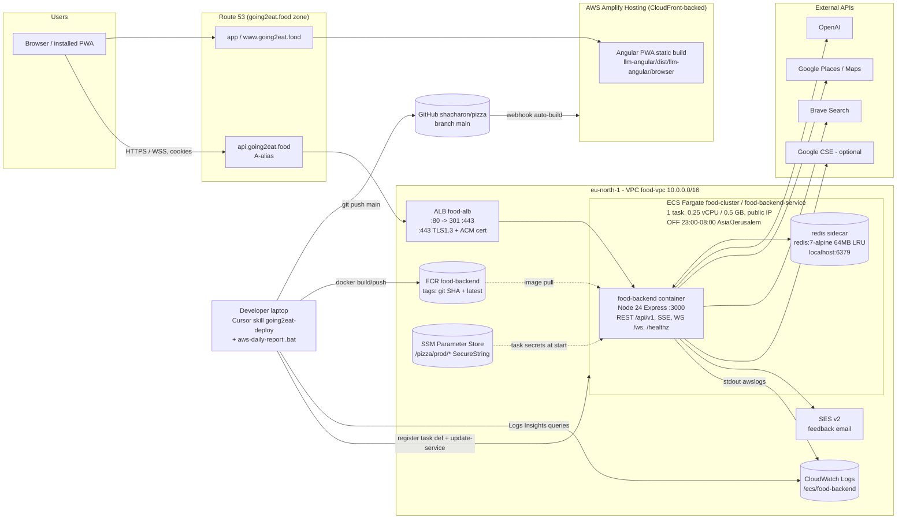
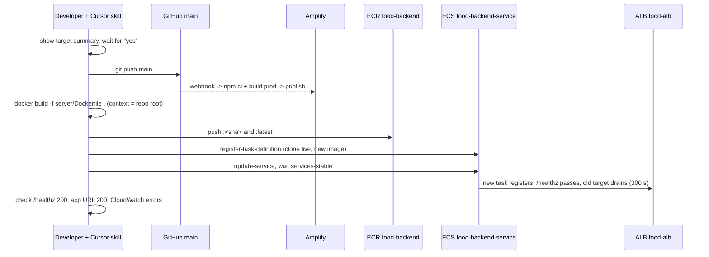

# 05 - AWS Infrastructure and DevOps (Going2Eat / "food orchestrator")

> Scope: how the app is hosted, built, deployed, configured, observed and paid for, as of **2026-10-05**.
> Method: code and config were trusted over prose docs. Each claim cites its source. Where a doc describes a *plan*
> rather than the *current state*, this is marked **[PLAN]**, **[DONE]** or **[STALE]**.
> No secret values appear here. The AWS account ID is redacted to `9073…4996`.

---

## TL;DR

- **Frontend**: Angular PWA on **AWS Amplify Hosting**. Amplify builds automatically on every push to `main` of the **GitHub** repo (`amplify.yml`, `.cursor/aws-deploy.json`). It serves `app.going2eat.food` and `www.going2eat.food`.
- **Backend**: one Node 24 container on **ECS Fargate** (`food-cluster` / `food-backend-service`, **eu-north-1**). It sits behind an **ALB** (`food-alb`) that serves `api.going2eat.food`. TLS ends at the ALB with an ACM certificate, and port 80 redirects to 443. The image is stored in **ECR** `food-backend` and tagged with the git short SHA plus `latest`.
- **Redis**: it used to be ElastiCache. Since 2026-10-04 it runs as a **sidecar container in the same task** (`redis:7-alpine`, 64 MB, LRU, no persistence), and **ElastiCache has been deleted** (`docs/infra/COST_REDUCTION_GOING2EAT.md`).
- **Other AWS services**: **SES v2** sends feedback emails. **SSM Parameter Store** holds 4 secrets. **CloudWatch Logs** group `/ecs/food-backend` has no retention set. **Route 53** hosts the zones. An optional **DynamoDB** provider-audit table exists in code, but nothing shows it is used.
- **Downtime by design**: the API is **switched off every night from 23:00 to 08:00 Israel time** by Application Auto Scaling scheduled actions. It runs as a single task (min 1 / max 1), so there is **no high availability**. This is accepted because the app is a demo.
- **CI/CD is mostly manual and agent-driven.** `bitbucket-pipelines.yml` is effectively **dead**: the repo is on GitHub, and the QA step points at a directory that no longer exists. Backend deploys are done by a personal Cursor skill (`going2eat-deploy`) that lives **outside the repo**. The repo's own `docker-build-and-push.*` scripts are **stale** (wrong region, repo name and cluster).
- **No IaC for Going2Eat.** The task definition, ALB, security groups, scaling and DNS were all made by hand or with the CLI. The deploy flow copies the live task definition forward.
- **Cost**: about **$100/month to start**, now roughly **$35-45/month** after right-sizing, the night schedule and the Redis sidecar. The ALB (about $25/month) is the biggest remaining item. Two follow-up plans exist, both **[PLAN]**: `ONE_ALB_PLAN` (share the dating ALB, parked) and `ONE_VM_PLAN` (one EC2 for both apps, about $20/month, the current preferred direction).
- **Main risks**: single task and single AZ, nightly outage, no alarms, a log group with unlimited retention, `SESSION_COOKIE_SECRET` stored as a **plain env var** rather than a secret, a misleading prod log about localhost Redis, `.dockerignore` sitting in the wrong place, 32+ log files committed to git, reports with real user queries kept on disk, and deploy and report tooling that lives only on one laptop.

---

## Table of contents

1. [Current deployment topology](#1-current-deployment-topology)
2. [Environments, domains and ports](#2-environments-domains-and-ports)
3. [CI/CD and deployment flow](#3-cicd-and-deployment-flow)
4. [Configuration and secrets management](#4-configuration-and-secrets-management)
5. [Networking, TLS/HTTPS/HSTS, CORS and cookies](#5-networking-tlshttpshsts-cors-and-cookies)
6. [Caching headers and PWA hosting](#6-caching-headers-and-pwa-hosting)
7. [Observability: logs, reports, metrics, alarms](#7-observability-logs-reports-metrics-alarms)
8. [Cost picture and cost-reduction plans](#8-cost-picture-and-cost-reduction-plans)
9. [Security posture of the infrastructure](#9-security-posture-of-the-infrastructure)
10. [Risks and gaps](#10-risks-and-gaps)
11. [Recommended roadmap](#11-recommended-roadmap)
12. [Source index](#12-source-index)

---

## 1. Current deployment topology

### 1.1 What is evidenced

| Component | Status | Evidence |
|---|---|---|
| Amplify Hosting (UI), app `d2vb…`, branch `main`, GitHub-connected | **Live** | `amplify.yml`, `.cursor/aws-deploy.json`, `docs/infra/ONE_ALB_PLAN.md` ("UI = Amplify app … via CloudFront") |
| ECS Fargate cluster `food-cluster`, service `food-backend-service`, task family `food-backend` (rev `:42`) | **Live** | `.cursor/aws-deploy.json`, `docs/infra/COST_REDUCTION_GOING2EAT.md` |
| Task size 0.25 vCPU / 0.5 GB (app hard limit 400 MB + redis sidecar) | **Live since 2026-10-04** | `COST_REDUCTION_GOING2EAT.md` Step 4 |
| ALB `food-alb`: 443 (TLS 1.3 policy) to TG `food-backend-tg` (ip, port 3000, `/healthz`); 80 redirects to 443 | **Live** | `ONE_ALB_PLAN.md` inventory, `docs/INFRASTRUCTURE_HTTPS_HSTS.md` |
| ACM certificate `api.going2eat.food` (eu-north-1) | **Live** | `ONE_ALB_PLAN.md` |
| ECR repository `food-backend` (eu-north-1), about 177 images / 11.8 GB, no lifecycle policy | **Live** | `.cursor/aws-deploy.json`, `COST_REDUCTION_GOING2EAT.md` |
| Redis: sidecar `redis:7-alpine` in the task, `REDIS_URL=redis://localhost:6379` | **Live** | `COST_REDUCTION_GOING2EAT.md` Step 3/3b |
| ElastiCache `food-redis-cluster` | **Deleted 2026-10-04** (snapshot `food-redis-before-sidecar-20261004` kept) | same |
| SSM Parameter Store `/pizza/prod/{BRAVE_SEARCH_API_KEY,GOOGLE_API_KEY,JWT_SECRET,OPENAI_API_KEY}` | **Live** | `ONE_ALB_PLAN.md` |
| SES v2 (eu-north-1) for feedback email; inline policy `food-feedback-ses` | **Live** | `server/src/services/feedback/send-feedback-email.ts`, `ONE_ALB_PLAN.md` |
| CloudWatch Logs `/ecs/food-backend` (no retention) | **Live** | `ONE_ALB_PLAN.md`, `aws-daily-report/*.bat` |
| Route 53 zones `going2eat.food` (+ dating zones); `api.going2eat.food` A-alias to `food-alb` | **Live** | `ONE_ALB_PLAN.md`, `ONE_VM_PLAN.md` |
| App Auto Scaling scheduled actions `g2e-night-off` (23:00) / `g2e-morning-on` (08:00), TZ Asia/Jerusalem | **Live since 2026-10-04** | `COST_REDUCTION_GOING2EAT.md` Step 2 |
| DynamoDB provider-audit table | **Code only, not evidenced in AWS.** Gated by `ENABLE_PROVIDER_AUDIT` + `PROVIDER_AUDIT_TABLE_NAME`; defaults to `us-east-1` | `server/src/lib/audit/providerAudit.store.ts` |
| Terraform / CloudFormation / CDK for Going2Eat | **None** ("the Terraform is not used for Going2Eat") | `COST_REDUCTION_GOING2EAT.md`; no `*.tf` in repo |

The same AWS account (profile `pizza`) also hosts a separate **"dating" app** in **eu-central-1**. That app has its own ALB, ECS, RDS and Terraform. The cost plans touch both apps, and the deploy rules repeatedly say "never mix with dating resources" (`.cursor/rules/aws-deploy.mdc`).

### 1.2 Architecture diagram (current state)

Notes:
- The UI calls the API **cross-origin**, from `app.` or `www.` to `api.`. This is why cookies use a parent domain and `SameSite=None` (see section 5).
- The task gets a **public IP** and has no NAT gateway. Outbound calls to OpenAI, Google and other APIs leave through the task's own public IP (`COST_REDUCTION_GOING2EAT.md`, `ONE_ALB_PLAN.md`).
- The task has `enableExecuteCommand=true` and the deployment circuit breaker turned on. Rolling deploys use min healthy 100% / max 200%, with a 30 s health grace (`ONE_ALB_PLAN.md`, `COST_REDUCTION_GOING2EAT.md`).

---

## 2. Environments, domains and ports

| Env | Frontend | API | How it is selected | Notes |
|---|---|---|---|---|
| **Local** | `http://localhost:4200` (`npm start`, `ng serve --proxy-config proxy.conf.json`) | `http://localhost:3000` (`npm run dev` in `server/`, nodemon + tsx) | `llm-angular/src/environments/environment.ts` | `proxy.conf.json` forwards `/api` and `/ws` to `127.0.0.1:3000`, so requests are same-origin and the host-only cookie works |
| **"AWS dev"** | `http://localhost:4201` (`npm run aws`) | `https://api.going2eat.food` (**the production API**) | `environment.development.ts` | There is no separate dev or staging backend. "Dev" means a local UI pointed at the prod API (`llm-angular/ENVIRONMENT_GUIDE.md`) |
| **Local Docker** | n/a | `http://localhost:3000` | `server/docker-compose.yml` (`NODE_ENV=development`, mounts `./logs`) | Has no Redis service. WS tickets fall back to memory in dev (`server/src/server.ts`) |
| **Production** | `https://app.going2eat.food`, `https://www.going2eat.food` (Amplify) | `https://api.going2eat.food`, `wss://api.going2eat.food/ws` | `environment.production.ts` (the build fails if the URL is not https/wss or points at localhost) | Single env. `staging` exists only as a code path (`getEnv()` treats `staging` like prod) |

Ports: the container listens on **3000** (`Dockerfile` `EXPOSE 3000`, `PORT` default). The ALB listens on **80/443**. The target group points at **3000**, and so does the health check `/healthz`. Redis sidecar uses **6379** on localhost. `/health` returns **404**; the real path is `/healthz` (`COST_REDUCTION_GOING2EAT.md`).

Server env detection: `NODE_ENV` or `ENV` maps to `production|staging|development|test`. ECS detection uses `AWS_EXECUTION_ENV` / `ECS_CONTAINER_METADATA_URI(_V4)` (`server/src/config/env.ts`).

---

## 3. CI/CD and deployment flow

### 3.1 Frontend: Amplify (live, automatic)

Source: `amplify.yml` (repo root), `llm-angular/AMPLIFY_SETUP.md`.

1. A push to `main` on GitHub (`origin = github.com/shacharon/pizza`) fires the Amplify webhook.
2. **preBuild**: `cd llm-angular`, print node and npm versions, then `npm ci`. Node 20 comes from `.nvmrc`.
3. **build**: `npm run build:prod`, which runs `ng build --configuration=production`.
4. **artifacts**: `llm-angular/dist/llm-angular/browser/**/*`.
5. **cache**: `llm-angular/node_modules/**/*`.
6. **customHeaders**: the cache policy described in section 6.
7. An **SPA rewrite** `/* -> /index.html (200)` is set in the Amplify console only, not in the repo (`AMPLIFY_SETUP.md`, step 5.3).

There is no test, lint or Lighthouse gate in the Amplify build. Every push to `main` ships to production.

### 3.2 Backend: manual, agent-driven (live)

The real flow is defined by `.cursor/rules/aws-deploy.mdc` and `.cursor/aws-deploy.json`. Its procedure lives in the personal Cursor skills `going2eat-deploy`, `going2eat-cook` and `deploy-aws-app`, which sit in the developer's `~/.cursor/skills`, **not in this repo**.

1. **Consent gate.** The skill shows a summary of the target (account, cluster, service, image) and waits for "yes".
2. **Git**: commit and `git push main` (never `--force`). This also triggers the Amplify UI build.
3. **Docker**: `docker build -f server/Dockerfile .`, with the **repo root** as the build context.
   - Stage 1 (`node:24-alpine`) installs the `server` and `llm-angular/shared` dependencies, runs `tsc` and `tsc-alias`, and copies the i18n JSON translations.
   - Stage 2 (`node:24-alpine`) runs `npm ci --omit=dev`, adds `curl`, creates the non-root user `nodejs` (uid 1001), sets `NODE_ENV=production` and `PORT=3000`, and declares a `HEALTHCHECK` on `/healthz`. The start command is `CMD node dist/server/src/server.js`.
4. **ECR push** to `…dkr.ecr.eu-north-1.amazonaws.com/food-backend:<git-sha>` and `:latest`. Example tags in use: `b491958`, `2c11e9c`.
5. **ECS**: register a new task definition **copied from the live revision** with only the image changed, then run `update-service` on `food-backend-service` and wait for `services-stable`.
6. **Verify**: the Amplify job SUCCEEDED, the ALB target is healthy, `https://api.going2eat.food/healthz` returns 200, and `/ecs/food-backend` shows no errors.

Consequences:
- The task definition, including env vars, secrets, sidecar and CPU/memory, exists **only in AWS**. Each revision inherits the previous one. History so far: `:38` 1 vCPU / 2 GB, `:39` resized, `:40`, `:41` sidecar, `:42` 0.25 vCPU / 0.5 GB.
- A deploy at night "succeeds" with 0 running tasks and only starts at 08:00 (`COST_REDUCTION_GOING2EAT.md`).
- A teammate who does not have the skill files cannot reproduce a deploy from the repo alone.

### 3.3 Repo scripts (stale or helper only)

| File | What it does | Status |
|---|---|---|
| `server/check-build.sh` / `.ps1` | Pre-Docker checks: node version, clean `npm ci`, `tsc` build, entry point exists, optional lint, docker daemon. The `.sh` does `cd ../shared`, which no longer exists, because shared moved to `llm-angular/shared` | Helper; partly stale |
| `server/docker-build-and-push.sh` / `.ps1` | ECR login, build, tag, push; prints an `ecs update-service` hint | **[STALE]** Defaults are `us-east-1`, ECR `pizza-backend`, cluster `pizza-app-cluster`, service `pizza-backend-service`. The live values are `eu-north-1` / `food-backend` / `food-cluster` / `food-backend-service`. Running it without parameters pushes to the wrong place |
| `server/docker-compose.yml` | Local container on :3000 with a healthcheck and `./logs` volume | Local only; no Redis service |
| `scripts/check-legacy-imports.sh` | Fails if `server/src/services/search` imports legacy `intent.ts`, `nlu.service.ts`, `chatPipeline.ts`, `dialogue/` or `chat/` | Used by Bitbucket only |
| `redis-admin-task.json` | **Empty file (0 bytes)** | Leftover; probably meant for a one-off ECS task that would administer ElastiCache |

### 3.4 Bitbucket Pipelines (`bitbucket-pipelines.yml`), effectively dead

The file defines `image: node:18` and two steps: **Legacy Import Fence** and **QA Regression Tests** (`cd server && npm ci && npm run qa`, artifacts `server/src/services/search/qa/snapshots/*.json`). These run on default, all PRs, `main` and `master`.

It is non-functional for three reasons:
- The remote is **GitHub**, not Bitbucket. There is no `.github/workflows`, so **no CI runs at all**.
- `npm run qa` runs `tsx src/services/search/qa/run-qa.ts`, but `server/src/services/search/qa/` **does not exist**, so the step would fail.
- It uses Node 18, while the Docker image uses Node 24 and Amplify uses Node 20. That is three different Node versions.

It documents the CI variables `GOOGLE_MAPS_API_KEY`, `OPENAI_API_KEY`, `PLACES_PROVIDER_MODE=mock` and `LOG_LEVEL`.

### 3.5 Deploy flow diagram

---

## 4. Configuration and secrets management

### 4.1 Where config comes from

| Layer | Mechanism | Source |
|---|---|---|
| Local | `server/.env.local`, then `server/.env` (dotenv, loaded first in `server.ts`); `.env*` is gitignored except `.env.example` | `server/src/server.ts`, `.gitignore` |
| Prod secrets | ECS task `secrets` taken from **SSM Parameter Store SecureString** `/pizza/prod/*`. The execution role `ecsTaskExecutionRole` has `AmazonECSTaskExecutionRolePolicy` + `AmazonSSMReadOnlyAccess` + an inline policy | `ONE_ALB_PLAN.md` |
| Prod non-secret config | Plain `environment` entries in the task definition. There are 22 env vars, including `COOKIE_DOMAIN`, `CORS_ALLOWED_ORIGINS` and **`SESSION_COOKIE_SECRET`** | `ONE_ALB_PLAN.md`, `COST_REDUCTION_GOING2EAT.md` |
| Frontend | Compile-time `environment.*.ts`; contains no secrets | `llm-angular/src/environments/` |
| AWS credentials | ECS uses the task role (`ElasticContainerfoodServiceTask`). Locally, the SES client uses `fromIni({ profile: 'pizza' })` when it is not on ECS | `send-feedback-email.ts` |

### 4.2 Secrets (names only)

| Name | Stored as (prod) | Validated at boot |
|---|---|---|
| `OPENAI_API_KEY` | SSM SecureString | Required if `ENABLE_AI_FEATURES` is true (the default); prod boot blocks without it |
| `GOOGLE_API_KEY` | SSM SecureString | Required if `ENABLE_GOOGLE_SEARCH` is true; prod boot blocks without it |
| `BRAVE_SEARCH_API_KEY` | SSM SecureString | Logged as present or absent |
| `JWT_SECRET` | SSM SecureString | 32+ chars and not the legacy dev default; prod boot blocks otherwise |
| `SESSION_COOKIE_SECRET` | **Plain task-definition env var** | 32+ chars and different from `JWT_SECRET`; prod boot blocks otherwise |
| `DEBUG_KEY` | unknown | Enables `/api/v1/debug/*` in prod |
| `ANTHROPIC_API_KEY`, `GOOGLE_CSE_API_KEY`, `GOOGLE_CSE_ENGINE_ID`, `GOOGLE_MAPS_API_KEY` | unknown / optional | none |
| `REDIS_URL` | Plain env (`redis://localhost:6379`, no auth, which is fine for a sidecar) | Format check (see section 10, R6) |

### 4.3 Main non-secret env var names (server)

Grouped from `grep process.env` over `server/src` and `server/.env.example`:

- **Runtime**: `NODE_ENV`, `ENV`, `PORT`, `HOSTNAME`, `AWS_REGION`, `AWS_EXECUTION_ENV`, `ECS_CONTAINER_METADATA_URI(_V4)`
- **CORS/WS/cookies**: `FRONTEND_ORIGINS`, `CORS_ALLOWED_ORIGINS`, `ALLOWED_ORIGINS`, `CORS_ALLOW_NO_ORIGIN`, `WS_ALLOWED_ORIGINS`, `WS_FALLBACK_ORIGIN`, `WS_REQUIRE_AUTH`, `COOKIE_DOMAIN`, `COOKIE_SAMESITE`, `SESSION_COOKIE_TTL_SECONDS`, `API_SUNSET_DATE`
- **Redis**: `ENABLE_REDIS_JOBSTORE`, `ENABLE_REDIS_CACHE`, `REDIS_CACHE_PREFIX`, `REDIS_JOB_TTL_SECONDS`, `REDIS_BOOT_RETRIES`, `REDIS_BOOT_DELAY_MS`, `REDIS_CONNECT_TIMEOUT_MS`, `REDIS_WS_MEMORY_FALLBACK`, `ENABLE_DEBUG_REDIS`
- **Feature/limits**: `ENABLE_AI_FEATURES`, `ENABLE_GOOGLE_SEARCH`, `FEATURE_SSE_ASSISTANT`, `ASSISTANT_SSE_TIMEOUT_MS`, `RATE_LIMIT_WINDOW_MS`, `RATE_LIMIT_MAX_REQUESTS`, `MAX_CONCURRENT_REQUESTS`, `MAX_CONCURRENT_PROVIDER_JOBS`, `SEARCH_PROVIDER`, `PLACES_PROVIDER_MODE`
- **Models/timeouts**: `LLM_PROVIDER`, `OPENAI_MODEL`, `GATE_MODEL`, `INTENT_MODEL`, `ASSISTANT_MODEL`, `*_TIMEOUT_MS`, plus many more
- **Caching**: `CACHE_INTENT*`, `CACHE_PLACES*`, `CACHE_GEOCODING*`, `CACHE_RANKING*`, `CACHE_ASSISTANT*`, `GOOGLE_CACHE_TTL_SECONDS`, `ENABLE_GOOGLE_CACHE`
- **Logging/tracing**: `LOG_LEVEL`, `LOG_PRETTY`, `LOG_TO_FILE`, `LOG_DIR`, `LOG_ROTATE_DAYS`, `LOG_CONSOLE`, `LOG_REDACT_FIELDS`, `TRACE_ENABLED`, `TRACE_SAMPLE_RATE`, `TRACE_DEBUG_ROUTES`, `METRICS_ENABLED`
- **Audit (DynamoDB)**: `ENABLE_PROVIDER_AUDIT`, `PROVIDER_AUDIT_TABLE_NAME`, `PROVIDER_AUDIT_AWAIT`, `PROVIDER_AUDIT_AWAIT_TIMEOUT_MS`

Reference files: `server/.env.example`, `server/env.performance.txt` (a performance and logging preset), `server/PRODUCTION_ENV_CORS.txt` and `server/docs/aws-deployment.md` (checklist).

There is **no single source of truth** for the prod configuration. The live task definition is the truth, and it is not versioned in git.

---

## 5. Networking, TLS/HTTPS/HSTS, CORS and cookies

### 5.1 TLS and HTTPS

- TLS ends at the **ALB**, using an ACM certificate for `api.going2eat.food` and the TLS 1.3 policy (`ELBSecurityPolicy-TLS13-1-2-2021-06`, as recommended in `docs/INFRASTRUCTURE_HTTPS_HSTS.md` and confirmed by `ONE_ALB_PLAN.md`). Port 80 returns a 301 to 443. The ALB talks plain HTTP to the task on port 3000.
- For the frontend, Amplify/CloudFront handles TLS for `app.` and `www.going2eat.food`.
- **HSTS**: `server/src/middleware/security-headers.middleware.ts` sets `Strict-Transport-Security: max-age=31536000; includeSubDomains` when `NODE_ENV=production`. **helmet()** in `app.ts` also sets HSTS and other headers by default. There is no `preload` directive. Its comment "this application does not set cookies" is **[STALE]**, because the app now sets a `session` cookie.
- The ALB idle timeout is 60 s, which matters for SSE and WebSocket. The WS heartbeat runs every 30 s (`server.ts`). Request and response timeouts are 30 s (`app.ts`). Target deregistration delay is 300 s.

### 5.2 CORS (`server/src/app.ts`, `server/src/config/env.ts`, `server/src/lib/security/origin-validator.ts`)

- The allowlist comes from `FRONTEND_ORIGINS`, falling back to `CORS_ALLOWED_ORIGINS`. Expected values are `https://www.going2eat.food` and `https://app.going2eat.food` (`server/PRODUCTION_ENV_CORS.txt`).
- In production, `*` is refused and forces an empty list. A missing list turns on a fail-safe that rejects any browser Origin but still allows requests without one (health checks, curl).
- Settings: `credentials: true`; methods GET/POST/PUT/DELETE/OPTIONS; headers `Content-Type`, `Authorization`, `X-Session-Id`. OPTIONS is answered early.
- `/api/v1/photos` is **open to any origin** (`origin: true` + `Cross-Origin-Resource-Policy: cross-origin`) so images can be embedded.
- Dev mode always adds `localhost:4200`, `localhost:4201` and `localhost:3000`.

**WebSocket origins** follow a *different* chain (`server/src/infra/websocket/websocket.config.ts`): `FRONTEND_ORIGINS`, then `ALLOWED_ORIGINS`, then `WS_ALLOWED_ORIGINS` (from `server.ts`, default `['*']`). In prod, an empty list or `*` falls back to `WS_FALLBACK_ORIGIN` or **`https://app.going2eat.food` alone**. The live task reportedly sets `CORS_ALLOWED_ORIGINS`, not `FRONTEND_ORIGINS`. If that is right, the WS layer does not read it, and **`www.going2eat.food` WebSocket connections may be rejected**. This needs checking against the live task definition (see R9).

### 5.3 Cookies (`server/src/controllers/auth/bootstrap.controller.ts`, `config/env.ts`)

- The cookie is `session`: signed with `SESSION_COOKIE_SECRET`, `HttpOnly`, and `Secure` when `NODE_ENV=production`. `SameSite` comes from `COOKIE_SAMESITE` (default `Lax`) and `Domain` from `COOKIE_DOMAIN` (default host-only). The TTL is `SESSION_COOKIE_TTL_SECONDS` (default 3600). The Redis session store uses a 7-day sliding TTL (`server.ts`).
- Prod (`.cursor/aws-deploy.json`, `server/docs/aws-deployment.md`) uses `COOKIE_DOMAIN=.going2eat.food` and `COOKIE_SAMESITE=None`, because the UI and API are on different subdomains.
- `PRODUCTION_COOKIE_SETUP.md` recommends same-origin hosting behind a reverse proxy (Option A). **Production actually uses Option B** (separate subdomains).
- Frontend `environment.production.ts` uses `authMode: 'dual'` (JWT header + cookie). `server/docs/aws-deployment.md` says `cookie_only`. That doc is **[STALE]**.

### 5.4 Network and security groups

- The task sits in the public subnets of `food-vpc` (10.0.0.0/16, 2 subnets) with a public IP and two security groups. ECS Exec is enabled.
- The intended rules are: ALB SG allows 80/443 from the internet, and the task SG allows 3000 from the ALB SG (`INFRASTRUCTURE_HTTPS_HSTS.md`). The actual SG rules are **not in the repo** and could not be verified here.
- **No `app.set('trust proxy')`** exists anywhere in `server/src`. Client IP comes from the **left-most `X-Forwarded-For`** value (`lib/http/client-ip.ts`, `middleware/rate-limit.middleware.ts`). See R10.

---

## 6. Caching headers and PWA hosting

From `amplify.yml` `customHeaders` (current), which match `docs/pwa-hosting-headers.md`:

| Pattern | Cache-Control |
|---|---|
| `**/*.js`, `**/*.css` (hashed bundles) | `public, max-age=31536000, immutable` |
| `**/*.png`, `**/*.svg`, `**/*.ico` | `public, max-age=604800` (7 days) |
| `/index.html` | `no-cache, no-store, must-revalidate` + `Pragma: no-cache` + `Expires: 0` |
| `/ngsw-worker.js`, `/ngsw.json`, `/safety-worker.js` | `no-cache, no-store, must-revalidate` |
| `/manifest.webmanifest` | `public, max-age=3600` |

Notes:
- In the repo the specific rules come *after* the `**/*.js` rule, with the comment "they must win over the long cache above". `docs/pwa-hosting-headers.md` says the opposite: specific rules should come *first*. Amplify's documented behaviour is that the last matching rule wins for a header. **Check this in production** with `curl -I https://app.going2eat.food/ngsw-worker.js`. If the worker is cached for a year, users get stuck on old builds.
- Other images (`jpg`, `webp`), fonts and `/assets/**` have no explicit rule.
- The Angular service worker (`llm-angular/ngsw-config.json`) caches the app shell and assets only. It deliberately does **not** cache API responses (`docs/pwa-hosting-headers.md`).
- The API sets `Cache-Control: no-store` for `/` and `/index.html` (`app.ts`), uses `compression()`, and puts `Deprecation` / `Sunset` / `Link` headers on legacy `/api/*` (not `/api/v1`) routes.
- No security headers (CSP, X-Frame-Options, Referrer-Policy) are set for the **frontend** in `amplify.yml`. Only the API gets them, via helmet.

---

## 7. Observability: logs, reports, metrics, alarms

### 7.1 Logging

- **Pino** structured JSON logs with redaction (`server/src/lib/logger/structured-logger.ts`, `config/logging.config.ts`). In prod they go to stdout, then through the awslogs driver to **CloudWatch Logs `/ecs/food-backend`** (eu-north-1). That group has **no retention policy** and held 5.7 MB as of 2026-10-04.
- **Dev** writes rotated files (`rotating-file-stream`) to `server/logs/`, kept for 14 days. `LOG_TO_FILE` defaults to true in dev. **32 rotated `.log.gz` files plus `server.log` and `server.log.txt` are tracked in git**, and more are untracked (see the git status).
- Redacted fields by default: `authorization`, `cookie`, `x-api-key`, `key`, `token`, `password`, `apiKey`, `api_key`, `secret` (`env.performance.txt`, `logging.config.ts`).
- Business events the reports depend on: `search_audit` (query text, outcome, top 4 result names, session, and **client IP** according to `route2/types.ts`), `assistant_llm_input_snapshot`, `result_action` (clicks), `landing_open` (tracked links `/q` and `/p/:name`, added in commit `2c11e9c`), `pipeline_failed`, plus `"level":"error"` lines.

### 7.2 Daily reports (`aws-daily-report/`)

- The `.bat` wrappers call Node scripts in **`%USERPROFILE%\.cursor\skills\going2eat-morning-report\scripts\`** (`report-3d.js`, `dating-landing-report.js`). Those scripts are **outside the repo**.
- **What they query.** They use **CloudWatch Logs Insights** (`StartQuery` / `GetQueryResults`, SigV4-signed with `@aws-sdk/credential-provider-ini`, profile `pizza`, region `eu-north-1`) against log group `/ecs/food-backend`. Five queries of the form `fields @timestamp, @message | filter @message like /"event":"<name>"/`:
  1. `search_audit`
  2. `assistant_llm_input_snapshot`
  3. `result_action`
  4. errors: `"level":"error"` or `pipeline_failed`, limit 200
  5. `landing_open`

  The script refuses to run if `sts get-caller-identity` returns a different account. The dating script queries `/ecs/dating-dev/dating-api` in eu-central-1.
- **Variants**: `general` (1d / 3d), `qr` (`/q`), `linkedin` and `cv` (`/p/<name>`), `opens` (link opens vs searches), `landing` (both apps, 1d and 7d).
- **What they report**: searches, unique queries, sessions ("people"), outcomes (results / clarify / not_food), GPS usage, duration median / p95 / max, searches with a click, link opens vs searches, daily-budget "Try again later" count, CloudWatch error lines, and a per-search table with query text and top results.
- **Volume is tiny.** For example, `general-3d_2026-10-05` shows 8 searches from 2 people over 3 days, with a median of 4.8 s and p95 of 6.2 s. The reports also show real users trying prompt-injection probes; those were classified `not_food` or answered with normal results.
- **Privacy**: the files contain real user search text and session hashes. `aws-daily-report/` was just added to `.gitignore` in an uncommitted change, and no report files are tracked. The `.bat` files are therefore not tracked either.

### 7.3 Metrics and alarms

- **AWS side**: only the default `AWS/ECS` (CPU and memory) and ALB metrics. **No CloudWatch alarms, no EventBridge rules, no Route 53 health checks, no autoscaling policies** apart from the night schedule (`COST_REDUCTION_GOING2EAT.md` Step 2, verified read-only).
- **App side**: an in-process metrics flag (`METRICS_ENABLED`), stats and debug endpoints (`/api/v1/debug/*` gated by `DEBUG_KEY` in prod, `/debug/redis` gated by `ENABLE_DEBUG_REDIS`), and `/healthz` (server status plus a Redis ping when `ENABLE_REDIS_*` is set; returns 503 if Redis is down).
- Container `HEALTHCHECK` in the Dockerfile runs `curl /healthz` every 30 s. ECS ignores it unless the task definition declares a health check. The ALB target-group health check is the one that counts.
- The DynamoDB provider audit (`recordProviderCall`, 90-day TTL) is **off unless configured**, and its region defaults to `us-east-1`, not the eu-north-1 used everywhere else.

---

## 8. Cost picture and cost-reduction plans

### 8.1 Timeline (Going2Eat only, pre-tax USD/month, from `docs/infra/COST_REDUCTION_GOING2EAT.md`)

| Step | Change | Status | Saving |
|---|---|---|---|
| Baseline (2026-10-03) | Fargate 1 vCPU / 2 GB about $39, ALB + IPv4 about $24.5, ElastiCache t4g.micro about $14.4, task IPv4 about $3.7, Amplify builds about $1.9, ECR about $1.2 | measured | |
| 1a | Task 1 vCPU / 2 GB to 0.5 / 1 GB (`:39`) | **DONE 2026-10-03** | about $19.5 |
| 2 | Night shutdown 23:00-08:00 Asia/Jerusalem (`g2e-night-off` / `g2e-morning-on`) | **DONE 2026-10-04** | about $8-10 |
| 3 / 3b | Redis moved to a sidecar (`:41`), ElastiCache deleted (snapshot kept) | **DONE 2026-10-04** | about $14 |
| 4 | Task 0.5 / 1 GB to 0.25 / 0.5 GB (`:42`) | **DONE 2026-10-04** | about $6-10 |
| 5 | Remove ALB | **Reviewed, kept** (needed for stable HTTPS and WebSocket) | 0 |
| ECR lifecycle (keep last 10) | | **Not started** | about $1 |

Measured usage before resizing: CPU averaged 0.03% (peak 12.6% of 1 vCPU), memory peaked at about 107 MB, and traffic was about 2,000 ALB requests/day (much of it health checks and bots). Even at 0.25 vCPU / 0.5 GB the app has headroom.

Estimated remaining Going2Eat spend is about **$35-45/month**: ALB plus IPv4 about $25, Fargate about $6-7 with the night schedule, task IPv4 about $2.3, Amplify about $2, ECR about $1.2, Route 53 and CloudWatch small. **The ALB is now the largest item.**

### 8.2 `docs/infra/ONE_ALB_PLAN.md`: Plan A [PLAN, parked]

- Goal: delete `food-alb` and route `api.going2eat.food` through the dating app's ALB (`dating-dev-alb`, eu-central-1) with a host-header rule. This saves about $25/month.
- Requires moving the Going2Eat ECS service to **eu-central-1** in the dating VPC. Secrets would be read cross-region by ARN, and the image would be pulled cross-region from eu-north-1 ECR. It also needs a new ACM cert in eu-central-1, a TG `g2e-api` plus a listener rule (priority 20) defined in the dating Terraform, a new SG, and a Route 53 alias switch.
- Risks: a mistake in the shared ALB affects dating; the dating Terraform state becomes coupled to Going2Eat; sessions are lost at cutover.
- Status: **superseded by Plan B** ("Supersedes the parked ONE_ALB_PLAN" in `ONE_VM_PLAN.md`). Nothing applied.

### 8.3 `docs/infra/ONE_VM_PLAN.md`: Plan B [PLAN, current direction, nothing built]

- Goal: replace both apps' ALBs, Fargate, RDS and public IPs with **one EC2 `t4g.small`** in eu-central-1 running Docker Compose: Caddy (Let's Encrypt, host routing), dating UI and API, `g2e-api`, postgres 16, and two Redis instances. Combined spend would drop from about $100 to about $18-22/month.
- Design: SG allows 80/443 only, no SSH (SSM Session Manager). An instance role replaces access keys. Secrets move to SSM SecureString env files. Backups are daily EBS snapshots plus a nightly `pg_dump` to S3. EventBridge Scheduler stops the instance 23:00-08:00. Going2Eat UI stays on Amplify. Terraform would go in the dating repo (`modules/vm`).
- Risks the plan accepts: a **single point of failure** for both apps, OS patching becomes the owner's job, the DB is a container on EBS, the deploy skills must be rewritten (SSM Run Command `docker compose pull && up -d`), a brief TLS gap at cutover, and Redis data loss.
- Open questions: t4g.small vs medium, EC2 vs Lightsail, Caddy HTTP-01 vs DNS-01, keeping a stopped RDS as fallback.

---

## 9. Security posture of the infrastructure

**Strengths**
- TLS everywhere at the edge (ALB with a TLS 1.3 policy, plus Amplify). HTTP redirects to HTTPS. HSTS is on for the API. The prod UI build refuses non-https/wss URLs.
- Strict CORS allowlist with fail-safe behaviour. Wildcard is refused in prod.
- Fail-fast boot checks: prod refuses to start with weak or missing `JWT_SECRET` / `SESSION_COOKIE_SECRET`, a shared secret, or missing provider keys (`config/env.ts`).
- Most secrets are in SSM SecureString and injected by ECS. The task role is used on ECS, with no static keys. Logs redact credential-like fields. Redis URLs are logged with the password masked.
- The container runs as a **non-root** user, uses a multi-stage build with production dependencies only, and is based on Alpine.
- helmet(), global rate limiting (300 req/min/IP), a separate feedback rate limit, 1 MB body limits, 30 s timeouts, and a prompt-injection-resistant gate (visible in the reports).
- Debug endpoints return 403/404 in prod unless `DEBUG_KEY` / `ENABLE_DEBUG_REDIS` is set.
- Deploys need explicit human consent (`.cursor/rules/aws-deploy.mdc`).

**Weaknesses**: see R-items below. In short: a secret in plain env, client IP is spoofable (which weakens the rate limiter and audit IPs), ECS Exec is on, there are no alarms, and logs are kept forever.

---

## 10. Risks and gaps

| # | Risk / gap | Severity | Evidence | Suggested fix |
|---|---|---|---|---|
| R1 | **Single task, single region, nightly 9 h outage.** Any crash or deploy problem means downtime, and the API returns 503 every night. In-memory and Redis state are lost on every restart | High (if real users), accepted for demo | `COST_REDUCTION_GOING2EAT.md` | Document it as an SLO. Show a "closed for the night" banner in the UI. Remove the schedule if real users arrive |
| R2 | **No IaC for Going2Eat.** Task definition, ALB, SGs, scaling, DNS, IAM and SSM are all click-ops or CLI. Drift is invisible and rebuilding is slow | High | no `*.tf`; "Terraform is not used for Going2Eat" | Export the live task definition into the repo (`infra/ecs/task-def.json`) now. Add Terraform with Plan B |
| R3 | **No working CI.** Bitbucket config is dead (GitHub remote, missing `qa/` directory, Node 18). No tests run before prod. Amplify ships every push to `main` | High | `bitbucket-pipelines.yml`, `git remote -v` | Add GitHub Actions: build server and UI, run `npm test`, run the legacy fence, build the Docker image. Protect `main` |
| R4 | **Deploy and report tooling lives only on one laptop** (`~/.cursor/skills/going2eat-*`). Repo scripts are stale (`us-east-1`, `pizza-backend`, `pizza-app-cluster`) | High (bus factor) | `.cursor/rules/aws-deploy.mdc`, `server/docker-build-and-push.*`, `aws-daily-report/*.bat` | Move deploy and report scripts into `scripts/` and parameterize them from `.cursor/aws-deploy.json`. Fix or delete the stale scripts |
| R5 | **`SESSION_COOKIE_SECRET` stored as a plain env var** in the task definition. It is visible to anyone with `ecs:DescribeTaskDefinition` | Medium | `ONE_ALB_PLAN.md` ("Other config is plain env (… SESSION_COOKIE_SECRET …)") | Move it to SSM `/pizza/prod/SESSION_COOKIE_SECRET` and rotate it |
| R6 | **Misleading Redis log in prod.** `validateRedisUrl` logs "REDIS_URL must not point to localhost when ENV=production - Redis features disabled" for the sidecar URL. Boot code and the job store use `config.redisUrl` directly, so Redis still works, but the log is wrong and `redisActuallyEnabled` reports false | Medium (confusing during incidents) | `server/src/config/env.ts`, `server/src/server.ts`, `job-store/index.ts` | Allow localhost when on ECS (sidecar), or add an explicit `REDIS_SIDECAR=true` |
| R7 | **`.dockerignore` sits in `server/`, but the build context is the repo root**, so Docker ignores it. The whole repo, including `node_modules`, `server/logs` and local `.env*` files, is sent to the daemon. The image only receives COPY'd paths, so `.env` does not get in. That file also ignores `package-lock.json`; if it were moved to the root as-is, `npm ci` would break | Medium | `server/.dockerignore`, `server/Dockerfile`, `docker-build-and-push.sh` (`-f Dockerfile ..`) | Rename it to `server/Dockerfile.dockerignore` (BuildKit) or move it to the root, and remove the `package-lock.json` exclusion |
| R8 | **Log files committed to git**: 32+ `server/logs/*.log.gz` plus `server.log` / `server.log.txt`, which change every dev run. Jest HTML reports are also tracked. Dev logs can contain user queries and IPs | Medium | `git ls-files server/logs`, git status | `git rm --cached server/logs llm-angular/reports` and add them to `.gitignore` |
| R9 | **WS origin config diverges from CORS.** WS reads `FRONTEND_ORIGINS`/`ALLOWED_ORIGINS`/`WS_ALLOWED_ORIGINS`, not `CORS_ALLOWED_ORIGINS`, and in prod falls back to `app.` only. `www.` WebSockets could be refused | Medium (to verify) | `websocket.config.ts`, `server.ts`, `ONE_ALB_PLAN.md` | Set `FRONTEND_ORIGINS` in the task definition and make WS use `config.frontendOrigins` |
| R10 | **Spoofable client IP**: the left-most `X-Forwarded-For` is trusted and `trust proxy` is not set. The ALB *appends* the real IP, so the right-most entry is the trustworthy one. Rate limits and audit IPs can be bypassed or forged | Medium | `lib/http/client-ip.ts`, `rate-limit.middleware.ts` | Set `app.set('trust proxy', 1)` and use `req.ip`, or take the last XFF hop |
| R11 | **No alarms or uptime checks.** An outage is only noticed by a person or by the morning report | Medium | `COST_REDUCTION_GOING2EAT.md` | CloudWatch alarms on ALB `UnHealthyHostCount` (outside night hours), 5xx, ECS running count, and a Logs metric filter on `level=error`, sent to SNS email |
| R12 | **Log group has no retention**, so cost and privacy exposure grow forever. Logs include query text and client IPs | Low-Medium | `ONE_ALB_PLAN.md` | Set retention to 30-90 days |
| R13 | **ECR has no lifecycle policy** (177 images). `latest` is mutable | Low | `COST_REDUCTION_GOING2EAT.md` | Keep the last 10-20 images. Deploy by SHA only |
| R14 | **ECS Exec enabled** in prod and the task has a public IP. SG rules are not in the repo | Low-Medium | `ONE_ALB_PLAN.md` | Turn Exec off unless needed. Confirm the task SG only allows 3000 from the ALB SG |
| R15 | **Amplify header order** may let `**/*.js` (1 year, immutable) override no-cache on `ngsw-worker.js` | Medium (stale PWA) | `amplify.yml` vs `docs/pwa-hosting-headers.md` | Check with `curl -I`. Reorder or narrow the patterns |
| R16 | **SES sender and recipient are hardcoded** to a personal Gmail address. The region is hardcoded to `eu-north-1`. Locally it falls back to `fromIni({profile:'pizza'})`. Unverified-domain sending is fragile | Low | `send-feedback-email.ts` | Move both to env vars (`FEEDBACK_EMAIL_*`). Verify the `going2eat.food` domain in SES |
| R17 | **Node version drift**: CI 18, Amplify 20 (`.nvmrc`), Docker 24 | Low | files above | Align on one LTS version |
| R18 | **Docs drift**: `INFRASTRUCTURE_OVERVIEW.md` (`WS_ALLOWED_ORIGINS=https://app.piza.co`, "Node 18+", in-memory cache), `INFRASTRUCTURE_HTTPS_HSTS.md` ("does not set cookies"), `aws-deployment.md` (`cookie_only`, ElastiCache `rediss://`), `ENVIRONMENT_GUIDE.md` ("Dev" = prod API), `AMPLIFY_SETUP.md` (`credentials:false` CORS snippet) | Low | those files | Mark them historical, or link to this document |
| R19 | **Sensitive identifiers in docs**: `docs/infra/*.md` contains the full account ID, SG/VPC/subnet IDs and the Amplify app ID (currently untracked). The report script hardcodes the account ID | Low | `docs/infra/` | Redact before committing, or keep in a private location |
| R20 | **Repo clutter**: empty `redis-admin-task.json`, plus zero-byte root files `[builder`, `CACHED`, `cd`, `docker`, `tsc`, `server@1.0.0` (leftovers from shell mistakes) | Low | repo root | Delete them |
| R21 | **DynamoDB audit region defaults to `us-east-1`**, which differs from every other resource | Low (feature off) | `providerAudit.store.ts` | Default to `AWS_REGION`, which ECS sets |

---

## 11. Recommended roadmap

**Now (hygiene, under 1 day, no architecture change)**
1. Untrack `server/logs/` and `llm-angular/reports/`, commit the `.gitignore` change for `aws-daily-report/`, and delete the zero-byte root files and the empty `redis-admin-task.json` (R8, R20).
2. Move `SESSION_COOKIE_SECRET` to SSM and rotate it. Set `FRONTEND_ORIGINS` explicitly in the task definition (R5, R9).
3. Set CloudWatch log retention, add an ECR lifecycle policy, and deploy by SHA only (R12, R13).
4. Fix `.dockerignore` placement and the stale `docker-build-and-push.*` defaults, or replace them with one script that reads `.cursor/aws-deploy.json` (R4, R7).
5. `curl -I` the PWA worker files on prod and fix the header order if needed (R15).

**Next (1-2 weeks)**
6. GitHub Actions CI on PRs: server `npm ci && npm run build && npm test`, UI `npm ci && npm run build:prod`, legacy fence, and a `docker build` smoke test. Delete `bitbucket-pipelines.yml` or point the QA step at a script that exists. Turn on branch protection for `main` (R3, R17).
7. Optional CD: a GitHub Actions job with OIDC to an AWS deploy role that builds, pushes and updates the ECS service on a tag. This removes the dependency on the laptop skill (R4).
8. Commit the live task definition (with secrets as SSM ARNs) to `infra/ecs/` as the reviewed source of truth (R2).
9. Add minimum alarms: ALB 5xx, unhealthy hosts (suppressed 23:00-08:00), and a metric filter on `level=error`, sent to SNS email (R11).
10. Code fixes: `trust proxy` / right-most XFF, the Redis localhost sidecar exemption, a single origins source for CORS and WS, SES addresses from env, DynamoDB region (R6, R9, R10, R16, R21).
11. Move `report-3d.js` into the repo (`scripts/reports/`) and parameterize the profile, region and log group, so reports do not depend on one machine (R4).

**Later (architecture)**
12. Decide on **Plan B (ONE_VM)**. If adopted, build it with Terraform from day one, including the Going2Eat pieces (EC2, EIP, SG, IAM, DLM snapshots, SSM params, Route 53). Rewrite deploy as `docker compose pull && up -d` via SSM Run Command, kept in this repo. Add an EC2 auto-recovery alarm and test a restore.
13. If Going2Eat stays on ECS/ALB instead, put the existing resources under Terraform (import), and consider Fargate Spot plus Graviton.
14. If real users arrive: remove the night schedule, run 2 tasks across 2 AZs, move Redis back to a managed service or give it persistence, and add a staging environment (a second Amplify branch plus a staging service with its own `api-staging.` host).

---

## 12. Source index

| Topic | Files |
|---|---|
| Frontend build and hosting | `amplify.yml`, `.nvmrc`, `llm-angular/AMPLIFY_SETUP.md`, `llm-angular/ENVIRONMENT_GUIDE.md`, `llm-angular/proxy.conf.json`, `llm-angular/src/environments/*.ts`, `llm-angular/ngsw-config.json`, `docs/pwa-hosting-headers.md` |
| Backend image and local run | `server/Dockerfile`, `server/.dockerignore`, `server/docker-compose.yml`, `server/check-build.sh/.ps1`, `server/docker-build-and-push.sh/.ps1` |
| CI | `bitbucket-pipelines.yml`, `scripts/check-legacy-imports.sh` |
| Deploy procedure | `.cursor/rules/aws-deploy.mdc`, `.cursor/aws-deploy.json`, (external) `~/.cursor/skills/going2eat-deploy` |
| Config and secrets | `server/src/config/env.ts`, `server/src/config/logging.config.ts`, `server/.env.example`, `server/env.performance.txt`, `server/PRODUCTION_ENV_CORS.txt`, `server/docs/aws-deployment.md` |
| Security, CORS and cookies | `server/src/app.ts`, `server/src/middleware/security-headers.middleware.ts`, `server/src/middleware/rate-limit.middleware.ts`, `server/src/lib/http/client-ip.ts`, `server/src/infra/websocket/websocket.config.ts`, `server/src/controllers/auth/bootstrap.controller.ts`, `PRODUCTION_COOKIE_SETUP.md`, `docs/INFRASTRUCTURE_HTTPS_HSTS.md` |
| Redis | `server/src/lib/redis/redis-client.ts`, `server/src/server.ts`, `server/src/controllers/health.controler.ts`, `server/REDIS_BOOTSTRAP_FIX.md`, `redis-admin-task.json` (empty) |
| AWS SDK usage | `server/src/services/feedback/send-feedback-email.ts` (SES v2), `server/src/lib/audit/providerAudit.store.ts` (DynamoDB) |
| Observability | `server/src/lib/logger/structured-logger.ts`, `server/src/services/search/route2/search-audit.ts`, `aws-daily-report/*.bat` and `*.txt`, (external) `~/.cursor/skills/going2eat-morning-report/scripts/report-3d.js` |
| Cost and plans | `docs/infra/COST_REDUCTION_GOING2EAT.md`, `docs/infra/ONE_ALB_PLAN.md`, `docs/infra/ONE_VM_PLAN.md` |
| Older architecture prose (mostly app-level, partly stale) | `docs/INFRASTRUCTURE_OVERVIEW.md`, `docs/INFRASTRUCTURE_HIGH_LEVEL.md`, `docs/INFRASTRUCTURE_LOW_LEVEL.md` |
